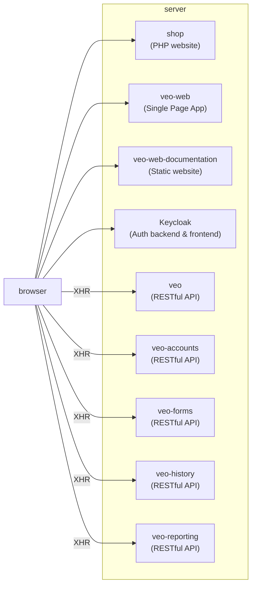
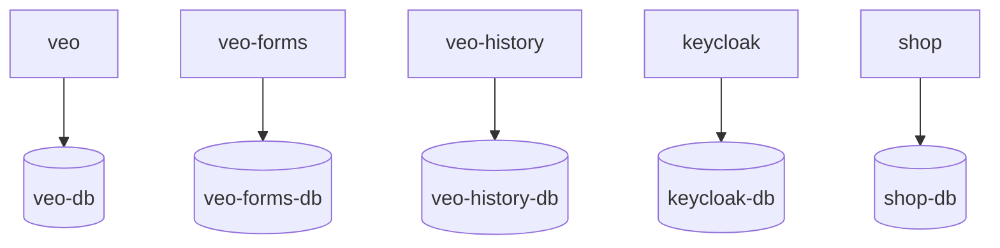
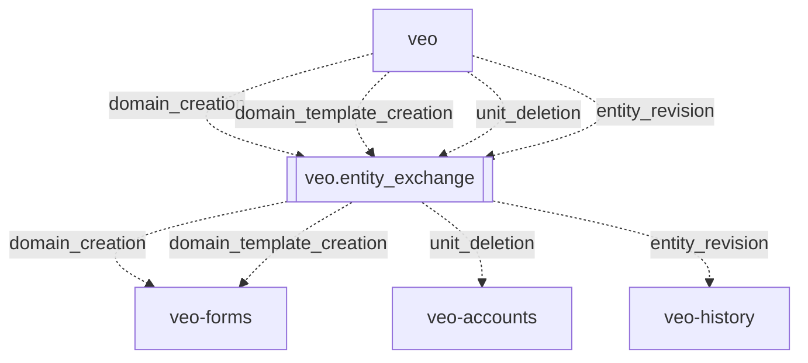
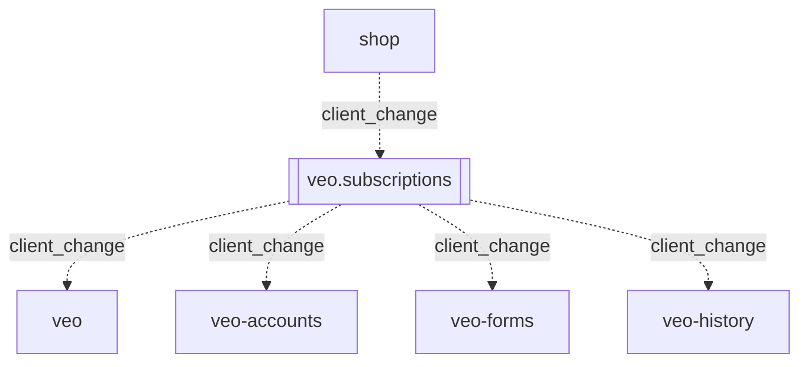
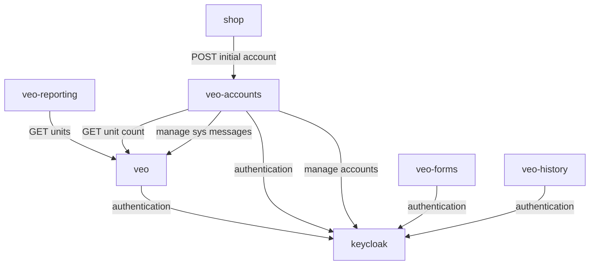

<!-- © 2026 The Project Contributors - see AUTHORS.txt -->
<!--@include: ../../.vitepress/developerLanguageHint.md-->

# Architecture

In the following, the major software components of verinice and their interactions are illustrated.

## Client-facing components

The primary client-facing components of verinice are the web app itself and several RESTful APIs.

A short summary of the public components:
* **shop**: In a cloud instance of verinice, a proprietary webshop is used for subscription management. A purchaser must create a [veo client](../object-model/objects#client) and initial user here, before that initial user can sign in to the actual web application. In an onprem instance, there is no shop and an admin must manage the veo clients instead.
* [veo-web](https://github.com/SerNet/verinice-veo-web) is the actual web application that verinice end users work with.
It is implemented as a Vuetify Single Page App and relies on the veo APIs described below.
* [veo-web-documentation](https://github.com/SerNet/verinice-veo-web-documentation) is a static documentation page (**you are here**).
* [Keycloak](https://www.keycloak.org/documentation.html): Each verinice instance contains a keycloak that is used for authenticating with the APIs. It provides the webpages for signing in and managing one's own account. The Keycloak only contains the actual application users and not the shop users.
* [veo](https://github.com/SerNet/verinice-veo) is the primary backend API that enables core business logic.
* [veo-accounts](https://github.com/SerNet/verinice-veo-accounts) is the account management service - this allows the initial application user to manage additional users and permissions inside their veo client.
* [veo-forms](https://github.com/SerNet/verinice-veo-forms) provides domain-specific dynamic user interfaces, see [forms](../object-model/forms).
* [veo-history](https://github.com/SerNet/verinice-veo-history) provides past versions of [objects](../object-model/objects#specialist-objects) managed in veo.
* [veo-reporting](https://github.com/SerNet/verinice-veo-reporting) generates domain-specific [reports](../manual/reports).

## Persistence

Each persistent service uses its own database.

Not all services need a database. *Veo-accounts* persists all of its data in keycloak and *veo-reporting* retrieves its data from *veo*.

## Data flow between services

Services communicate with each other either asynchronously via AMQP or synchronously via HTTPS.

### Asynchronous messaging

Asynchronous messaging over AMQP is the preferred means of communication between services.
This allows for loose coupling and fast response times.
A [RabbitMQ](https://www.rabbitmq.com/docs) is used as a message broker and defines the following two main [exchanges](https://www.rabbitmq.com/docs/exchanges).

#### Entity exchange

The `veo.entity_exchange`is used for normal application events (e.g. for new [domains](../object-model/domains) or modified [objects](../object-model/objects.md#specialist-objects)).

The following message types are processed via this exchange:
* `domain_creation`: Produced by **veo** when a new domain is created, and consumed by **veo-forms**.
When **veo-forms** learns about a new domain, it creates the domain in its own DB.
If the domain was created from a [domain template](../object-model/domain-templates), **veo-forms** also copies all form templates for the domain template (if any) into the new domain.
* `domain_template_creation`: Produced by **veo** when a domain template is created, and consumed by **veo-forms**.
When **veo-forms** learns that a domain template has been created from a domain, it automatically takes the forms that exist in the source domain and creates a form template bundle from them.
* `entity_revision`: Produced by **veo** when an [object](../object-model/objects#specialist-objects) or [risk](../object-model/objects#risk) is created, updated or deleted. The revision message contains a complete representation of the entity and is consumed by **veo-history**, which archives the revision in its own DB.
* `unit_deletion`: Produced by **veo** when a unit is deleted and consumed by **veo-accounts**, which removes references to the deleted unit from all access groups (see [permissions](../manual/permissions)).

#### Subscriptions exchange

The shop can manage veo clients over the `veo.subscriptions` exchange (e.g. when a customer subscribes to verinice or buys more content). The shop doesn't have access rights to any other exchanges.

The only message type processed via this exchange is `client_change`.
It informs several services when a veo client is created, updated, deactivated, activated or deleted.

**Veo-accounts** manages all veo clients as user groups in the Keycloak, and will create, modify or delete these groups based on `client_change` messages.
The service also enforces the upper limits for users and units that can be defined in a `client_change` message.
**Veo** also uses these messages to keep track of all clients in its DB, and copies the content specified in the message into the client.

When a `client_change` message signalizes the deletion of a veo client, all services will delete the data that they hold for that veo client.

### Synchronous calls

In cases where a service needs an immediate response from another service, synchronous HTTPS requests are used.

The following use cases require synchronous calls:
* The **shop** creates the initial application user using a POST on **veo-accounts**.
This must be handled synchronously, because **veo-accounts** may respond with an error if the username or email address already exists.
For this request, the shop authenticates against **veo-accounts** with an API key.
* For most client-facing services, external HTTPS requests must authenticate with a [JWT](https://datatracker.ietf.org/doc/html/rfc7519).
The services must communicate with the **Keycloak** so they can validate the incoming JWTs.
* When a client requests a report, **veo-reporting** fetches [units](../object-model/objects#unit) and the contained [objects](../object-model/objects#specialist-objects) from **veo** to generate the report.
The auth token from the external request is simply passed through to the **veo** API.
That is why **veo-reporting** does not need to talk to the **Keycloak** directly.
* **Veo-accounts** is responsible for licensing.
Amongst other checks, it monitors the total amount of units in the verinice instance, which it must request directly from **veo**.
If **veo-accounts** detects that the verinice instance is under-licensed, it must create system messages on the **veo** service so that the users are informed.
The HTTPS requests between these two services are authenticated using API keys.

