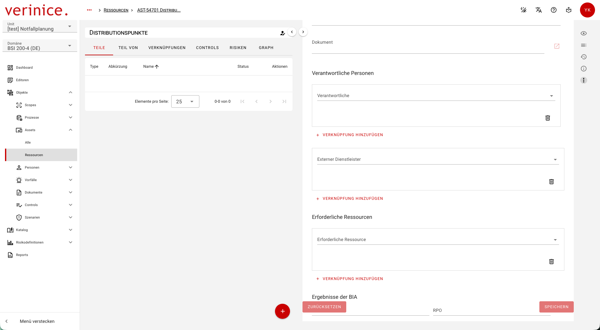
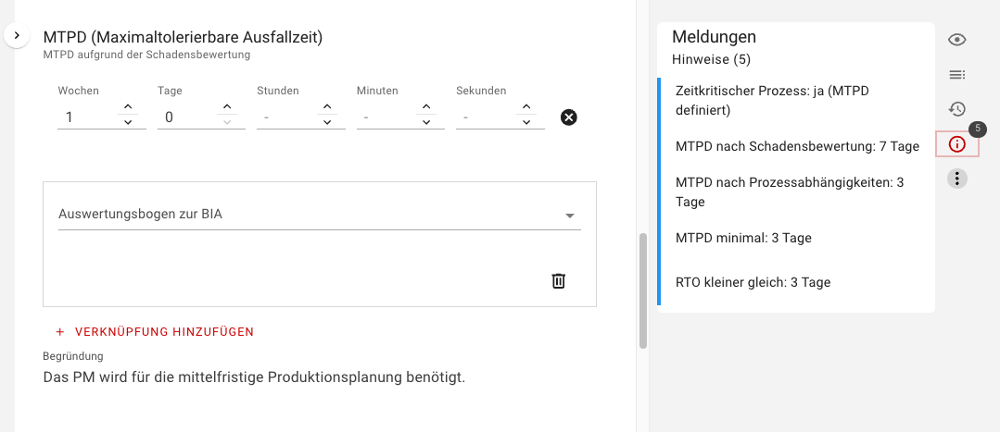
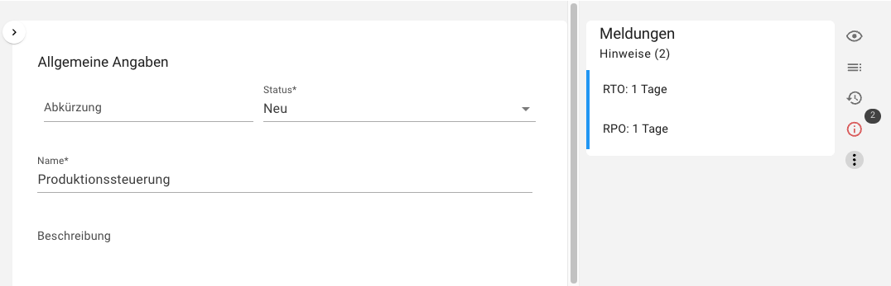

<!-- © 2026 The Project Contributors - see AUTHORS.txt -->
# Business Impact Analyse (BIA)

Ein Hauptziel des Business Continuity Management Systems (BCMS) ist die angemessene Absicherung geschäftskritischer Prozesse. Die Business Impact Analyse (BIA) dient dazu, systematisch folgende Kernfragen zu beantworten:

* Zeitkritikalität: Ist der Geschäftsprozess zeitkritisch?
* Ausfalltoleranz: Wie lange darf der Prozess maximal ausfallen, bevor nicht tolerierbare Schäden für die Institution entstehen?
* Ressourcenbedarf: Welche Ressourcen sind zwingend erforderlich, um den Prozess im Notbetrieb aufrechtzuerhalten?

Damit bildet die BIA das Fundament für die Priorisierung von Prozessen, die Definition von Wiederanlaufzielen (RTO, RPO) sowie die anschließende Planung von Notfall- und Wiederherstellungsmaßnahmen.

## BIA-Vorbereitung

### Anlegen der Geschäftsprozesse

Um mit der BIA zu starten, müssen die relevanten Prozesse für Ihren BCMS-Geltungsbereich identifiziert und als Objekte erfasst werden. Nutzen Sie hierfür vorhandene Synergien: Existiert in Ihrer Institution bereits ein Informationssicherheitsmanagementsystem (ISMS) oder ein Verzeichnis der Verarbeitungstätigkeiten (VVT) nach DS-GVO, können diese Daten als ideale Ausgangsbasis dienen.

* Neue Prozesse anlegen: Falls noch keine Prozesse erfasst sind, erstellen Sie diese neu über den Objekttyp Geschäftsprozess.

* Vorhandene Prozesse nutzen: Bereits existierende Prozesse aus der Datenschutz- oder ISMS-Domäne können Sie ganz einfach der BCMS-Domäne zuordnen.

### Dokumentation von Prozess-Details

Im Formular des jeweiligen Geschäftsprozesses können Sie spezifische Zusatzinformationen zur BIA hinterlegen. Dazu gehören:

* Datum der Erhebung
* Art der Erhebung: Die gewählte Methodik (z. B. Selbstauskunft, Einzelinterview, Workshop)
* Der/die BIA-Zuständige/r sowie die zuständige Organisationseinheit
* Kritischste Zeiträume: Art der Prozesskontinuität: z. B. kontinuierlich, ergebnisgesteuert, zyklisch oder quasi-kontinuierlich sowie die Phasen, in denen ein Ausfall besonders schwerwiegende Folgen hätte

### Festlegung der Ressourcenkategorien und -cluster

Für einen strukturierten Überblick werden benötigte Ressourcen unter dem Objekttyp Ressource erfasst und über sogenannte Composites (Obergruppen) in Ressourcenkategorien und -cluster (z. B. Personal, IT-Systeme, Gebäude, Dienstleister, Informationen) unterteilt.

* Strukturierung: Einzelne Ressourcen ordnen Sie über den Reiter **Teile** dem jeweils passenden Composite zu.
* Verantwortlichkeiten: Verknüpfen Sie direkt in der Ressource die zuständigen internen Personen oder externen Dienstleister.

## Durchführung der BIA

### Ermittlung des Schadenspotenzials und der maximal tolerierbaren Ausfallzeit (MTPD)

Zur Identifikation zeitkritischer Prozesse muss das Schadenspotenzial jedes Geschäftsprozesses für zuvor definierte Zeithorizonte bewertet werden. Definieren Sie die **MTPD nach Schadensbewertung** nach dem Worst-Case Prinzip im Abschnitt **MTPD (Maximal tolerierbare Ausfallzeit)**:

Anschließend begründen Sie, wie die MTPD ermittelt wurde und welche Schadensszenarien ausschlaggebend für die Bewertung waren. Sobald eine MTPD eingetragen wird, ermittelt verinice unter **Meldungen**, dass es sich um einen zeitkritischen Geschäftsprozess handelt.

### Festlegung des Notbetriebsniveaus

Über das Feld Notbetriebsniveau definieren Sie, in welchem minimalen Leistungsumfang der Geschäftsprozess im Krisenfall betrieben werden muss, um nicht tolerierbare Schäden abzuwenden (z. B. Aufrechterhaltung von 60 % der regulären Kapazität, Nutzung vereinfachter manueller Verfahren).

### Abbildung von notfallrelevanten Prozessabhängigkeiten

Nach der ersten Bewertung werden die notfallrelevanten Abhängigkeiten zwischen den Prozessen analysiert. Dies ist notwendig, um festzustellen, ob sich die MTPD eines Prozesses durch die Abhängigkeit von einem anderen Prozess verringert. Ändert sich die Ausfalltoleranz durch diese Verknüpfungen, gibt die automatisierte Prüfung (Inspection) folgende Meldungen aus:

- **Zeitkritischer Prozess:** Der Prozess wird als zeitkritisch bewertet, wenn eine MTPD nach Schadensbewertung festgelegt wurde.
- **MTPD nach Schadensbewertung:** Der eingetragene Wert wird angezeigt.
- **MTPD nach Prozessabhängigkeiten:** Dieser Wert wird nach dem Minimumprinzip aus allen von **anderen Prozessen** geforderten MTPD bestimmt. 
- **MTPD minimal:** Aus den beiden vorhergehenden Werten resultiert der kleinste Wert als minimale MTPD für den Prozess.
- **RTO kleiner gleich:** Die RTO für Ressourcen muss in jedem Fall kleiner oder gleich der MTPD sein.

### Abbildung der Ressourcenabhängigkeiten sowie Festlegung der geforderten Wiederanlaufzeit (RTO) und des maximal tolerierbaren Datenverlusts (RPO)

Der Prozesseigentümer identifiziert und dokumentiert nach den Prozessabhängigkeiten auch die Ressourcenabhängigkeiten:

* Die für den Notbetrieb benötigten Ressourcen werden über den Custom-Link verknüpft.
* Direkt in diesem Custom-Link werden die spezifische RTO und RPO der jeweiligen Ressource für diesen konkreten Geschäftsprozess definiert. Für informationsbasierte Ressourcenkategorien (z. B. Daten, IT-Systeme, Informationen) muss zusätzlich die Recovery Point Objective (RPO) bestimmt werden. Diese beschreibt den maximal tolerierbaren Datenverlust – also bis zu welchem Zeitpunkt Daten im Notbetrieb zurückliegen dürfen, ohne den Prozessablauf unzulässig zu beeinträchtigen.

Die RPO ist konzeptionell unabhängig von MTPD und RTO, wird jedoch im nächsten Schritt konsolidiert, wenn mehrere Prozesse auf dieselbe Ressource zugreifen.

### Identifizierung von Single Points of Failure

Ressourcen, die von mehreren zeitkritischen Prozessen gemeinsam genutzt werden und bei deren Ausfall eine Kettenreaktion droht, sind als kritische Engpässe zu kennzeichnen. In verinice können diese Schwachstellen im Ressourcen-Objekt über das Feld Single-Point-of-Failure/of-Knowledge/of-Contact (SPoF/SPoK/SPoC) dokumentiert werden. Bevor Sie dies tun, können die SPoFs als bekannte Schwachpunkte direkt im übergeordneten Geschäftsprozess verknüpft werden.

verinice unterscheidet dabei drei Kategorien:

* SPoF (Single Point of Failure): Technische oder dienstleistungsbezogene Engpässe (z. B. eine zentrale Firewall, ein einziger externer Dienstleister).
* SPoK (Single Point of Knowledge): Wissensabhängigkeiten, bei denen geschäftskritisches Know-how nur bei einer einzelnen Person liegt.
* SPoC (Single Point of Contact): Kommunikationsabhängigkeiten, bei denen der Informationsfluss an einer einzigen Kontaktperson hängt.

### Konsolidierung von RTO und RPO

Nachdem alle Prozesseigentümer ihre Bedarfe dokumentiert haben, werden die RTO- und RPO-Anforderungen der verschiedenen Prozesse auf Ebene der jeweiligen Ressourcen automatisch konsolidiert. Die finalen Ergebnisse werden direkt in das Ressourcen-Objekt übernommen. Nutzen mehrere Prozesse dieselbe Ressource, gilt das Minimalprinzip: Die schärfste (kleinste) RTO oder RPO aller verknüpften Prozesse bestimmt die globale Anforderung für diese Ressource.

## Entwickeln von Notfall-/ Business-Continuity-Lösungen zur Geschäftsfortführungsplanung

Sobald die BIA-Ergebnisse im Geschäftsprozess vorliegen, können für alle notfallrelevanten Ressourcen eines Geschäftsprozesses passgenaue BC-Lösungen entwickelt werden. 

**Modellierungslogik für BC-Lösungen in verinice**

Die Konzeption von Geschäftsfortführungsmaßnahmen folgt einem zweistufigen Prinzip, um sowohl den Vorgaben des BSI-Standards 200-4 zu entsprechen als auch eine präzise Umsetzung im Notfall zu gewährleisten:

* Szenariobasierte Klammer (Übergeordnete BC-Lösung):

Für jedes relevante Ausfallszenario (z. B. Ausfall von Personal, Ausfall von IT-Infrastruktur) wird zunächst eine übergeordnete BC-Lösung angelegt und mit dem Geschäftsprozess verknüpft. Diese definiert die strategische Rahmenbedingung für den Prozess im Ernstfall (z. B. Notbetriebsregeln, Reduktion auf Mindestbetriebsniveaus) und bildet das direkte Struktur-Kapitel für den automatisiert generierten Geschäftsfortführungsplan (GFP).

* Ressourcenspezifische Präzisierung (Teillösungen):

Innerhalb dieser übergeordneten BC-Lösung werden die konkreten Teillösungen für die in der BIA identifizierten Einzelressourcen modelliert. Dies ermöglicht passgenaue Maßnahmen für unterschiedliche Abhängigkeiten – wie etwa gezielte Stellvertreterregelungen für Schlüsselpersonen, Umverteilungspläne für operative Teams oder Nachqualifizierungsmaßnahmen.

Durch diesen Aufbau bleibt das Notfallkonzept in verinice übersichtlich strukturiert, modular pflegbar und lässt sich im Krisenfall direkt auf Prozessebene anwenden.

Die konkrete Ausarbeitung erfolgt im Objekttyp BC-Lösung (Details finden Sie im Kapitel [Geschäftsfortführungs- und Wiederanlaufplanung](./create-Plans-for-Emergency)).