<!-- © 2025 The Project Contributors - see AUTHORS.txt -->
# Geschäftsfortführungs- und Wiederanlaufplanung

## Zielsetzung

Ziel der Geschäftsfortführungs- und Wiederanlaufplanung ist es, sicherzustellen, dass zeitkritische Geschäftsprozesse und Ressourcen nach einem Schadensereignis innerhalb der geforderten Zeitspanne wiederaufgenommen bzw. wiederhergestellt werden können.

Die Grundlage hierfür bilden die Ergebnisse der Business Impact Analyse (BIA) sowie die definierten Business Continuity Strategien. Die Planung gliedert sich in zwei operative Teilbereiche:

- Geschäftsfortführungsplanung (GFP): Fokus auf zeitkritische Geschäftsprozesse.
- Wiederanlauf- und Wiederherstellungsplanung (WAP/WHP): Fokus auf zeitkritische Ressourcen (z. B. IT-Systeme, Gebäude).

Für beide Bereiche sind strukturierte Pläne zu erstellen, die alle erforderlichen technischen, organisatorischen und personellen Maßnahmen enthalten. Als zentrales operatives Instrument des Business Continuity Managements (BCM) gewährleisten diese Pläne eine koordinierte, nachvollziehbare und effektive Reaktion auf Notfälle und Krisen.

## Geschäftsfortführungsplanung

Die Geschäftsfortführungspläne beschreiben alle Maßnahmen und Abläufe, um zeitkritische Geschäftsprozesse im Notfall innerhalb der vorgegebenen Zeit fortzuführen. Die in der BIA identifizierten zeitkritischen Prozesse bilden dafür die fundamentale Basis.

Damit ein Geschäftsfortführungsplan automatisiert als Report aus verinice generiert werden kann, empfiehlt sich die folgende Vorgehensweise:

1. **Geschäftsfortführungsplan anlegen und allgemeine Angaben erfassen:** 

    
Dokumentieren Sie  unter dem Dokumenten-Objekt grundlegende Informationen für den Plan, wie:
* Geltungsbereich, Zielgruppe und Zielsetzung des GFP,
verlinken Sie zusätzlich den Geschäftsprozess für welchen der Plan erstellt werden soll.
   
* definieren Sie Aktivierungskriterien oder den Aktivierungsprozess sowie Rückführungskriterien
   
   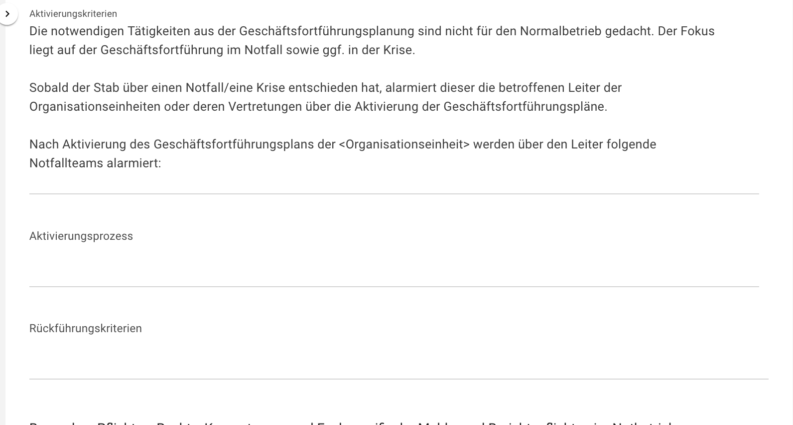

* halten Sie Besondere Pflichten, Rechte und Kompetenzen und fachspezifische Melde- und Berichtspflichten im Notbetrieb fest, 

   

* verlinken Sie wichtige Kontakte sowie Referenzdokumente

Sollte einem Geschäftsprozess eine Organisationseinheit zugeordnet worden sein, wird von dieser im Report eine Interne Kommunikationsmatrix ausgegeben, mit einer verantwortlichen Leitungsperson für die Alarmierung, und die zuständigen Personen/Notfallteams aus dem Scope-Objekttyp *Organisationseinheit* übernommen.

Es können zusätzlich Angaben zur Dokumentenlenkung, Revision und zur Aufbewahrung und Archivierung vorgenommen werden, wie: 
   - Abkürzung, 
   - Name,
   - Autor/Ersteller
   - Klassifizierung, 
   - Version, 
   - Lebenszyklus, 
   - Genehmigungsdatum und Genehmiger/-in und Gültigkeitszeitraum,
   - Überprüfungsintervall

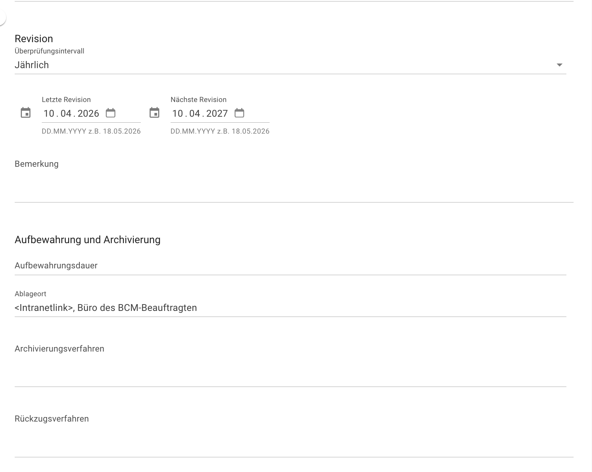

Als nächsten Schritt müssen folgende Voraussetzungen erfüllt sein: 

2. **BC-Lösungen erstellen und dem Geschäftsprozess zuordnen**: Dem jeweiligen Geschäftsprozess müssen die BC-Lösungen für die relevanten Ausfallszenarien zugeordnet sein. Falls Sie noch keine BC-Lösung angelegt haben, erstellen Sie diese direkt unter dem Geschäftsprozess im Bereich *Geschäftsfortführungsmaßnahmen im Notfall.*

   

    Eine umfassende BC-Lösung sollte sich aus verschiedenen Teillösungen für jede benötigte Ressource zusammensetzen, die wiederum mehrere konkrete Notfallmaßnahmen beinhalten.

    * 2.1 **Composite-Objekt anlegen:** Erstellen Sie zunächst ein übergeordnetes Composite-Objekt, um alle zugehörigen BC-Lösungen gebündelt zu sammeln. Benennen Sie dieses nach dem jeweiligen Ausfallszenario (z. B. „Ausfall von Personal“).

    * 2.2. **Objekte verlinken:** Verknüpfen Sie im Formular des Composite-Objekts der BC-Lösung mindestens die folgenden Elemente:

      * das zugrunde liegende Ausfallszenario,
      * die notwendigen Rollen/Funktionen sowie die Arbeitsplätze im Notbetrieb.

      

    * 2.3 **Ressourcen-spezifische BC-Lösungen anlegen**: Erstellen Sie nun im linken Bereich über den Reiter „Teile“ weitere Objekte vom Typ BC-Lösung. Legen Sie dabei für jede Ressource, die im Ernstfall für den Notbetrieb des Geschäftsprozesses zwingend benötigt wird, eine eigene BC-Lösung an.

    * 2.4 **Formularfelder ausfüllen:** Erfassen Sie in den jeweiligen Ressourcen-Formularfeldern die folgenden Pflichtangaben:
      * Art der Notfallplanung: GFP
      * Szenario
      * Die betroffene Ressource
      * Die angewandte BC-Strategie

3. **Notfallmaßnahmen für die einzelnen Ressourcen-BC-Lösungen anlegen**: Erstellen oder verknüpfen Sie die konkreten Notfallmaßnahmen über den Reiter “Teile" der jeweiligen Ressourcen-BC-Lösung.
Die Maßnahmen lassen sich entweder als einzelne Objekte oder als übergeordnetes Composite (inklusive untergeordneter Aktivitäten) abbilden. Unterteilen Sie diese sinnvollerweise in folgende Phasen:

    * Maßnahmen zum Erreichen des Notbetriebs (Wiederanlauf in den Notbetrieb)
    * Maßnahmen für die eigentliche Geschäftsfortführung
    * Maßnahmen zur Rückführung in den Normalbetrieb

4. **Notfallmaßnahmen verwalten und klassifizieren**: Innerhalb des Control-Objekts der Notfallmaßnahme können Sie eine detaillierte Beschreibung hinterlegen sowie eine verantwortliche Person (Zuständige/r) verknüpfen.
Damit die Maßnahme später im Report automatisch an der korrekten Stelle eingeordnet wird, müssen Sie im Bereich „Details“ zwingend die folgenden Klassifizierungen vornehmen:

    * Klassifikation der Maßnahme: Wählen Sie die jeweils zutreffende Phase aus (Wiederanlauf, Notbetrieb oder Rückführung in den Normalbetrieb).
    * Zugehörigkeit: Wählen Sie aus, zu welchem Plan die Maßnahme gehört (Geschäftsfortführungsplan).

## Erstellung von Wiederanlauf- und Wiederherstellungspläne für kritische Ressourcen

Die Wiederanlauf- und Wiederherstellungsplanung umfasst sämtliche organisatorischen, technischen und personellen Maßnahmen, um ausgefallene Ressourcen (wie IT-Systeme, Gebäude, Arbeitsplätze oder Dienstleistungen) schnellstmöglich wieder in einen betriebsbereiten Zustand zu versetzen. Diese Planung wird idealerweise von den jeweiligen Ressourcenzuständigen durchgeführt. Der Aufbau der Wiederanlauf- und Wiederherstellungsplanung in verinice orientiert sich dabei eng an der offiziellen BSI-Vorlage für Wiederanlaufpläne.

### Inhalte der Wiederanlaufplanung (WAP)

Initial muss für eine Ressource ein Objekt vom Typ *BC-Lösung* für den WAP/WHP angelegt werden. Dies kann beispielsweise direkt in der Ressource über den Custom-Link *BC-Lösung (WAP/WHP)* erfolgen unter dem Bereich *Notfallplanung*.

Die eigentliche Detailplanung erfolgt anschließend direkt im Objekt BC-Lösung:

1. **Basisangaben und Voraussetzungen dokumentieren**: Wählen Sie im Objekt BC-Lösung unter Details > Art der Notfallplanung **WAP** aus.

Daraufhin öffnen sich spezifische Felder zur Dokumentation der folgenden Inhalte:

- **Allgemeine Informationen:** Zielsetzung, Aktivierungsprozess und Rahmenbedingungen.
- **Voraussetzungen zum Wiederanlauf:** Organisatorische 

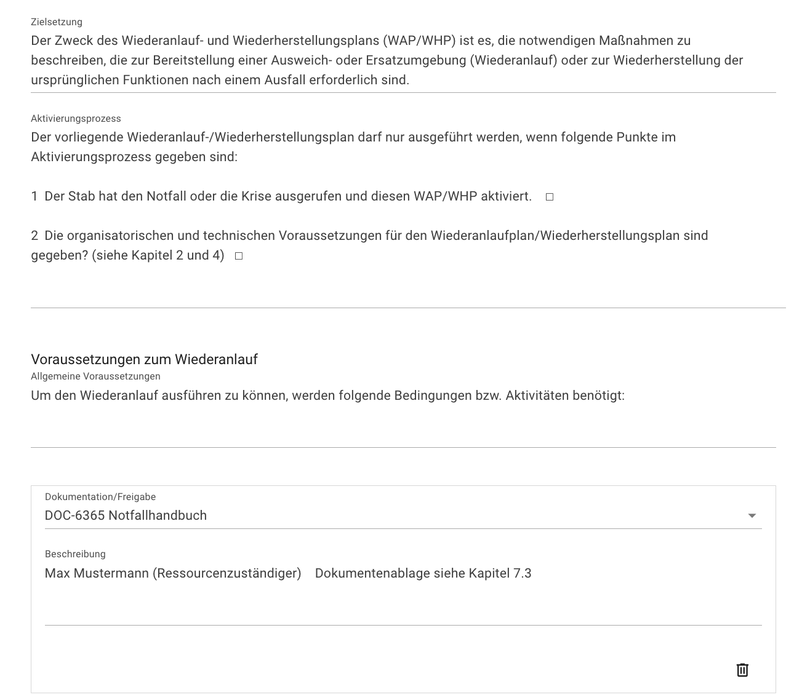

 und **technische Voraussetzungen**.

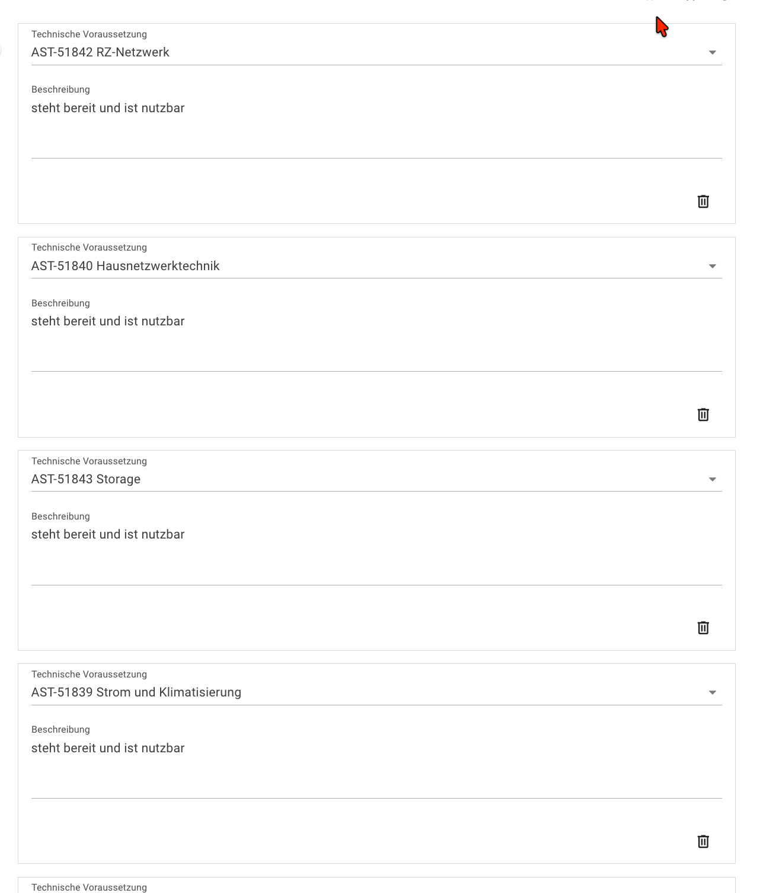

- Beschreibung des **Notbetriebsniveaus** und zu erwartende Einschränkungen.
- Falls erforderlich: Zusätzliche Maßnahmen für den Notbetrieb.

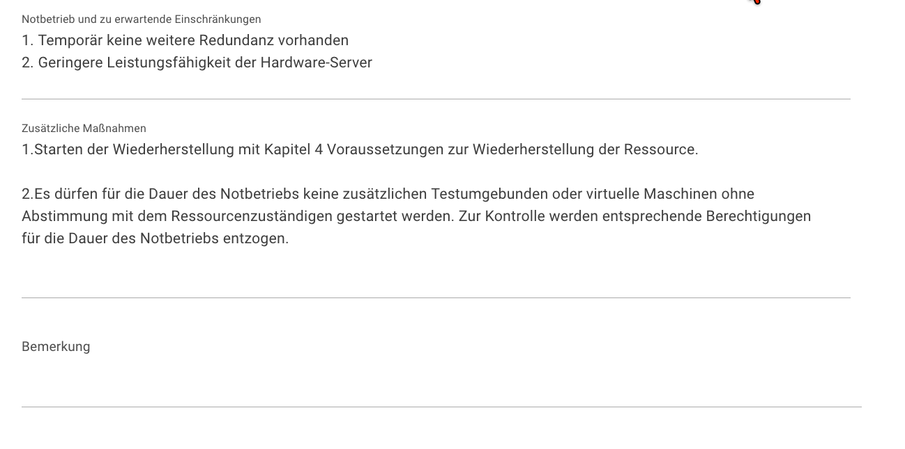

2. **Ablaufplan anlegen**: Zur konkreten Strukturierung des Wiederanlaufs legen Sie im linken Bereich über den Reiter „Teile“ ein Composite-Objekt vom Typ Notfallmaßnahme an. Benennen Sie dieses beispielsweise mit „Ablaufplan des Wiederanlaufs“.

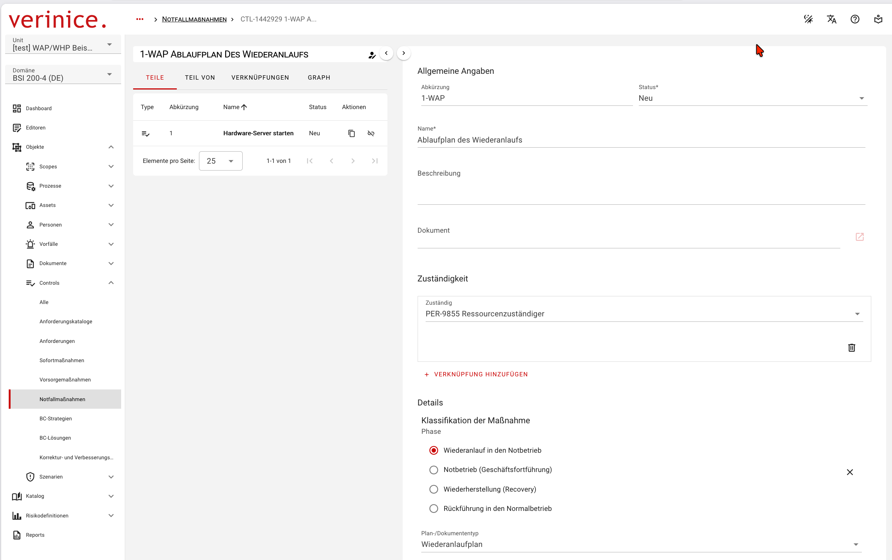

3. **Notfallmaßnahmen und Aktivitäten verwalten**: Diesem Ablaufplan können nun die einzelnen konkreten Notfallmaßnahmen hinzugefügt werden.

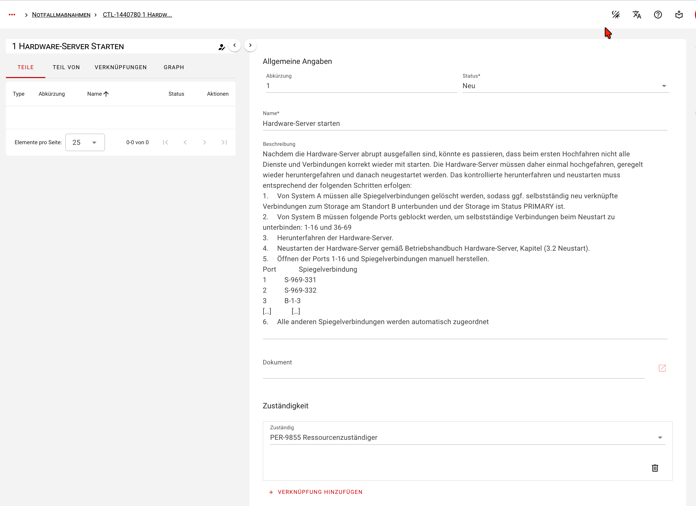

Damit die korrekte Reihenfolge der Aktivitäten im späteren Report automatisch tabellarisch ausgegeben wird, müssen die nachfolgenden Schritte jeweils über den Custom-Link *Nachgelagerte Aktivität* miteinander verknüpft werden. Stellen Sie sicher, dass im Bereich „Details“ folgende Klassifizierungen hinterlegt sind:
Phase: Wiederanlauf, Wiederherstellung oder Rückführung in den Normalbetrieb

* Plan- und Dokumententyp: Wiederanlaufplan
* Durchführungsart: Operativ (Einsatz)
* Maßnahmentyp: Aktivität

Anschließend können Sie pro Aktivität folgende Details festhalten:

* Konkrete Prüfschritte
* Erwartete Dauer und erforderliche Dokumentation
* Ausführendes System und zuständige Person
* Nachgelagerte Aktivitäten sowie weitere Hinweise

4. **Funktionstests und Übergabe in den Notbetrieb:** Zusätzlich können unter der BC-Lösung weitere Notfallmaßnahmen-Composites hinzugefügt werden, um Testaktivitäten, deren Ergebnisse (erfolgreich / nicht erfolgreich) sowie gegebenenfalls notwendige Korrekturmaßnahmen zu beschreiben.

Verknüpfen Sie im Anschluss – falls dies nicht bereits initial geschehen ist – das fertige Objekt zum Wiederanlauf im übergeordneten Ressourcen-Objekt unter dem Bereich **Notfallplanung**.

### Inhalte der Wiederherstellungsplanung

Die **Wiederherstellungsplanung (WHP)** ergänzt die **Wiederanlaufplanung(WAP)** und beschreibt alle erforderlichen Maßnahmen, um die ausgefallenen Ressourcen vollständig wiederherzustellen und den **Normalbetrieb** sicherzustellen.

Für die Wiederherstellung können spezifische organisatorische und technische Voraussetzungen sowie Schlüsselkontakte dokumentiert werden.

Sowohl für den Wiederanlauf als auch für die Wiederherstellung lassen sich wichtige Ansprechpartner hinterlegen, damit diese mitsamt ihren Kontaktdaten gesammelt als Übersicht im Report erscheinen.

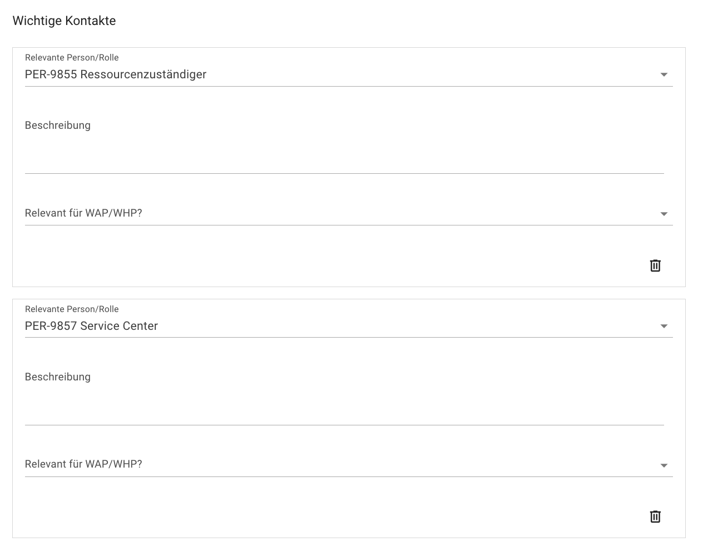

#### Ablaufplan der WHP strukturieren

Fügen Sie die erste Notfallmaßnahme/Aktivität als Element zum Ablaufplan hinzu. 

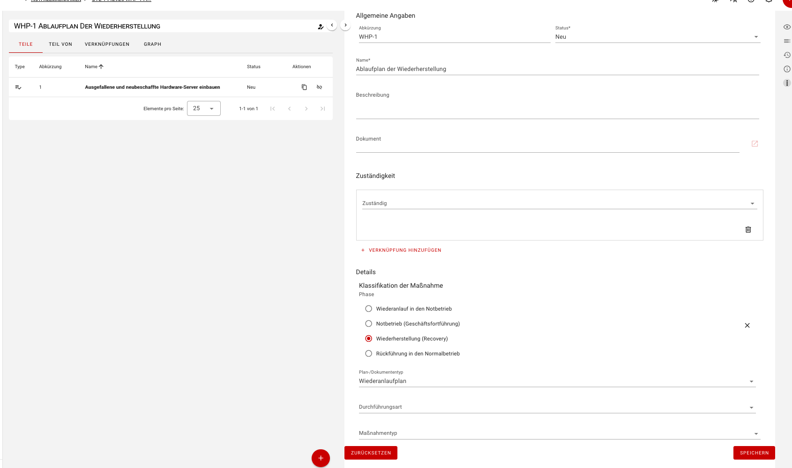

Alle darauffolgenden Aktivitäten verknüpfen Sie anschließend wieder flexibel über den Custom-Link.

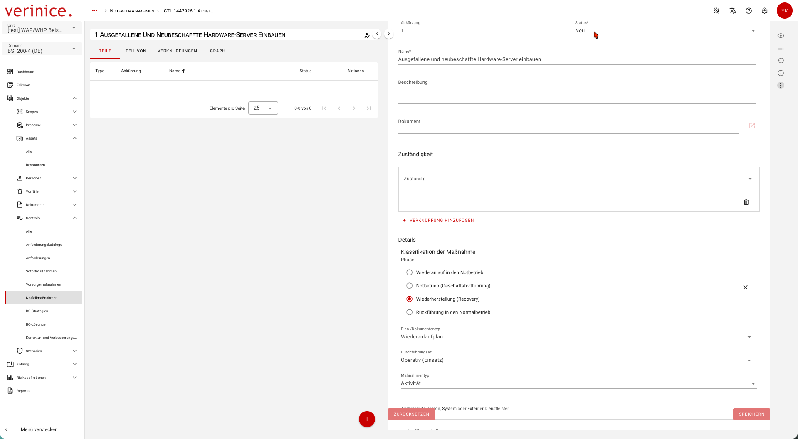

Analog zur Wiederanlaufplanung lässt sich jede Aktivität der Wiederherstellung präzise beschreiben:
  * Prüfschritte, 
  * erwartete Dauer und erforderliche Dokumentation,
  * ausführendes System und zuständige Person,
  * nachgelagerte Aktivitäten und weitere Hinweise.

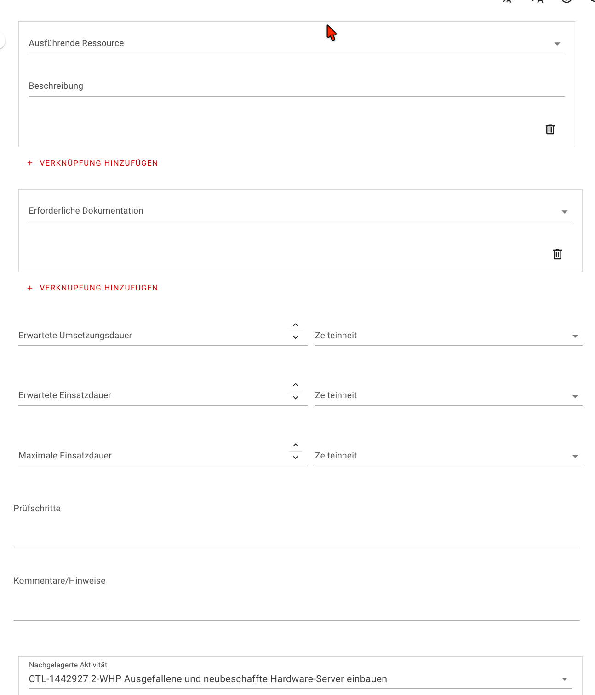

#### Rückführung in den Normalbetrieb

Um auch die geordnete Rückkehr in den Normalbetrieb detailliert zu planen, kann im linken Bereich (Reiter „Teile“) unter dem Composite BC-Lösung ein weiteres Maßnahmen-Objekt ergänzt werden.

Die genaue Vorgehensweise für die Rückkehr können Sie direkt im Beschreibungsfeld dokumentieren sowie eine zuständige Person dafür definieren.

Damit diese Schritte im Report richtig zugeordnet werden, müssen die Maßnahmen im Bereich „Details“ wieder korrekt klassifiziert werden. Wählen Sie dazu die folgenden Einstellungen aus:

* Phase: Rückführung in den Normalbetrieb
* Plan- und Dokumententyp: Wiederanlaufplan
*  Durchführungsart: Operativ (Einsatz)
* Maßnahmentyp: Workaround

