<!-- © 2025 The Project Contributors - see AUTHORS.txt -->
# Geschäftsfortführungs- und Wiederanlaufplanung

## Zielsetzung

Ziel der Geschäftsfortführungs- und Wiederanlaufplanung ist es, sicherzustellen, dass zeitkritische Geschäftsprozesse und Ressourcen nach einem Schadensereignis innerhalb der geforderten Zeitspanne wiederaufgenommen bzw. wiederhergestellt werden können.

Die Grundlage hierfür bilden die Ergebnisse der Business Impact Analyse (BIA) sowie die definierten Business Continuity Strategien. Die Planung gliedert sich in zwei operative Teilbereiche:

- Geschäftsfortführungsplanung (GFP): Fokus auf zeitkritische Geschäftsprozesse.
- Wiederanlauf- und Wiederherstellungsplanung (WAP/WHP): Fokus auf zeitkritische Ressourcen (z. B. IT-Systeme, Gebäude).

Für beide Bereiche sind strukturierte Pläne zu erstellen, die alle erforderlichen technischen, organisatorischen und personellen Maßnahmen enthalten. Als zentrales operatives Instrument des Business Continuity Managements (BCM) gewährleisten diese Pläne eine koordinierte, nachvollziehbare und effektive Reaktion auf Notfälle und Krisen.

## Geschäftsfortführungsplanung

Die Geschäftsfortführungsplanung beschreibt alle Maßnahmen und Abläufe, um zeitkritische Geschäftsprozesse im Notfall innerhalb der vorgegebenen Zeit fortzuführen. Die in der Business Impact Analyse (BIA) identifizierten zeitkritischen Prozesse bilden dafür die fundamentale Basis.

Die folgende Anleitung führt Sie chronologisch von links nach rechts anhand des Prozessdiagramms durch die Erstellung eines auswertbaren Geschäftsfortführungsplans.

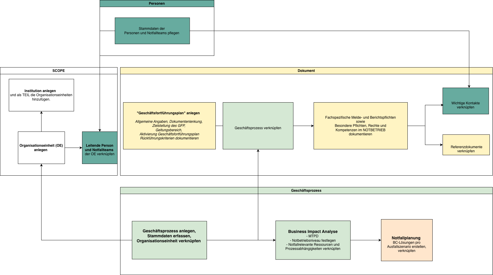

### Basis-Einrichtung im Scope & Zuordnung der Organisationseinheit (OE)

1.	Institution anlegen: Legen Sie im Bereich SCOPE die Institution an und ordnen Sie dieser als Teil die für den GFP zuständige Organisationseinheit hinzu.
2.	Organisationseinheiten zuordnen: Verknüpfen Sie die relevante Organisationseinheit mit dem Geschäftsprozess (im Subtyp Geschäftsprozess). Die Zuordnung der OE legt unmissverständlich fest, wer für die Ausführung der BC-Lösungen im Ernstfall die Verantwortung trägt.
3.	Personen & Notfallteams zuweisen: Ordnen Sie die leitende Person sowie die Notfallteams der Organisatinseinheit zu (für die Alarmierung).

Die Zuordnung von Organisationseinheiten zu Geschäftsprozessen und BC-Lösungen sichert die verbindliche Verantwortlichkeit im gesamten BCM-Lebenszyklus:

* Im Regelbetrieb: Eindeutige Zuständigkeit für die laufende Pflege, Aktualisierung und Erprobung der dokumentierten Notfallmaßnahmen.

* Im Ernstfall: Klare Zuweisung von Ausführungs- und Weisungsbefugnissen an die zuständige Fachbereichsleitung zur schnellen und autorisierten Umsetzung der BC-Lösungen.

### Einrichtung des Dokumenten-Objekts & Stammdaten

Legen Sie im Bereich Dokument das zentrale Plan-Objekt an und pflegen Sie die Grunddaten:

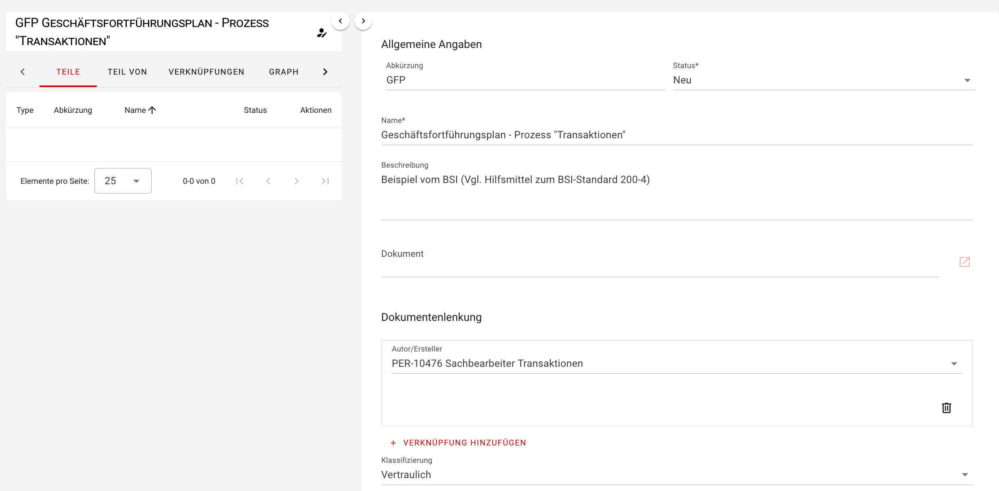 

1.	Geschäftsfortführungsplan-Objekt unter dem Subtyp Geschäftsfortführungsplan anlegen (z.B. DOC-GFP "Prozess Transaktionen"): Erstellen Sie das Dokumenten-Objekt und erfassen Sie allgemeine Angaben: 
- Dokumentenlenkung: Abkürzung, Name, Autor/Ersteller, Klassifizierung, Version, Lebenszyklus, Genehmigungsdatum, Genehmiger/-in, Gültigkeitszeitraum, Überprüfungsintervall.
- Planinhalte: Zielstellung des GFP, Geltungsbereich, Aktivierung Geschäftsfortführungsplan, Rückführungskriterien.

2.	Geschäftsprozess verknüpfen: Verknüpfen Sie den in verinice angelegten Geschäftsprozess direkt mit dem GFP-Dokumentenobjekt. Hinweis: Ist dem Geschäftsprozess eine Organisationseinheit zugeordnet, wird im Report automatisch eine interne Kommunikationsmatrix mit den verantwortlichen Personen generiert.

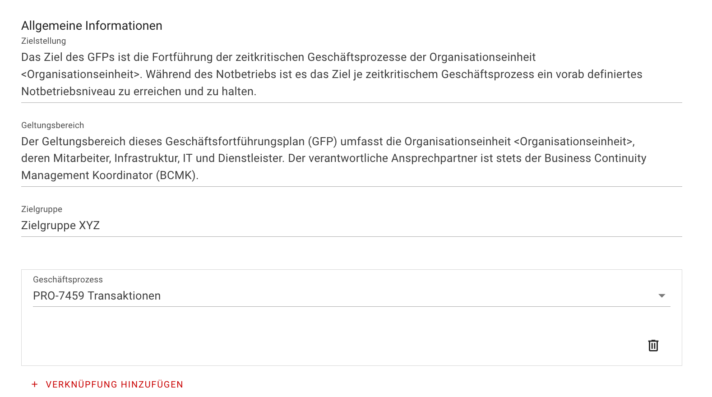

3.	Rechte, Pflichten & Meldewege dokumentieren: Erfassen Sie im Folgeschritt die fachspezifischen Melde- und Berichtspflichten sowie besondere Pflichten, Rechte und Kompetenzen im Notbetrieb.

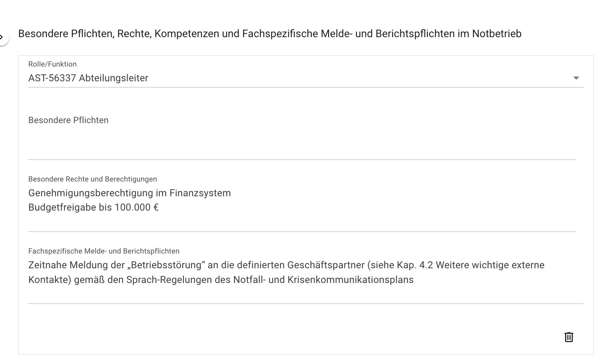

4.	Kontakte und Dokumente anbinden: Stellen Sie die Verbindung zu den relevanten Ansprechpartnern her und verlinken ergänzende Referenzdokumente und mitgeltende Unterlagen.

### Vorbereitung im Geschäftsprozess (BIA & Voraussetzungen)

Wechseln Sie in den Bereich Geschäftsprozess, um die inhaltlichen Grundlagen für die BC-Lösungen sicherzustellen:

1.	Geschäftsprozesse anlegen & Stammdaten erfassen: Erstellen Sie den Geschäftsprozess, pflegen Sie die Stammdaten und ordnen Sie eine Organisationseinheit zu.
2.	Business Impact Analyse (BIA) durchführen:
- Legen Sie die MTPD (Maximum Tolerable Period of Disruption) fest.
- Bestimmen Sie das geforderte Notbetriebsniveau.
- Identifizieren Sie notfallrelevante Ressourcen und definieren Sie die Prozessabhängigkeiten.
3.	BC-Lösungen pro Ausfallszenario erstellen & verknüpfen: Erstellen Sie direkt unter dem Geschäftsprozess (im Bereich Geschäftsfortführungsmaßnahmen im Notfall) die BC-Lösungen pro Ausfallszenario (z. B. Ausfall von Personal, Ausfall von IT-Systemen, Gebäudeausfall) und verknüpfen Sie diese mit dem Prozess.

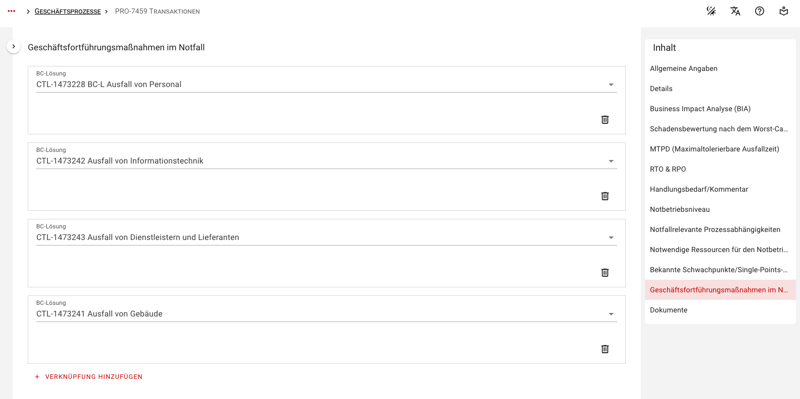

### Strukturierung der BC-Lösungen

Eine umfassende BC-Lösung setzt sich aus verschiedenen Teillösungen für jede benötigte Ressource zusammen:

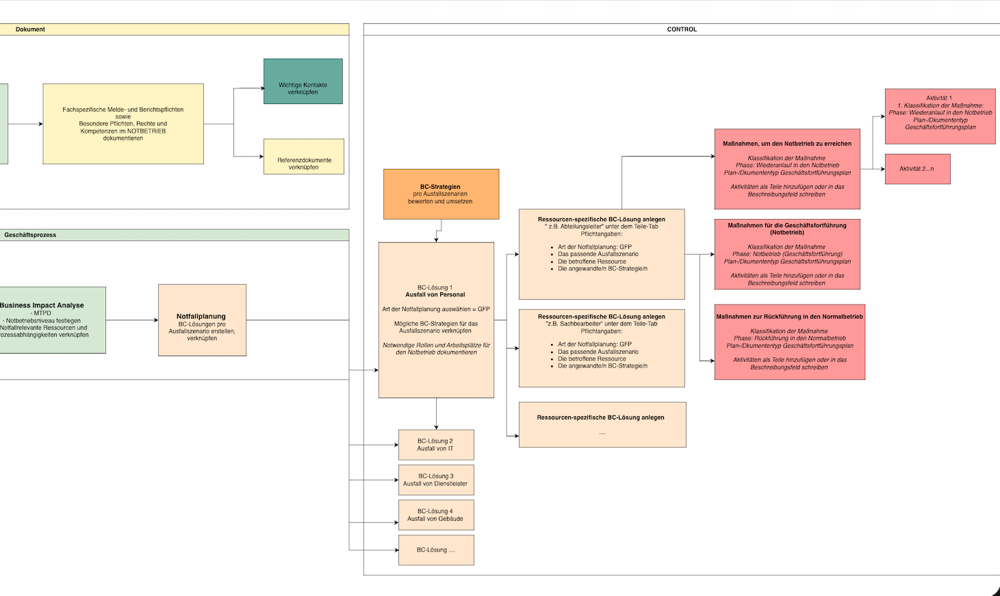

1.	Composite-Objekt anlegen: Erstellen Sie unter dem Geschäftsprozess ein übergeordnetes Composite-Objekt, um alle zugehörigen BC-Lösungen gebündelt zu sammeln, und benennen Sie dieses nach dem jeweiligen Ausfallszenario.
2.	Ressourcen-spezifische BC-Lösungen & Notfallmaßnahmen zuordnen:
- Fügen Sie dem Composite-Objekt die ressourcenspezifischen Teillösungen Ressourcen hinzu.
- Detaillieren Sie innerhalb der Teillösungen die konkreten Notfallmaßnahmen und Aktivitäten.

### Detaillierung der BC-Lösungen & Maßnahmen 

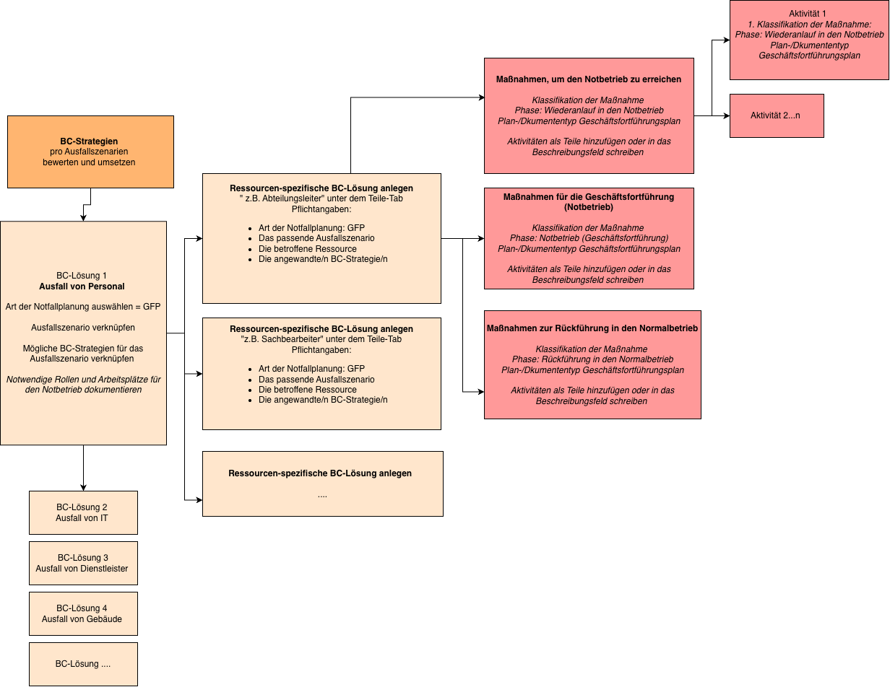

1. Composite-BC-Lösungen für Ausfallszenarien anlegen
- Bewerten Sie vorab Ihre BC-Strategien.
- Falls noch nicht erfolgt: Erstellen Sie ein Composite-Objekt für das jeweilige Ausfallszenario (z. B. BC-Lösung 1: Ausfall von Personal, BC-Lösung 2: Ausfall von IT, etc.).
- Formularfelder & Verknüpfungen des Composite-Objekts befüllen:
   - Art der Notfallplanung auswählen: GFP
   - Ausfallszenario verknüpfen
   - BC-Strategien: Verknüpfen Sie die möglichen/passenden BC-Strategien für das Ausfallszenario.
   - Rollen & Arbeitsplätze: Dokumentieren Sie die notwendigen Rollen/Funktionen sowie die Arbeitsplätze für den Notbetrieb.

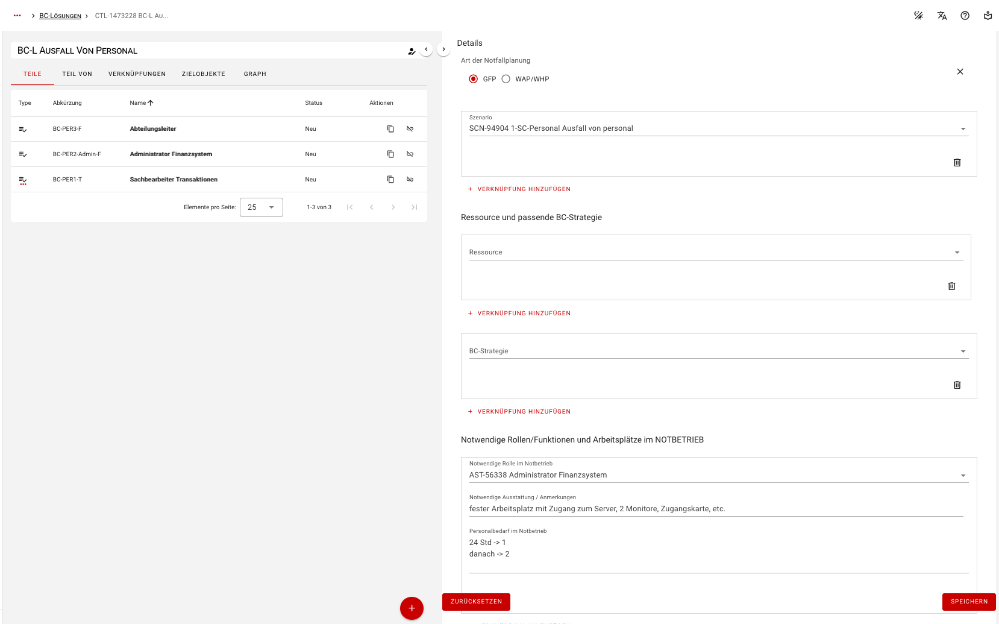
    
2.  Ressourcen-spezifische BC-Lösungen anlegen:
Erstellen Sie nun im Teile-Tab des übergeordneten Composite-Objekts für jede benötigte Ressource eine eigene ressourcenspezifische BC-Lösung (z. B. "z. B. Abteilungsleiter", "z. B. Sachbearbeiter"). Pflichtangaben in jeder ressourcenspezifischen BC-Lösung sind:
   - Art der Notfallplanung: GFP
   - Ausfallszenario: Das Ausfallszenario zuordnen
   - Ressource: Die betroffene Ressource auswählen
   - BC-Strategie/n: Die angewandte/n BC-Strategie/n hinterlegen

3. Notfallmaßnahmen nach Phasen gliedern & klassifizieren: 
Legen Sie unter dem Teile-Tab der jeweiligen ressourcenspezifischen BC-Lösung die konkreten Notfallmaßnahmen an. 

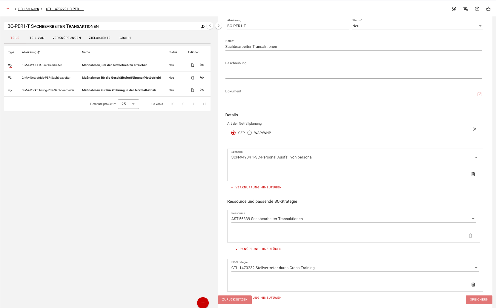

Sie können einzelne Aktivitäten einer Notfallmaßnahme entweder direkt im Beschreibungsfeld der Notfallmaßnahme zusammenfassen oder als untergeordnete Teile (Aktivität 1, Aktivität 2...n) hinzufügen.
Gliedern Sie die Maßnahmen in folgende drei Phasen und klassifizieren Sie die Notfallmaßnahmen wie folgt:

A. Maßnahmen, um den Notbetrieb zu erreichen
   - Phase: Wiederanlauf in den Notbetrieb
   - Plan-/Dokumententyp: Geschäftsfortführungsplan
   - Aktivitäten: Aktivitäten als Teile hinzufügen oder gesammelt im Beschreibungsfeld erfassen.

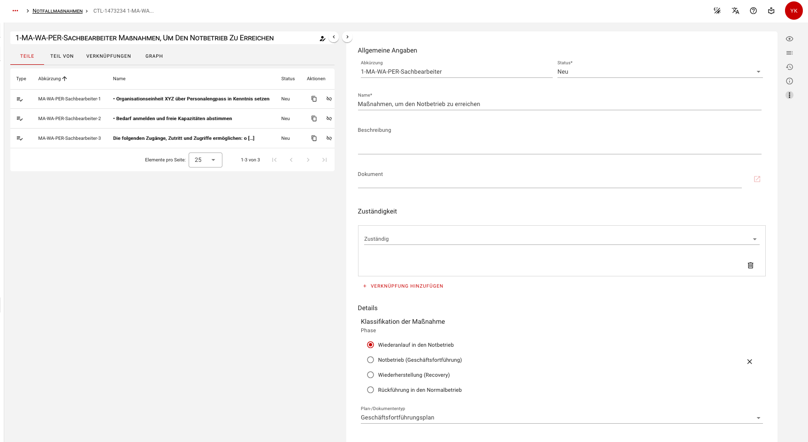

B. Maßnahmen für die Geschäftsfortführung (Notbetrieb)
   - Phase: Notbetrieb (Geschäftsfortführung)
   - Plan-/Dokumententyp: Geschäftsfortführungsplan
   - Aktivitäten: Aktivitäten als Teile hinzufügen oder gesammelt im Beschreibungsfeld erfassen.

C. Maßnahmen zur Rückführung in den Normalbetrieb
   - Phase: Rückführung in den Normalbetrieb
   - Plan-/Dokumententyp: Geschäftsfortführungsplan
   - Aktivitäten: Aktivitäten als Teile hinzufügen oder gesammelt im Beschreibungsfeld erfassen.

## Erstellung von Wiederanlauf- und Wiederherstellungsplänen für kritische Ressourcen

Die Wiederanlauf- und Wiederherstellungsplanung stellt sicher, dass ausgefallene Ressourcen – von IT-Systemen über Gebäude bis hin zu Dienstleistungen – schnellstmöglich wieder betriebsbereit sind. 

Während die Wiederanlaufplanung (WAP) auf die rasche Wiederaufnahme des Betriebs abzielt, beschreibt die ergänzende Wiederherstellungsplanung (WHP) sämtliche organisatorischen, technischen und personellen Maßnahmen zur vollständigen Rückkehr in den Normalbetrieb. 

Dazu gehören auch die Dokumentation spezifischer Voraussetzungen sowie die Erfassung zentraler Schlüsselkontakte.

Idealerweise wird diese Planung direkt von den jeweiligen Ressourcenzuständigen durchgeführt. Der strukturelle Aufbau in verinice orientiert sich dabei eng an den offiziellen BSI-Vorgaben für Wiederanlaufpläne.

Die folgende Anleitung führt Sie chronologisch anhand von Prozessdiagrammen durch die Erstellung eines auswertbaren Wiederanlauf- und Wiederherstellungsplan einer Ressource.

### Initialisierung: Scope, Ressourcen & Dokumenten-Objekte

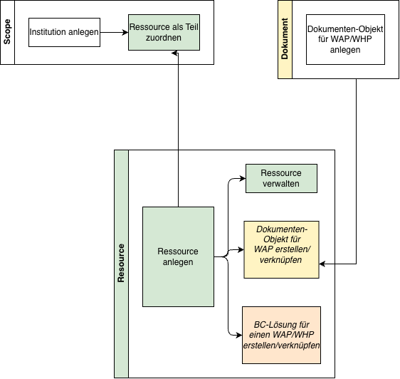

1. Scope-Einrichtung:
- Legen Sie im Bereich Scope eine neue Institution an.
- Optional: Falls die Ressource noch nicht angelegt wurde,  wechseln Sie in den Subtyp Ressource und legen eine neue Ressource an.
- Ordnen Sie im Folgeschritt die Ressource als Teil der Institution zu.

2. Ressource & Verknüpfungen zur BC-Lösung und zum Dokument: 
- Ressource verwalten: Pflegen und verwalten Sie die Stammdaten der erstellten Ressource.
- Dokumenten-Objekt für WAP erstellen / verknüpfen: Erstellen Sie die Verknüpfung zu dem Dokument erzeugten „Dokumenten-Objekt für WAP/WHP“.
- BC-Lösung für einen WAP/WHP erstellen / verknüpfen: Erzeugen Sie das zentrale Objekt BC-Lösung, das als Basis für die gesamte nachfolgende Detailplanung dient.

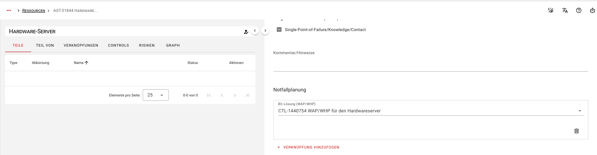

### Erfassung der Grunddaten & Voraussetzungen

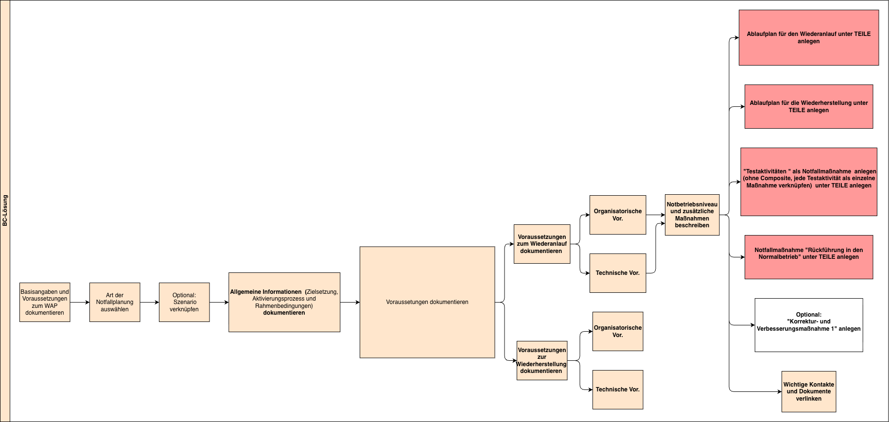

Die Erfassung im zentralen Objekt BC-Lösung erfolgt chronologisch von links nach rechts anhand des folgenden Ablaufs:
1.	Basisangaben und Voraussetzungen zum WAP dokumentieren:
- Öffnen Sie das neu angelegte Objekt, um mit der Dokumentation der Grunddaten zu beginnen.
2.	Art der Notfallplanung auswählen:
- Legen Sie in verinice fest, welche Notfallplanungsart für das Objekt gilt (WAP / WHP).
3.	Optional: Szenario verknüpfen:
- Verknüpfen Sie bei Bedarf ein bereits definiertes Notfallszenario mit der BC-Lösung für welches die Planung des Wiederanlaufs gilt.

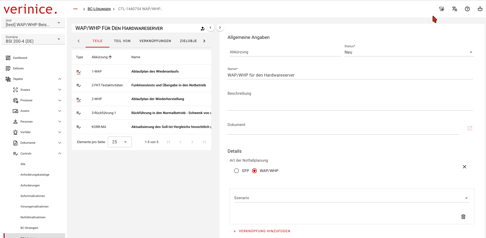

4.	Allgemeine Informationen dokumentieren:
- Erläutern Sie die Zielsetzung und den Aktivierungsprozess
5.	Voraussetzungen für den Wiederanlauf und die Wiederherstellung dokumentieren:
- Beschreiben Sie die erforderlichen Voraussetzungen: Legen Sie organisatorische Voraussetzungen für den Wiederanlauf (z. B. Zuständigkeiten, Freigabepfade) sowie technische Voraussetzungen fest (z. B. Systemkonfigurationen, Zugänge).

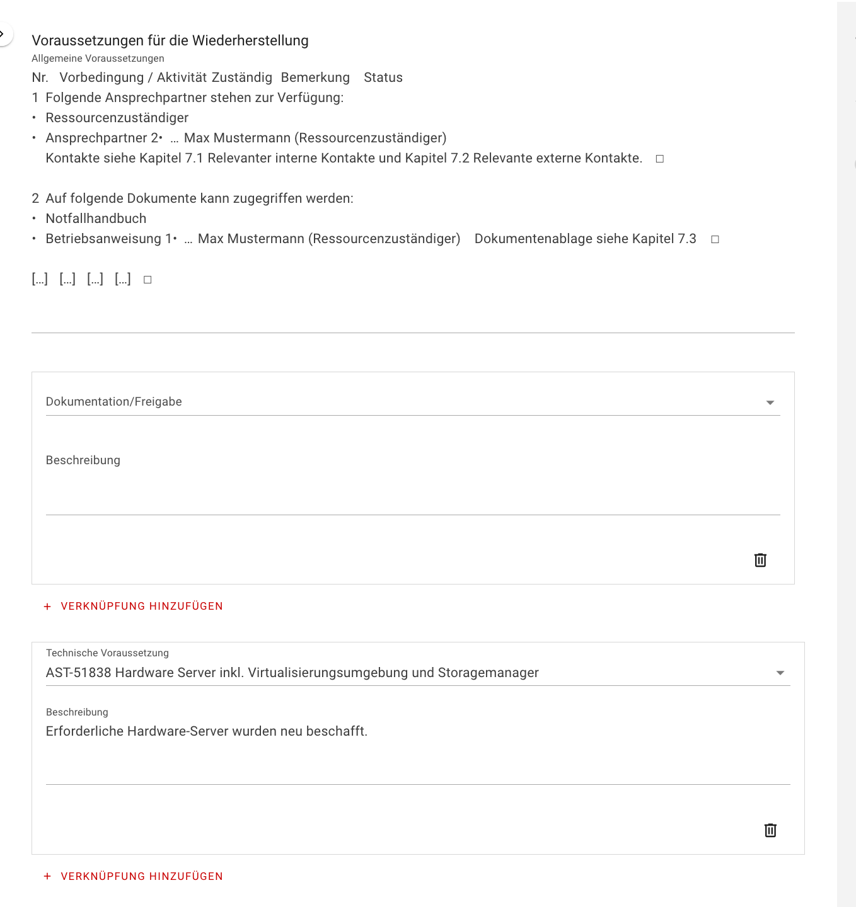

6.	Notbetriebsniveau und zusätzliche Maßnahmen beschreiben: Dokumentieren Sie das zu erreichende Mindestniveau im Notbetrieb sowie etwaige Sondermaßnahmen.

### Erstellung der Ablaufpläne & Aktivitäten (im Teile-Tab der BC-Lösung)

Nach der Erfassung der Grunddaten legen Sie im Teile-Tab der BC-Lösung die Ablaufpläne als Sammel-Objekte (Composites) und deren einzelne Aktivitäten vom Typ Notfallmaßnahme wie folgt an:

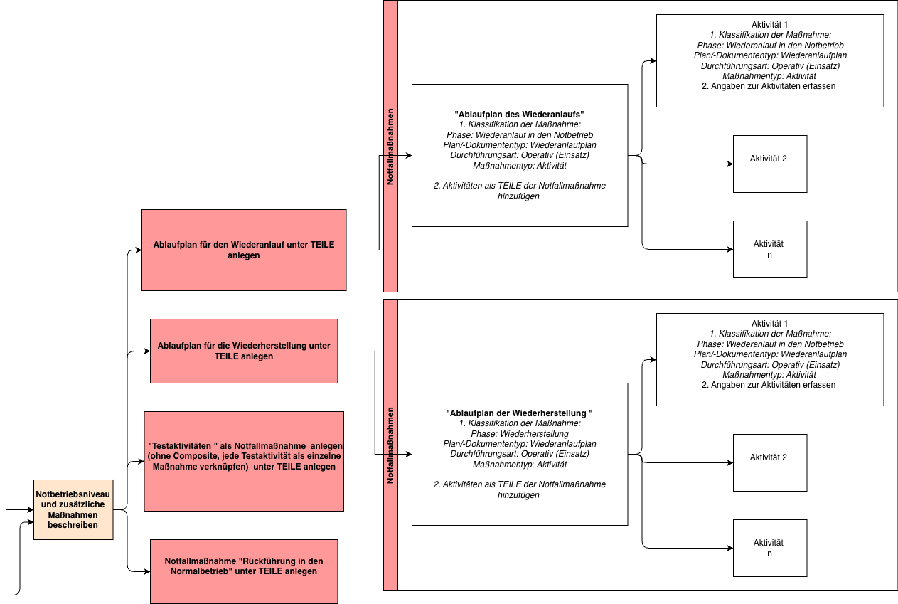

Legen Sie im Teile-Tab der BC-Lösung die benötigten Maßnahmen-Objekte an:

1. Ablaufplan für den Wiederanlauf unter dem Teile-Tab anlegen: Erstellen Sie ein Composite-Objekt (Typ Notfallmaßnahme) als Sammelbehälter für alle Aktivitäten des Wiederanlaufs.
2.	Ablaufplan für die Wiederherstellung unter dem Teile-Tab anlegen:
- Erstellen Sie ein zweites Composite-Objekt (Typ Notfallmaßnahme) als Sammelbehälter für die Schritte zur vollständigen Wiederherstellung.
3.	Testaktivitäten als Notfallmaßnahme anlegen:
- Legen Sie diese unter dem Teile-Tab an (ohne Composite; jede Testaktivität wird als einzelne Maßnahme verknüpft).
4.	Notfallmaßnahme "Rückführung in den Normalbetrieb" unter dem Teile-Tab anlegen:
- Erfassen Sie dieses Objekt für die geordnete Rückkehr in den Regelbetrieb.
5.	Optional: Legen Sie bei Bedarf Korrektur- und Verbesserungsmaßnahmen an.

#### Detaillierung der Composite-Ablaufpläne & Aktivitäten
Fügen Sie den erstellten Composite-Ablaufplänen  die einzelnen Schritte als untergeordnete Teile (Typ Notfallmaßnahme) hinzu und klassifizieren Sie diese sowie das Composite wie folgt:

A. Ablaufplan des Wiederanlaufs
1.	Composite-Einstellung ("Ablaufplan des Wiederanlaufs"):
- Klassifikation der Maßnahme:
   - Phase: Wiederanlauf in den Notbetrieb
   - Plan-/Dokumententyp: Wiederanlaufplan
   - Durchführungsart: Operativ (Einsatz)
   - Maßnahmentyp: Aktivität

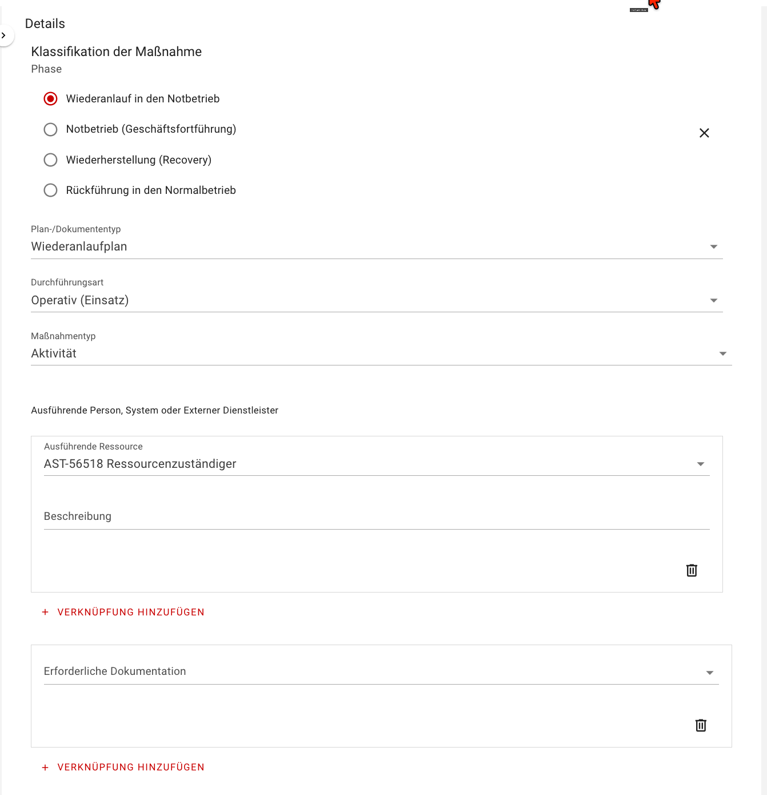

- Fügen Sie anschließend die einzelnen Aktivitäten als Teile der Notfallmaßnahme hinzu.

2.	Aktivitäten unterteilen & erfassen (Aktivität 1, Aktivität 2, ... Aktivität n):
- Klassifikation der jeweiligen Aktivität:
   - Phase: Wiederanlauf in den Notbetrieb
   - Plan-/Dokumententyp: Wiederanlaufplan
   - Durchführungsart: Operativ (Einsatz)
   - Maßnahmentyp: Aktivität
- Angaben zur Aktivität erfassen:
   - Detaillierte Beschreibung der Handlungsschritte, Prüfschritte, erwartete Dauer und erforderliche Dokumentation, ausführendes System und zuständige Person, nachgelagerte Aktivität sowie weitere Hinweise

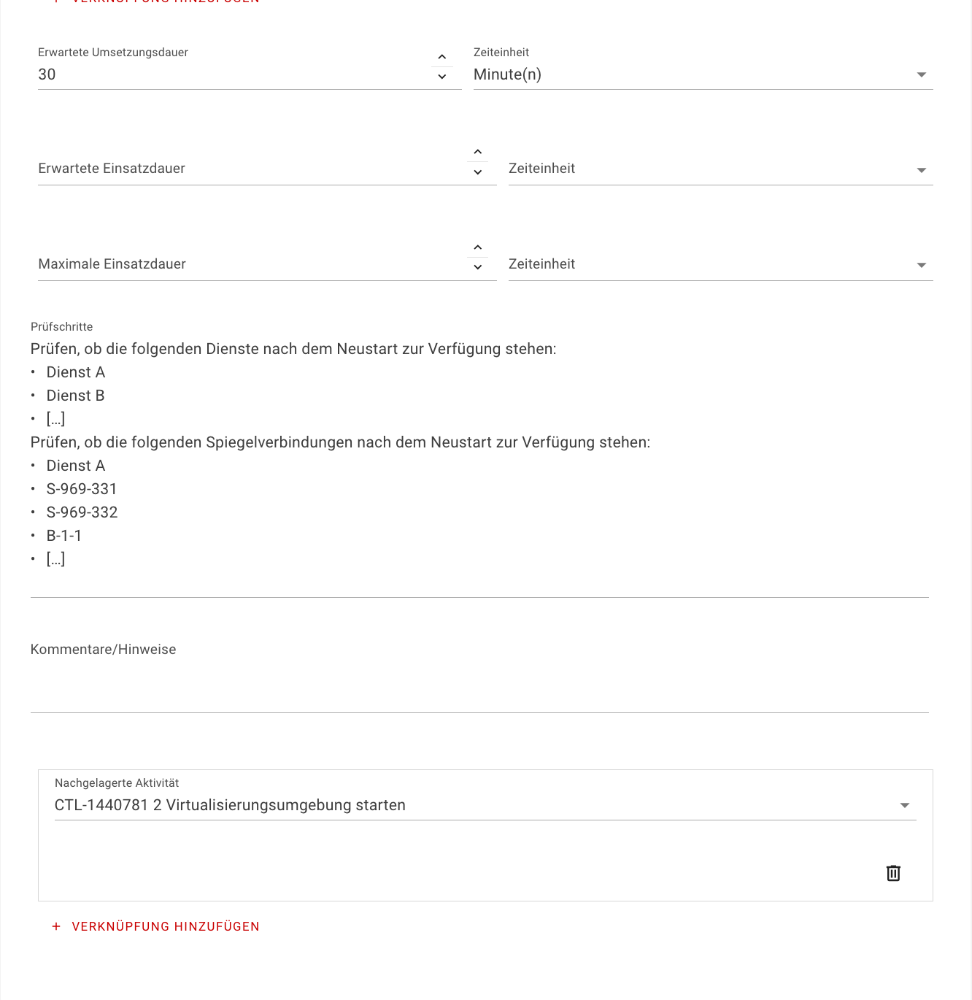

B. Ablaufplan der Wiederherstellung

1. Composite-Einstellung ("Ablaufplan der Wiederherstellung"): 
- Klassifikation der Maßnahme:
   - Phase: Wiederherstellung
   - Plan-/Dokumententyp: Wiederanlaufplan
   - Durchführungsart: Operativ (Einsatz)
   - Maßnahmentyp: Aktivität

- Fügen Sie anschließend die einzelnen Aktivitäten als Teile der Notfallmaßnahme hinzu.

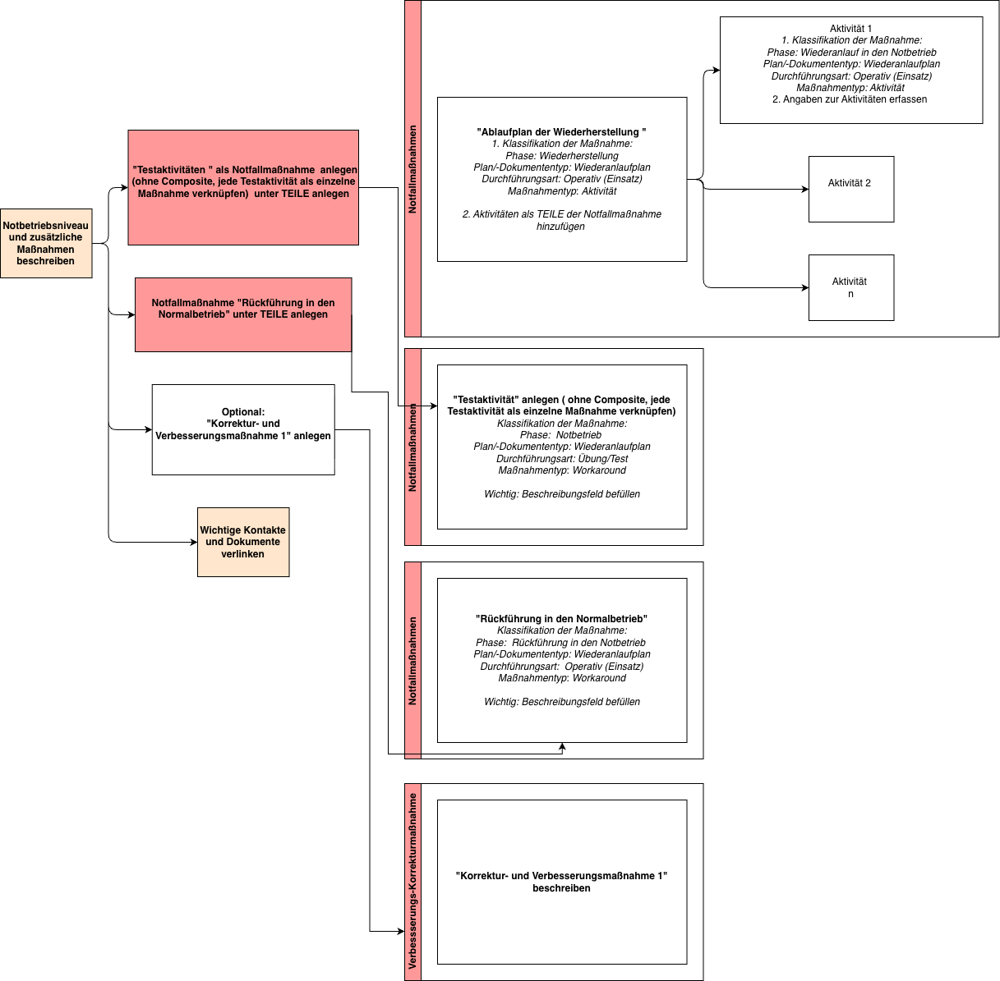

2. Aktivitäten unterteilen & erfassen (Aktivität 1, Aktivität 2, ... Aktivität n)

- Klassifikation der jeweiligen Aktivität:
   - Phase: Wiederherstellung (Anmerkung: Achten Sie darauf, hier im Feld Phase „Wiederherstellung“ auszuwählen)
   - Plan-/Dokumententyp: Wiederanlaufplan
   - Durchführungsart: Operativ (Einsatz)
   - Maßnahmentyp: Aktivität
- Angaben zur Aktivität erfassen:
   - Detaillierte Beschreibung der Wiederherstellungsschritte.

C. Testaktivitäten in der BC-Lösung anlegen (ohne Composite; jede Testaktivität wird als einzelne Notfallmaßnahme verknüpft), 
- 1. Klassifikation der Maßnahme:
   - Phase: Notbetrieb
   - Plan-/Dokumententyp: Wiederanlaufplan
   - Durchführungsart: Übung/Test
   - Maßnahmentyp: Workaround
- 2.	Dokumentation: Wichtig: Das Beschreibungsfeld der Maßnahme muss vollständig befüllt werden.

D. Maßnahmen zur Rückführung in den Normalbetrieb ergänzen (ohne Composite; jede Testaktivität wird als einzelne Notfallmaßnahme verknüpft).

1.	Klassifikation der Maßnahme:
- Phase: Rückführung in den Normalbetrieb
- Plan-/Dokumententyp: Wiederanlaufplan
- Durchführungsart: Operativ (Einsatz)
- Maßnahmentyp: Workaround

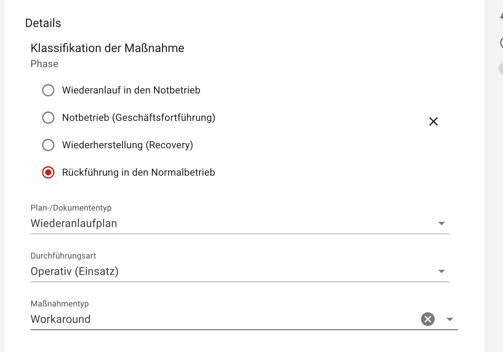

2.	Dokumentation:
-  Die Maßnahme muss in dem Beschreibungsfeld beschrieben werden, z.B. das konkrete Vorgehen zur geordneten Rückkehr in den Regelbetrieb und Zuweisung der verantwortlichen Person.

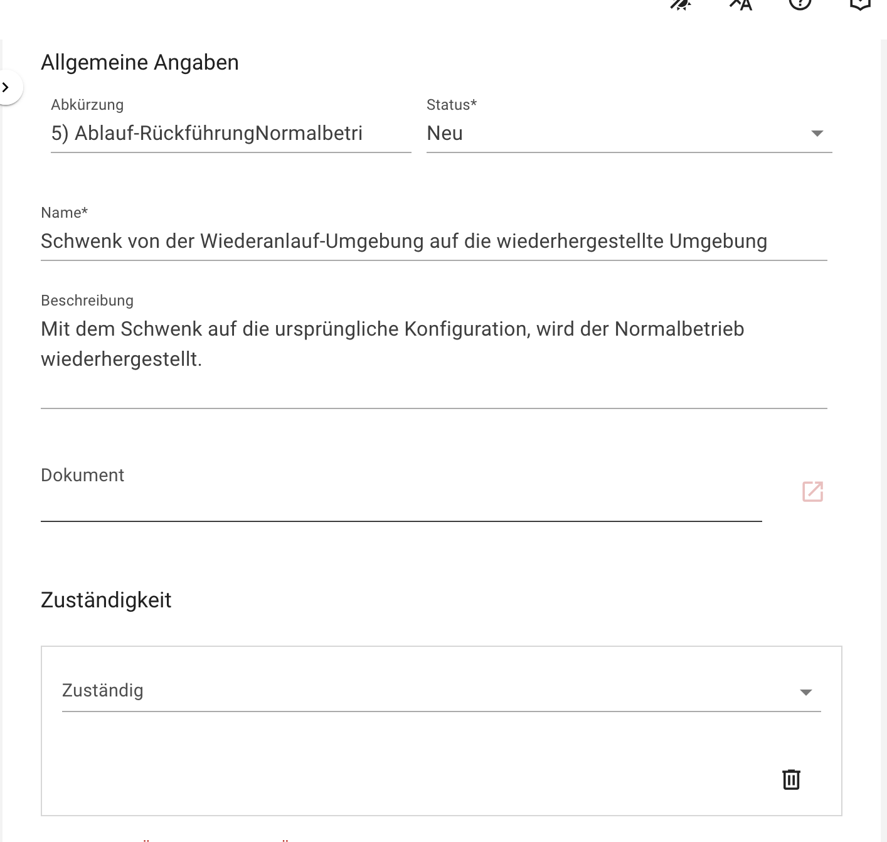

E. Optionale Folgeschritte
1.	Erfassen und beschreiben Sie bei Bedarf Maßnahmen zur kontinuierlichen Verbesserung (z. B. Erkenntnisse aus Tests oder vergangenen Notfällen).
2.	Wichtige Kontakte und Dokumente verlinken:
- Verknüpfen Sie abschließend alle relevanten Ansprechpartner, Notfallkontakte und begleitenden Dokumente in der BC-Lösung.

Verknüpfen Sie im Anschluss – falls dies nicht bereits initial geschehen ist – das fertige Objekt zum Wiederanlauf im übergeordneten Ressourcen-Objekt unter dem Bereich **Notfallplanung**.