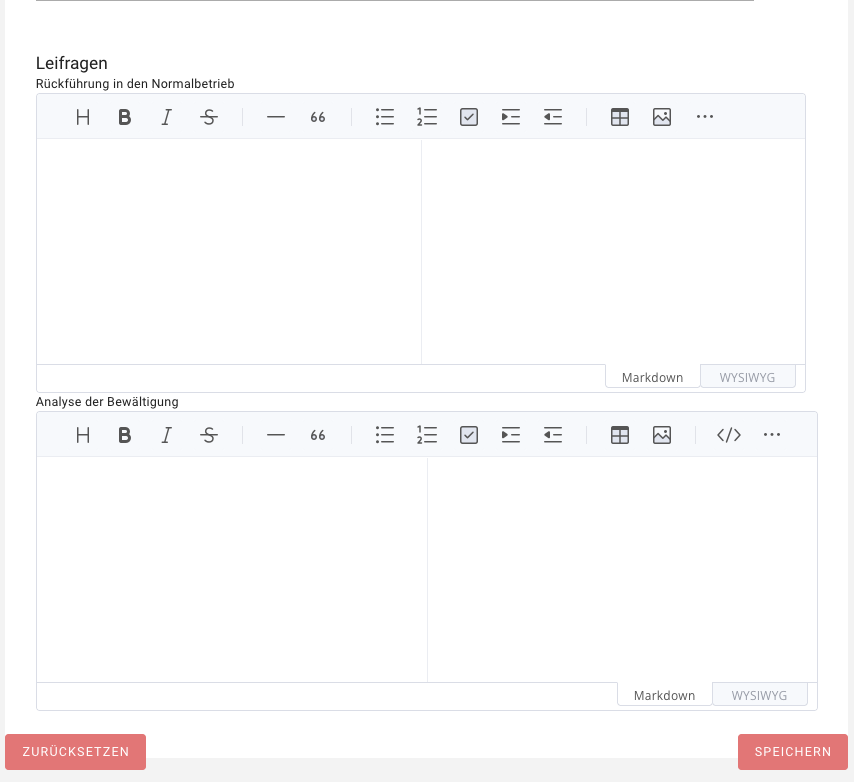

<!-- © 2025 The Project Contributors - see AUTHORS.txt -->
# Planung der Notfall- und Krisenbewältigung

Ziel der Notfall- und Krisenbewältigung ist es, sicherzustellen, dass die Institution bei Eintritt eines gravierenden Schadensereignisses handlungsfähig bleibt, Schäden minimiert und die Kontinuität kritischer Geschäftsprozesse gewährleistet. Hierzu werden organisatorische, personelle und kommunikative Maßnahmen definiert, die eine strukturierte Reaktion und Wiederherstellung ermöglichen, auch ohne unmittelbaren Rückgriff auf detaillierte Notfallpläne.

## Aufbau einer Besonderen Aufbauorganisation (BAO)

Zur wirksamen Steuerung von Notfällen und Krisen ist eine **Besondere Aufbauorganisation (BAO)** einzurichten und einsatzfähig zu halten.

Die BAO umfasst alle erforderlichen organisatorischen Einheiten, Rollen und Kommunikationsstrukturen, um im Not- und Krisenfall schnell und koordiniert handeln zu können. Die organisatorischen Maßnahmen zur Etablierung der BAO sollten dokumentiert und in einem **Notfallhandbuch** zusammengefasst werden. Dieses dient den Verantwortlichen als operative Grundlage, um einen geordneten Notbetrieb zu gewährleisten und eine Rückkehr in den Normalbetrieb sicherzustellen. Regelungen, die den Notbetrieb in den einzelnen Organisationseinheiten betreffen, sind in den entsprechenden Dokumenten zur Geschäftsfortführung, Wiederanlauf und Wiederherstellung hinterlegt.

## Definition und Umsetzung von Sofortmaßnahmen

Sofortmaßnahmen sind unmittelbar nach Eintritt eines Schadensereignisses umzusetzen und dienen dem Schutz von Leben und Gesundheit sowie der Eindämmung von Folgeschäden. In verinice können sowohl allgemeine Sofortmaßnahmen als auch szenariospezifische Sofortmaßnahmen erfasst und mit Verantwortlichkeiten verknüpft werden.

Legen Sie unter dem Subtyp Sofortmaßnahme eine neue Maßnahme an und ergänzen Sie die zugehörigen Aktivitäten über den Reiter **Teile**. 

Anschließend können alle Sofortmaßnahmen im Notfallhandbuch 

oder szenario-spezifische Sofortmaßnahmen im Ausfallszenario verknüpft und zusammengefasst werden.

Ziel ist es, alle Sofortmaßnahmen zentral in verinice zu dokumentieren und  übersichtlich in einem Report des Notfallhandbuchs auszugeben.

## Aufbau und Steuerung der Notfall- und Krisenkommunikation (NuK-Kommunikation)

Das **Notfall- und Krisenkommunikationsteam (NuK-Team)** ist Bestandteil der BAO und trägt die Verantwortung für eine strukturierte, kontrollierte und zeitgerechte Kommunikation im Not- und Krisenfall. Die Organisation ist verpflichtet, Prozesse für interne und externe Kommunikation zu planen, einzurichten und aufrechtzuerhalten.
Auf Grundlage der Analyse der Interessengruppen können für jede Interessengruppe die Kommunikationsanforderungen in verinice dokumentiert werden. Hierzu sind insbesondere folgende Felder zu befüllen:

- Kommunikation im Notbetrieb  
- Zeitintervall  
- Kommunikationsweg  

Zudem können Rollen oder explizierte Personen verknüpft werden, um Kommunikationsverantwortlichkeiten transparent darzustellen. So lässt sich nachvollziehen, wer Informationen bereitstellt, empfängt oder freigibt und sicherstellen, dass im Ereignisfall eine koordinierte und kontrollierte Informationsweitergabe erfolgt.

## Nacharbeitung und Deeskalation eines Schadensereignisses 

Nach erfolgreicher Bewältigung eines Ereignisses erklärt der Krisenstab den Notfall offiziell für beendet (Deeskalation). Diese Entscheidung ist innerhalb der Institution zu kommunizieren, vorzugsweise über dieselben Kommunikationskanäle, die für die Alarmierung verwendet wurden. Zur strukturierten Rückführung in den Normalbetrieb können Checklisten eingesetzt werden. 

Das Ereignis wird in verinice als Vorfall-Objekt dokumentiert. In diesem Objekt können **Leitfragen zur Rückführung in den Normalbetrieb** und zur **Analyse der Bewältigung** hinterlegt werden. 

# Notfallhandbuch per Report erstellen

Das Notfallhandbuch bündelt alle Aspekte zur Notfallbewältigung und dient im Ernstfall auch als zentrale Unterstützung bei der Krisenbewältigung. Es wird in der Regel durch den BCM-Beauftragten erstellt. 

Der Aufbau des Notfallhandbuchs in verinice orientiert sich eng an der offiziellen Dokumentenvorlage des BSI (nach BSI-Standard 200-4). Es deckt alle relevanten Anforderungen aus Kapitel 6.4 (Aufbau und Befähigung der BAO) ab, die eine Dokumentation im Rahmen des Notfallhandbuchs voraussetzen. Zudem werden die in den Kapiteln 6.9 (Geschäftsfortführungspläne) und 6.10 (Wiederanlaufpläne) behandelten operativen Notfallpläne direkt im Notfallhandbuch dokumentiert oder von dort aus referenziert.

## Zentrale Inhalte des Notfallhandbuchs

Das verinice-Modul strukturiert das Notfallhandbuch in folgende Kernbereiche:

* Allgemeine Informationen: Zielsetzung, Geltungsbereich und grundlegende Definitionen des Notfallhandbuchs.

* Sofortmaßnahmen: Erste Verhaltensweisen und Schutzmaßnahmen unmittelbar nach Eintritt eines Ereignisses.

* Alarmierung und Eskalation: Dokumentation der Meldekette. Nutzen Sie hierfür die spezifischen Custom-Links, um die genauen Meldewege (z. B. den Eskalations- und Alarmierungspfad) direkt zu verknüpfen.

* Detektion und Meldung: Kriterien zur Erkennung von Notfällen. Über Custom-Links lassen sich hier vordefinierte Leitfragen zur ersten Lageeinschätzung verlinken.

* Alarmierung der BAO: Prozesse und Zuständigkeiten zur Einberufung der Besonderen Aufbauorganisation.

* Stabsraum: Dokumentation der Standorte und Erreichbarkeiten der Stabsräume sowie deren technische Ausstattung und Vorbereitung.

* Stabsarbeit: Richtlinien für die Arbeit im Krisenstab. Nutzen Sie den Custom-Link, um direkt auf die geltenden Grundsätze der Stabsarbeit zu verweisen.

* Geschäftsfortführungspläne (GFP): Referenzierung der Pläne zur Aufrechterhaltung kritischer Geschäftsprozesse.

* Wiederanlauf- und Wiederherstellungspläne (WAP/WHP): Referenzierung der technischen und organisatorischen Pläne zur Wiederinbetriebnahme ausgefallener Ressourcen.

* Überführung in den Normalbetrieb: Erforderliche Maßnahmen zur geordneten Rückkehr in den Regelbetrieb, Prozesse zur Deeskalation, Analyse und Bewertung der erfolgten Notfallbewältigung (Lessons Learned).

* Regelungen zur regelmäßigen Überprüfung und Aktualisierung des Notfallhandbuchs.

* Geschäftsordnung des Stabs: Regelungen und Kompetenzen für die Mitglieder des Krisenstabes.

* Referenzdokumente & Kommunikationsmedien: Übersicht der im Notfall verfügbaren, redundanten Kommunikationsmittel sowie mitgeltender Unterlagen.

* Wichtige Kontakte: Zentrale Telefonnummern, Ansprechpartner und Erreichbarkeiten aller internen und externen Schlüsselpersonen.

## Generierung des Handbuchs

Nachdem Sie die oben genannten Inhalte und Verknüpfungen in Ihrer BCM-Domäne gepflegt haben, können Sie das vollständige, standardkonforme Dokument jederzeit automatisch über die Report-Funktion in verinice exportieren und als fertiges Notfallhandbuch bereitstellen.

# Zukünftige Weiterentwicklungen

Das verinice.TEAM plant die Erweiterung von verinice um Funktionen zur Digitalisierung der Notfall- und Krisenbewältigung oder um Schnittstellen zu anderen geeigneten Tools. 
Schwerpunkte sind das Management von Meldewegen, die Alarmierung der BAO sowie die Unterstützung der Stabsarbeit. 