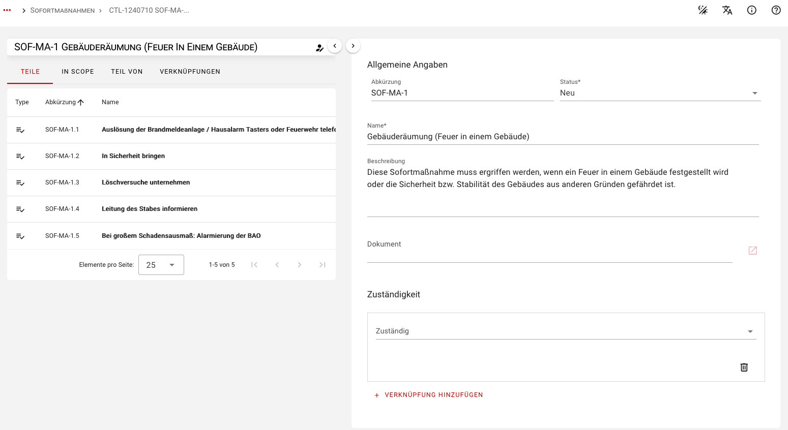
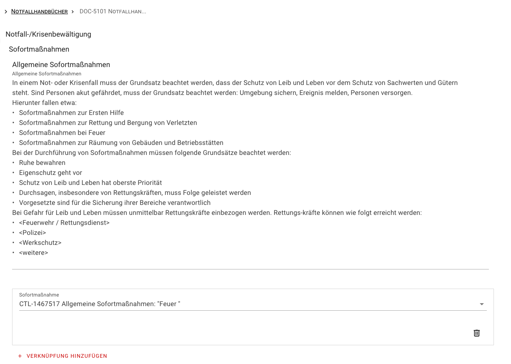
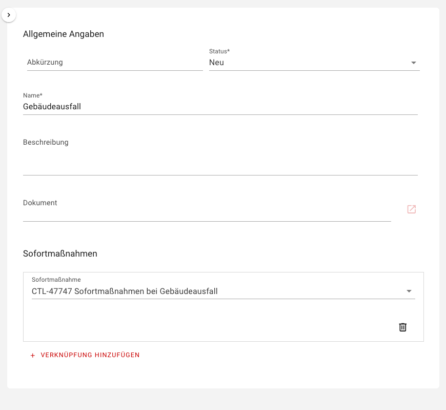
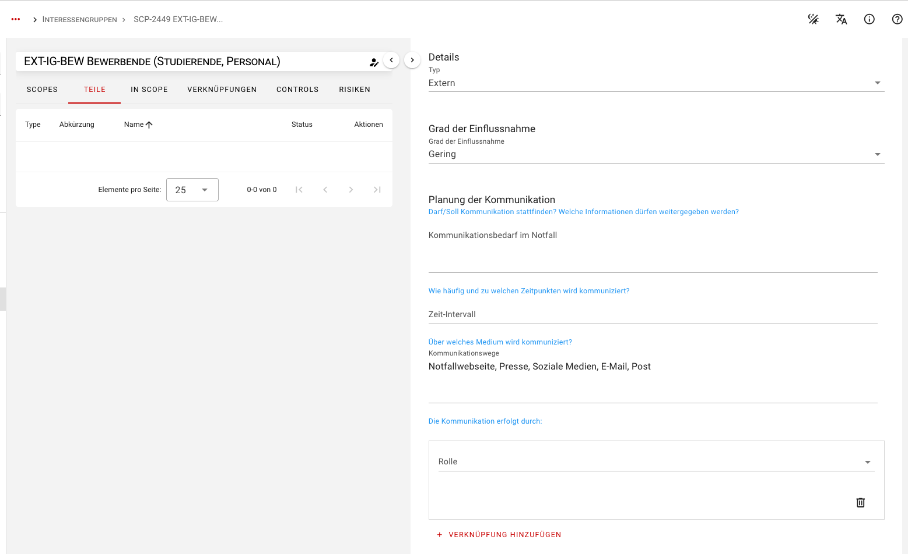
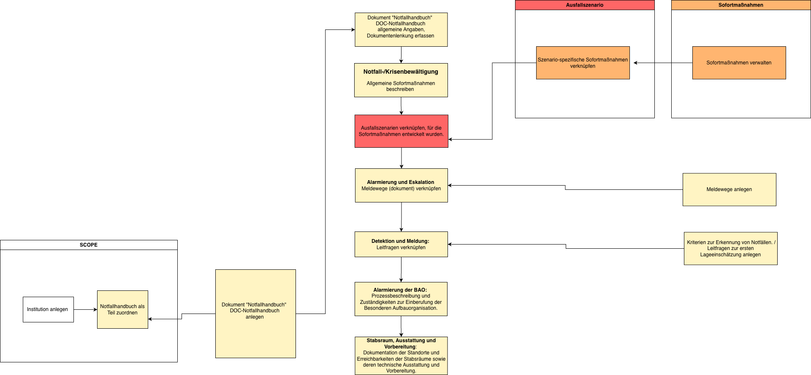
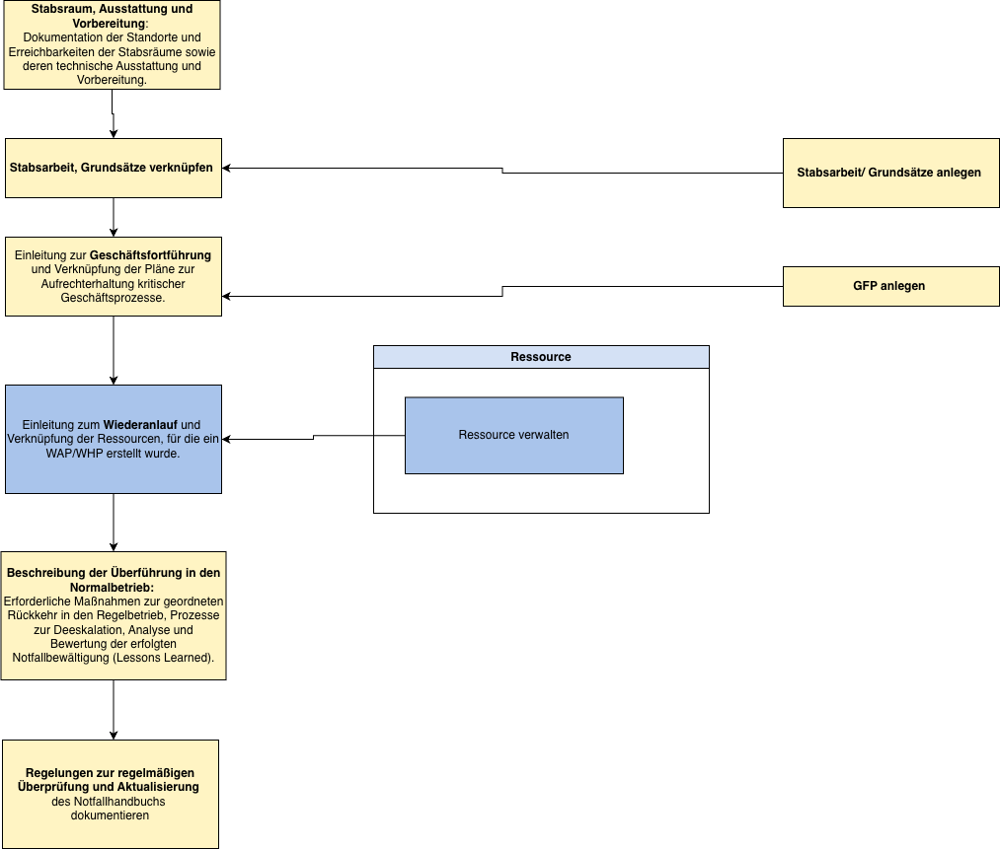
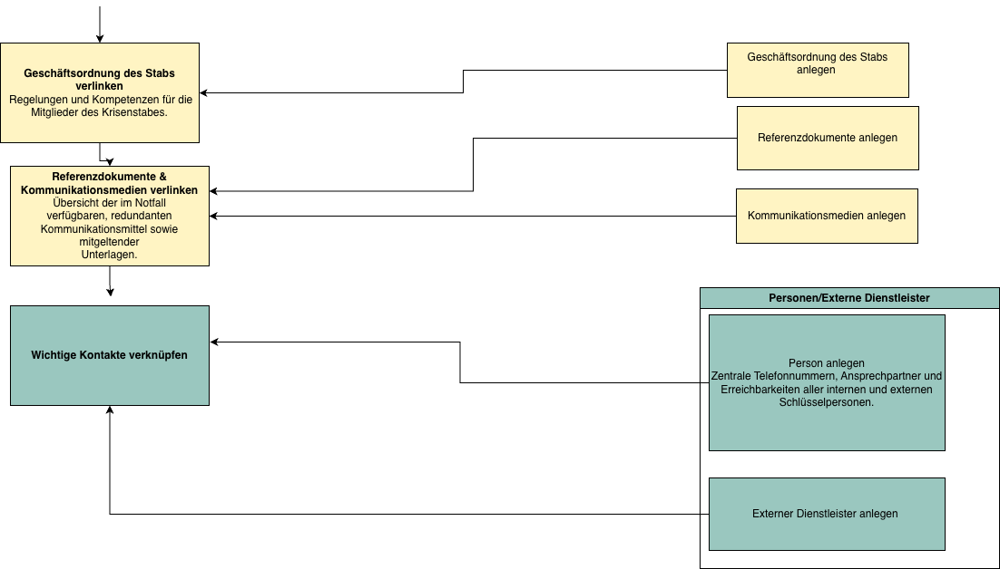

<!-- © 2025 The Project Contributors - see AUTHORS.txt -->
# Planung der Krisenbewältigung

Ziel der Krisenbewältigung ist es, sicherzustellen, dass die Institution bei Eintritt eines gravierenden Schadensereignisses handlungsfähig bleibt, Schäden minimiert und die Kontinuität kritischer Geschäftsprozesse gewährleistet. Hierzu werden organisatorische, personelle und kommunikative Maßnahmen definiert, die eine strukturierte Reaktion und Wiederherstellung ermöglichen, auch ohne unmittelbaren Rückgriff auf detaillierte Notfallpläne.

## Aufbau und Befähigung der Besonderen Aufbauorganisation (BAO)

Zur wirksamen Steuerung von Notfällen und Krisen ist eine **Besondere Aufbauorganisation (BAO)** einzurichten und einsatzfähig zu halten.

Die BAO umfasst alle erforderlichen organisatorischen Einheiten, Rollen und Kommunikationsstrukturen, um im Not- und Krisenfall schnell und koordiniert handeln zu können. Die organisatorischen Maßnahmen zur Etablierung der BAO sollten dokumentiert und in einem **Notfallhandbuch** zusammengefasst werden. Dieses dient den Verantwortlichen als operative Grundlage, um einen geordneten Notbetrieb zu gewährleisten und eine Rückkehr in den Normalbetrieb sicherzustellen. Regelungen, die den Notbetrieb in den einzelnen Organisationseinheiten betreffen, sind in den entsprechenden Dokumenten zur Geschäftsfortführung, Wiederanlauf und Wiederherstellung hinterlegt.

### Definition und Umsetzung von Sofortmaßnahmen

Sofortmaßnahmen sind unmittelbar nach Eintritt eines Schadensereignisses umzusetzen und dienen dem Schutz von Leben und Gesundheit sowie der Eindämmung von Folgeschäden. In verinice können sowohl allgemeine Sofortmaßnahmen als auch szenariospezifische Sofortmaßnahmen erfasst und mit Verantwortlichkeiten verknüpft werden.

Legen Sie unter dem Subtyp Sofortmaßnahme eine neue Maßnahme an und ergänzen Sie die zugehörigen Aktivitäten über den Reiter **Teile**. 

Anschließend können alle Sofortmaßnahmen im Notfallhandbuch 

oder szenario-spezifische Sofortmaßnahmen im Ausfallszenario verknüpft und zusammengefasst werden.

Ziel ist es, alle Sofortmaßnahmen zentral in verinice zu dokumentieren und  übersichtlich in einem Report des Notfallhandbuchs auszugeben.

### Aufbau und Steuerung der Notfall- und Krisenkommunikation (NuK-Kommunikation)

Das **Notfall- und Krisenkommunikationsteam (NuK-Team)** ist Bestandteil der BAO und trägt die Verantwortung für eine strukturierte, kontrollierte und zeitgerechte Kommunikation im Not- und Krisenfall. Die Organisation ist verpflichtet, Prozesse für interne und externe Kommunikation zu planen, einzurichten und aufrechtzuerhalten.
Auf Grundlage der Analyse der Interessengruppen können für jede Interessengruppe die Kommunikationsanforderungen in verinice dokumentiert werden. Hierzu sind insbesondere folgende Felder zu befüllen:

- Kommunikation im Notfall  
- Zeitintervall  
- Kommunikationsweg  

Zudem können Rollen oder explizierte Personen verknüpft werden, um Kommunikationsverantwortlichkeiten transparent darzustellen. So lässt sich nachvollziehen, wer Informationen bereitstellt, empfängt oder freigibt und sicherstellen, dass im Ereignisfall eine koordinierte und kontrollierte Informationsweitergabe erfolgt.

### Nacharbeitung und Deeskalation eines Schadensereignisses 

Nach erfolgreicher Bewältigung eines Ereignisses erklärt der Krisenstab den Notfall offiziell für beendet (Deeskalation). Diese Entscheidung ist innerhalb der Institution zu kommunizieren, vorzugsweise über dieselben Kommunikationskanäle, die für die Alarmierung verwendet wurden. Zur strukturierten Rückführung in den Normalbetrieb können Checklisten eingesetzt werden. 

Das Ereignis wird in verinice als Vorfall-Objekt dokumentiert. In diesem Objekt können **Leitfragen zur Rückführung in den Normalbetrieb** und zur **Analyse der Bewältigung** hinterlegt werden. 

## Erstellung eines Notfallhandbuchs in verinice

Als zentrales Instrument im Notfall bündelt das Notfallhandbuch alle übergeordneten Richtlinien, Sofortmaßnahmen, Alarmierungswege und Stabsstrukturen. Es dient im Ernstfall als verlässlicher Leitfaden zur Krisenbewältigung und führt sämtliche Referenzen zu den operativen Wiederanlauf-, Wiederherstellungs- und Geschäftsfortführungsplänen zusammen. Die Erstellung erfolgt in der Regel durch die BCM-Beauftragten. Der Aufbau des Notfallhandbuchs in verinice orientiert sich dabei eng an der offiziellen BSI-Dokumentenvorlage nach BSI-Standard 200-4. Es deckt alle Anforderungen aus Kapitel 6.4 (Aufbau und Befähigung der BAO) ab und integriert bzw. referenziert die operativen Notfallpläne aus den Kapiteln 6.9 und 6.10.

Die folgende Anleitung führt Sie Schritt für Schritt durch die entsprechende Modellierung in verinice.

### Initialisierung & Scope-Zuordnung
- Legen Sie eine Institution an.
- Erstellen Sie im Bereich Dokument das zentrale Dokumenten-Objekt "Notfallhandbuch".
- Ordnen Sie das Notfallhandbuch-Objekt als Teil zu.

### Verwalten des Notfallhandbuchs 
Öffnen Sie das neu angelegte Objekt und arbeiten Sie die Abschnitte im Formular ab. Verknüpfen Sie dabei die jeweils zugehörigen Objekte aus anderen Subtypen:
 - Grundangaben & Sofortmaßnahmen: Erfassen Sie im Objekt die Stammdaten (Zielsetzung, Geltungsbereich, Versionsstand, Dokumentenlenkung)

- Notfall-/Krisenbewältigung: Beschreiben Sie allgemeine Sofortmaßnahmen und szenario-spezifische Sofortmaßnahmen. Verknüpfen Sie hierfür die Notfallszenarien, für die Sofortmaßnahmen entwickelt wurden.
- Dokumentieren Sie die Meldewege: Verlinken Sie die im Bereich Dokument angelegten Meldewege.
- Detektion und Meldung: Verlinken Sie die vordefinierten Leitfragen zur ersten Lageeinschätzung (Kriterien zur Erkennung von Notfällen / Leitfragen zur ersten Lageeinschätzung).
- Alarmierung der BAO: Dokumentieren Sie Prozessablauf, Auslösekriterien und Zuständigkeiten zur Einberufung der Besonderen Aufbauorganisation (Krisenstab).
- Stabsraum & Stabsarbeit: Dokumentieren Sie Standorte, Erreichbarkeiten, technische Ausstattung und Vorbereitungsmaßnahmen der Stabsräume.

- Stabsarbeit: Verlinken Sie vorhandene Dokuemente zur Stabsarbeit / Grundsätze.
- Referenzierung der Pläne (GFP & WAP/WHP): Verlinken Sie die erstellten  Geschäftsfortführungspläne zur Aufrechterhaltung kritischer Geschäftsprozesse und verlinken Sie die Ressourcen für die ein WAP/WHP erstellt wurde.
- Beschreiben Sie die erforderlichen Maßnahmen zur geordneten Rückkehr in den Regelbetrieb (Deeskalation, Analyse & Lessons Learned).
- Erfassen Sie die Review-Intervalle und Verantwortlichkeiten zur Aktualisierung des Handbuchs.

- Verknüpfen Sie die Geschäftsordnung des Stabs
- Verlinken Sie die relevanten Referenzdokumente sowie Kommunikationsmedien (redundante Notfall-Kommunikationsmittel).
- Verlinken Sie die zentralen Ansprechpartner aus dem Bereich Personen / Externe Dienstleister

### Generierung des Handbuchs

Sobald alle genannten Abschnitte befüllt und die entsprechenden Objekte über Custom-Links verknüpft sind:
1. Navigieren Sie in verinice zum Bereich Reports.
2.	Wählen Sie die Report-Vorlage für das Notfallhandbuch aus.
3.	Exportieren Sie das Dokument. verinice generiert automatisch ein vollständiges, standardkonformes Notfallhandbuch inklusive aller Ablageorte und Links der verknüpften Pläne, Kontakte und Meldewege.