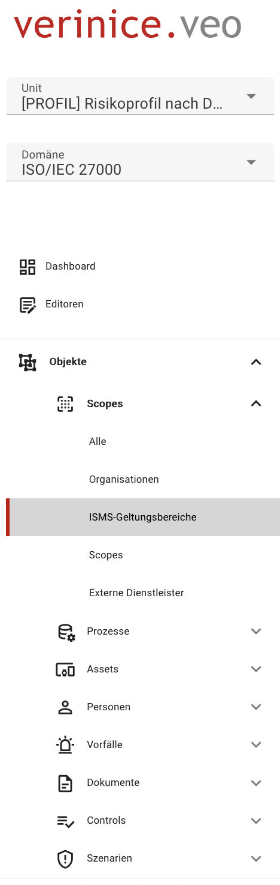
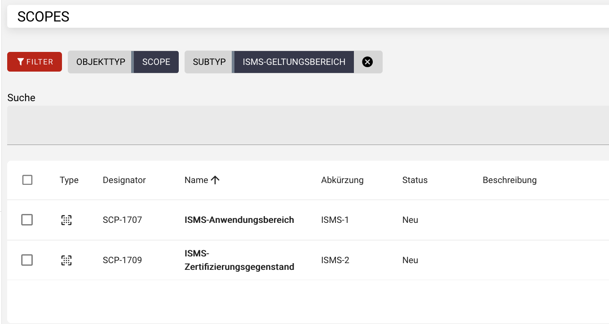
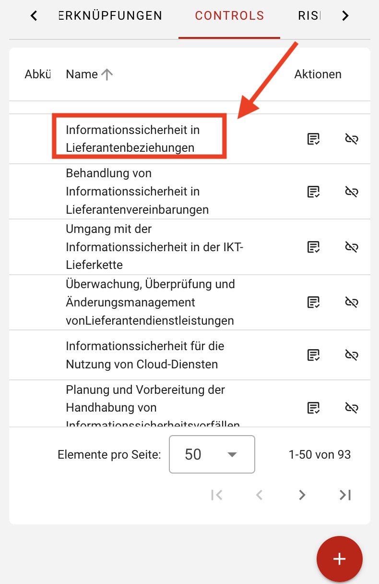
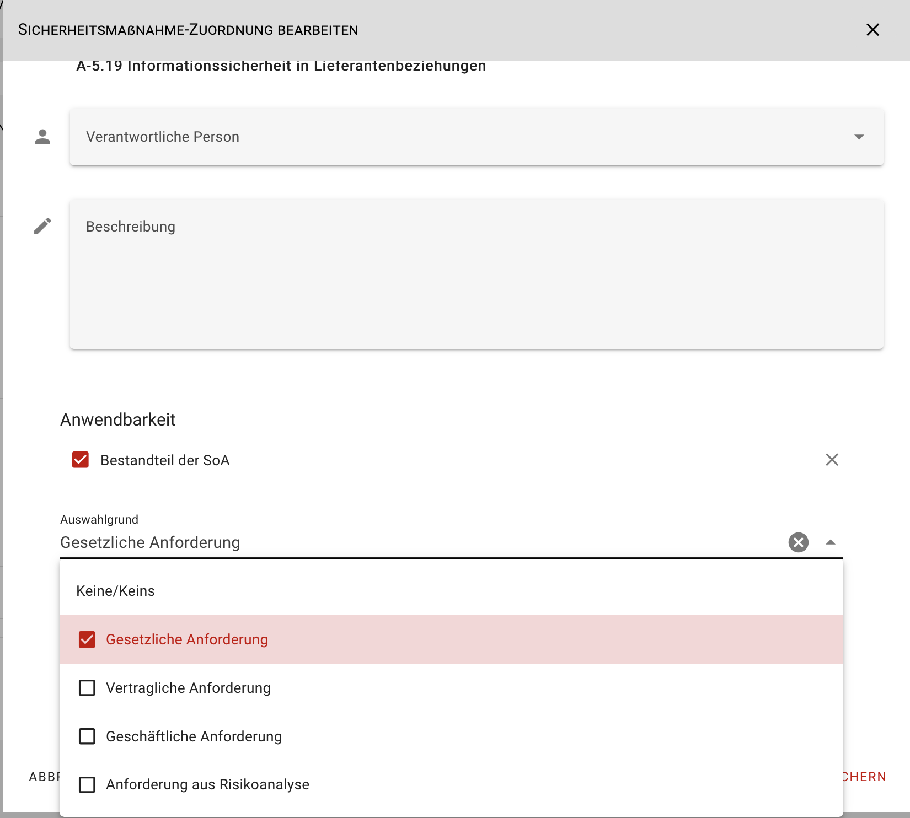
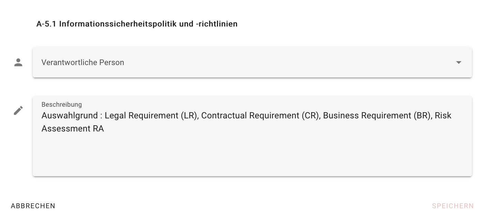
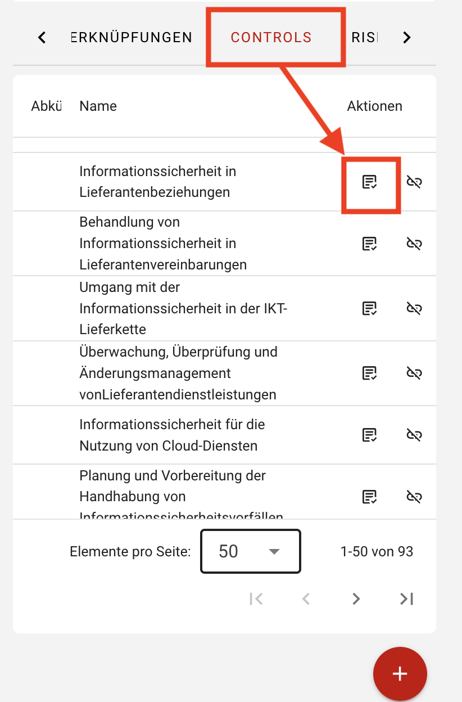
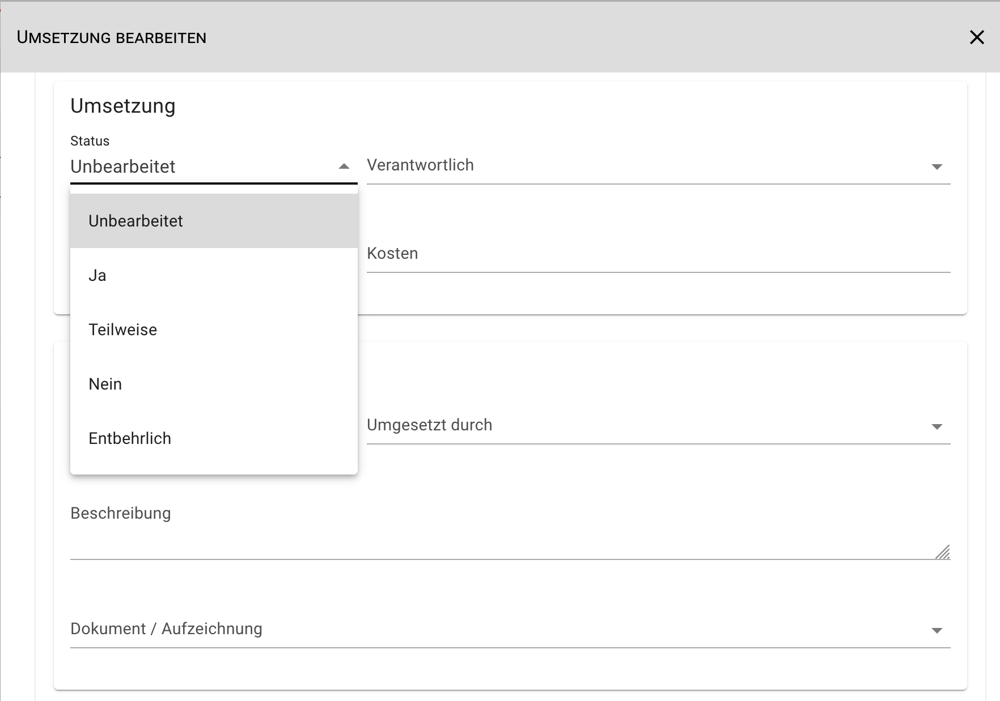
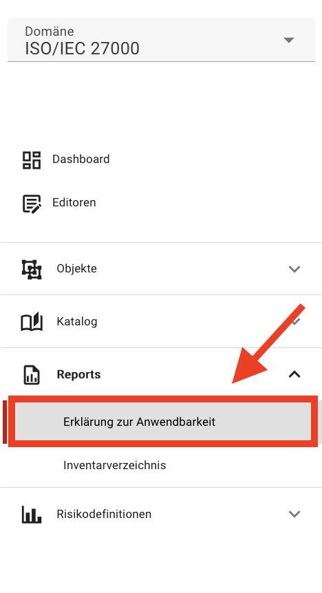

<!-- © 2025 The Project Contributors - see AUTHORS.txt -->
# Erklärung zur Anwendbarkeit (SoA)

## Ziel der Funktion

Die Erklärung zur Anwendbarkeit (Statement of Applicability – SoA) dient als zentrales Element des ISMS nach ISO/IEC 27001. In dieser Funktion von verinice dokumentieren Sie:

1. welche **Sicherheitsmaßnahmen aus Anhang A der ISO/IEC 27001** auf den definierten ISMS-Anwendungsbereich zutreffen,
1. aus welchem Grund sie anwendbar sind oder ausgeschlossen sind und
1. wie der aktuelle Umsetzungsstatus dieser Maßnahmen ist.

## Grundlagen: Scope-Objekte

In verinice steht für diesen Zweck der Scope-Subtyp **ISMS-Geltungsbereiche** zur Verfügung:

Es können beliebig viele Geltungsbereiche angelegt werden, wie z.B.:

- **ISMS-Anwendungsbereich**: Beschreibt den organisatorischen und systemtechnischen Geltungsbereich des ISMS. Dieses Objekt kann die Grundlage für die Bewertung und die Anwendbarkeit von Sicherheitsmaßnahmen bilden.
- **Zertifizierungsgegenstand**: Beschreibt den konkreten Teil des Unternehmens, der zertifiziert werden soll.

## Sicherheitsmaßnahmen prüfen und Anwendbarkeit dokumentieren

### Auswahl des ISMS-Anwendungsbereichs

Navigieren Sie im Menü unter **Objekte** zu **Scopes** und dann zu **ISMS-Geltungsbereiche**. Im rechten unteren Rand des Bildschirms können Sie über den Plus-Button einen ISMS-Geltungsbereich anlegen und es im Formular beschreiben.

Alternativ wählen Sie im Dashboard den Subtyp **ISMS-Geltungsbereiche** und erstellen in der Objektübersicht ein entsprechendes Objekt.

### Zugriff auf die SoA-Funktion

Öffnen Sie den angelegten **ISMS-Geltungsbereich** und wählen Sie den Tab-Reiter **Controls**. Über die Plus-Schaltfläche **Sicherheitsmaßnahmen verknüpfen** können Sie die anwendbaren Sicherheitsmaßnahmen für die Erklärung zur Anwendbarkeit auswählen und speichern. Wenn der **Katalog ISO/IEC 27001** bereits auf Ihre Unit angewendet wurde, wird die Liste der Sicherheitsmaßnahmen aus Anhang A der ISO/IEC 27001 automatisch geladen.

In der Liste müssen alle Sicherheitsmaßnahmen ausgewählt werden, die im Sinne einer Erklärung zur Anwendbarkeit angewendet werden müssen. Das können sowohl Sicherheitsmaßnahmen aus dem Anhang A als auch organisationsspezifische sein.

### Anwendbarkeit, Umsetzungsstatus und Begründung dokumentieren

Um die Anwendbarkeit für eine Sicherheitsmaßnahme zu dokumentieren, klicken Sie im Tab-Reiter **Controls** auf die entsprechende Maßnahme.

Neben der Möglichkeit eine verantwortliche Person zuzuweisen und eine Beschreibung zu hinterlegen, können Sie unter dem Abschnitt **Anwendbarkeit** auswählen, ob die Sicherheitsmaßnahme Bestandteil der Statement of Applicability (SOA) ist. Darüber hinaus kann ein Auswahlgrund aus den Kategorien **gesetzliche Anforderungen, vertragliche Anforderungen, organisatorische Anforderung und Anforderungen aus der Risikoanalyse** ausgewählt werden. Zusätzlich besteht die Möglichkeit, eine Begründung für die Anwendbarkeit bzw. Nichtanwendbarkeit der Sicherheitsmaßnahme zu hinterlegen.

**Hinweis**: Diese Funktionen stehen mit dem Release von **verinice 57** zur Verfügung. Haben Sie die Anwendbarkeit der SOA - insbesondere den Auswahlgrund - bisher im allgemeinen Beschreibungsfeld dokumentiert, müssen diese Informationen nach dem Update manuell in den Abschnitt **Anwendbarkeit** übertragen werden.

Um den Umsetzungsstatus einer Sicherheitsmaßnahme zu dokumentieren, öffnen Sie den Umsetzungs-Dialog durch Mausklick auf das Icon **Umsetzung anzeigen**:

Öffnen Sie die entsprechende Maßnahme und dokumentieren Sie im unteren Bereich den aktuellen Umsetzungsstatus:

## SoA-Report

Ein vollständig ausgefüllter Report für die Erklärung zur Anwendbarkeit kann zur weiteren Verwendung im PDF-Format exportiert werden. Klicken Sie dazu im linken Menü auf **Reports** und wählen Sie die **Erklärung zur Anwendbarkeit** aus:

Wählen Sie einen ISMS-Geltungsbereich mit den zugeordneten Sicherheitsmaßnahmen der ISO/IEC 27001, Anhang A aus und klicken Sie auf **Report generieren**.

[def]: ../assets/domain-iso/verinice-57-select-reason.png