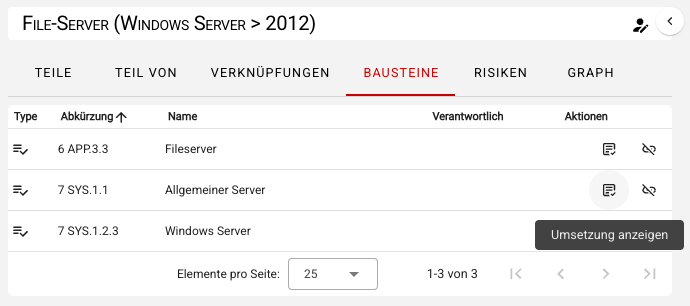
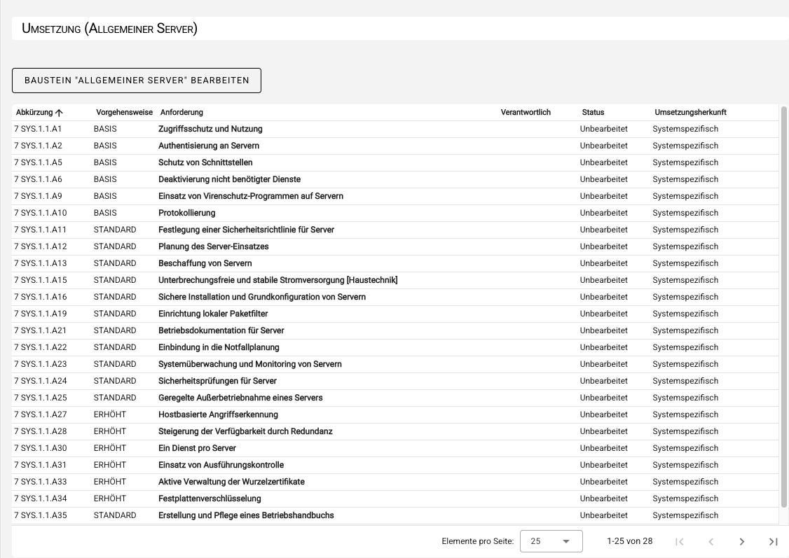
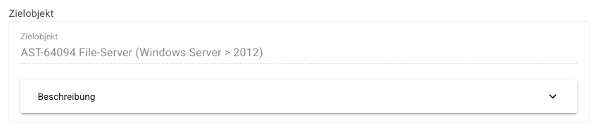
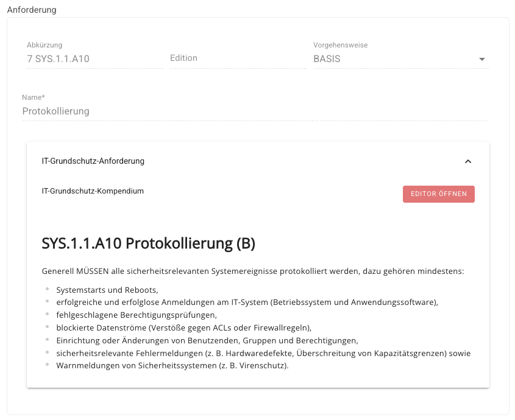
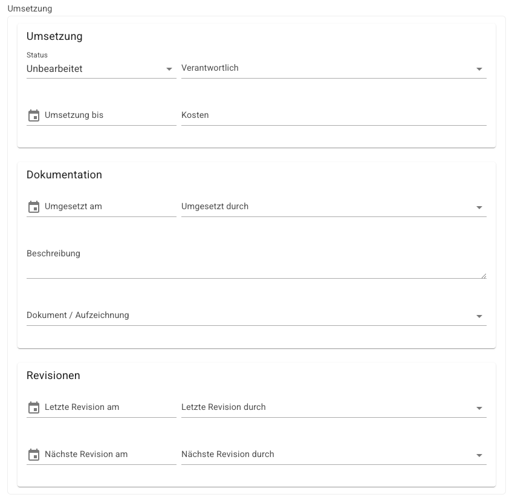

<!-- © 2024 The Project Contributors - see AUTHORS.txt -->
# IT-Grundschutz-Check

In diesem Schritt gilt es, den Status der modellierten Bausteine, konkret der einzelnen Anforderungen, abzuarbeiten. Um Anforderungen zu bearbeiten, klicken Sie im Objektumfeld des Zielobjektes im Tab **Bausteine** auf **Umsetzung anzeigen** des jeweiligen Bausteins.

Sie gelangen zur Übersicht aller Anforderungen des ausgewählten Bausteins.

Hier können Sie die einzelnen Anforderungen bearbeiten. Durch Klick auf eine Anforderung öffnet sich der Umsetzungsdialog, in dem Sie folgenden Informationen in drei Abschnitten einsehen bzw. einpflegen können:

1. Informationen zum Zielobjekt (informativ/schreibgeschützt)

2. Anforderungsbeschreibung, z.B. aus dem IT-Grundschutz-Kompendium (informativ/schreibgeschützt)

3. Informationen zur Umsetzung dokumentieren Sie in drei Abschnitten:

**Umsetzung**

- Umsetzungsstatus (Unbearbeitet, Ja, Teilweise, Nein, Entbehrlich)
- Verantwortliche Person
- Umsetzung bis (Datum)
- Kosten für die Umsetzung

**Dokumentation**

- Umgesetzt am
- Umgesetzt durch
- Umsetzungsbeschreibung
- Link zu einem Dokument oder einer Aufzeichnung

**Revision**

- Letzte Revision am
- Letzte Revision durch
- Nächste Revision am
- Nächste Revision durch

Nachdem Sie die Daten eingetragen haben, schließen Sie den Dialog mit **Speichern**.

Nachdem alle modellierten Bausteine und Anforderungen bearbeitet worden sind, ist es möglich das Ergebnis des IT-Grundschutz-Checks als Report auszugeben.
