<!-- © 2024 The Project Contributors - see AUTHORS.txt -->
# Risikoanalyse nach 200-3

## Definitionen

Im BSI IT-Grundschutz nach 200-x können je Unit unterschiedliche Parameter für die Risikoberechnung definiert werden. Die organisationsweite und für alle Zielobjekte gültige Risikomatrix wird unter [Risikodefinitionen](../manual/risk-definition.md) definiert. Navigieren Sie dazu im Menü zu **Risikodefinitionen** und anschließend **GSRA**. Hier können Sie mit einem **Klick auf das Stift-Symbol** die Kategorien bearbeiten. Dabei können Sie folgende Parameter an Ihre Anforderungen anpassen:

- Eintrittswahrscheinlichkeit
  - Name und Definition der Kategorien
- Schadenshöhe
  - Name und Definition der Kategorien
- Risikokategorien
  - Name, Definition und Farbe der Kategorien

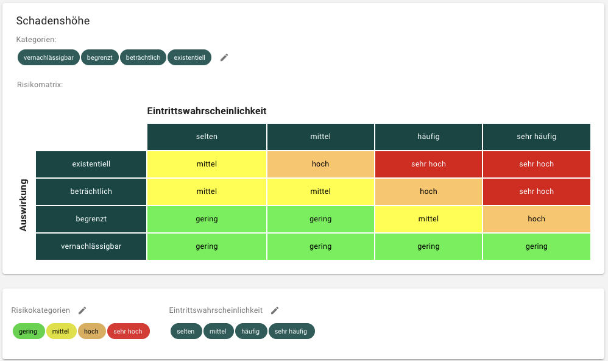

## Gefährdungsübersicht erstellen

Sofern eine Risikoanalyse erforderlich ist, müssen Sie im Zielobjekt bei den Objektdetails eine **Gefährdungsübersicht erstellen**. Dies kann z.B. erforderlich sein, wenn das Zielobjekt in einem der drei Schutzziele einen hohen oder sehr hohen Schutzbedarf aufweist.

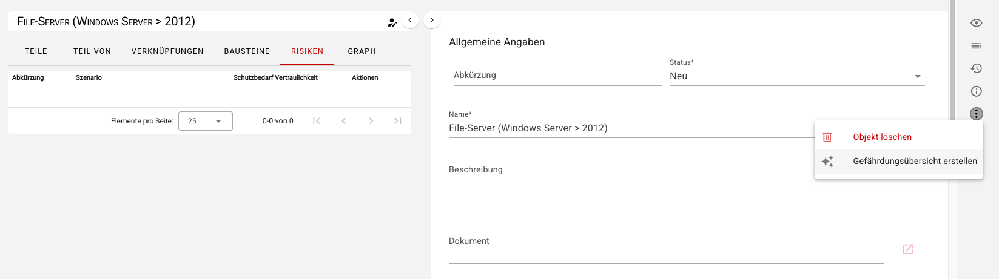

Durch diese Aktion werden die elementaren Gefährdungen entsprechend der Kreuzreferenztabellen des BSI in Ihre Unit kopiert und im Objektumfeld des Zielobjekts Risikoobjekte für jede elementare Gefährdung angelegt:

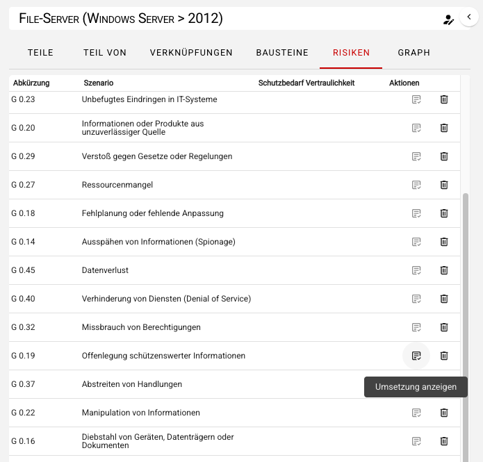

## Risikobewertung

Um die einzelnen Elementaren Gefährdungen weiter bearbeiten zu können, klicken Sie auf die entsprechende Gefährdung und es öffnet sich ein Dialog. Hier kann als erstes die Risikobewertung vorgenommen werden. Bewerten Sie hierzu folgende Parameter:

- **Eintrittswahrscheinlichkeit** (und gegebenenfalls eine Erklärung)
- **Auswirkung hinsichtlich der Schadenshöhe** (und gegebenenfalls eine Erklärung)

Aus diesen beiden Werten wird nachdem Sie Ihre Eingaben gespeichert haben automatisch das **Bruttorisiko** anhand der Risikomatrix berechnet.

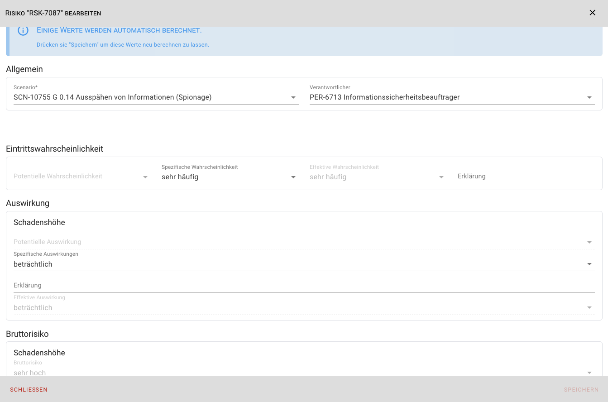

## Risikobehandlung

Je nach Höhe des Risikos kann bzw. muss eine Risikobehandlung vorgenommen und gegebenenfalls eine Erklärung dokumentiert werden. Sie können mehrere **Behandlungsoptionen** auswählen, es stehen folgende Optionen zur Auswahl:

- Risikoakzeptanz
- Risikovermeidung
- Risikoreduktion
- Risikotransfer

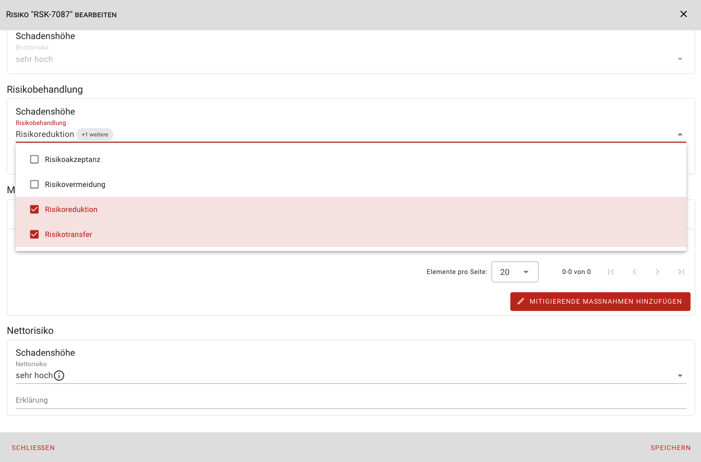

### Risikoreduktion

Bei gewählter Risikobehandlungsoption **Risikoreduktion** kann das Risiko durch Hinzufügen ergänzender Sicherheitsmaßnahmen reduziert werden. Dabei haben Sie zwei Möglichkeiten mitigierende Maßnahmen zu hinterlegen:

1. Um eine **neue Maßnahme** zu erstellen klicken Sie **Mitigierende Maßnahmen hinzufügen** und anschließend **Mitigierende Maßnahme erstellen**. Es öffnet sich ein Dialog, um die neue Maßnahme zu erstellen. Nachdem Sie Ihre Daten zur Maßnahme gespeichert haben, wird die neue Maßnahme im vorherigen Risikodialog im Bereich **Maßnahmen zur Risikoreduktion** angezeigt. 

1. Um bereits **vorhandene Maßnahmen** zu verknüpfen klicken Sie **Mitigierende Maßnahmen hinzufügen** und anschließend **Mitigierende Maßnahme verknüpfen**. Es öffnet sich ein Dialog, in dem Sie aus allen bereits vorhandenen Maßnahmen die benötigten mitigierenden Maßnahmen auswählen können. Nachdem Sie den Dialog mithilfe von **Speichern** schließen, werden die ausgewählten Maßnahmen im Bereich **Maßnahmen zur Risikoreduktion** angezeigt:

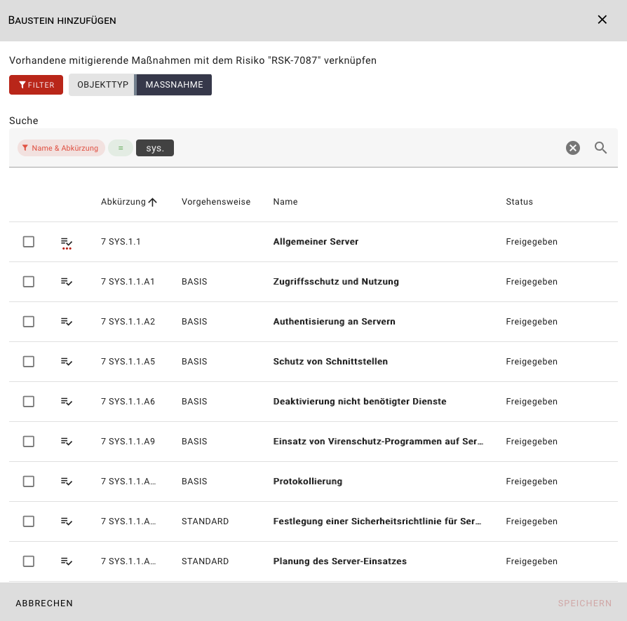

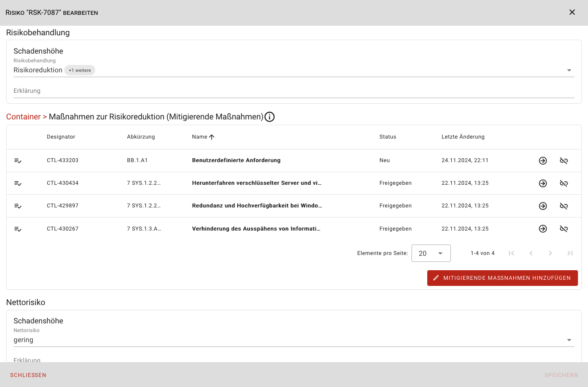

Abschließend muss das **Nettorisiko** (und gegebenenfalls eine Erklärung) manuell gesetzt werden. **Speichern** und **Schließen** Sie den Risikodialog.

### Mitigierende Maßnahmen bearbeiten

Um Ihre mitigierenden Maßnahmen bearbeiten zu können, klicken Sie **Umsetzung anzeigen** bei der entsprechenden elementaren Gefährdung im Tab **Risiken** im Objektumfeld des Zielobjektes.

Sie gelangen zur Übersicht aller mitigierenden Maßnahmen für die ausgewählte Elementare Gefährdung.

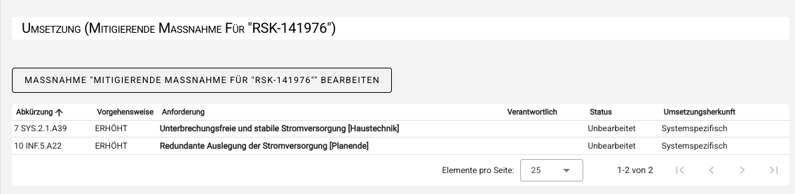

Hier können Sie die einzelnen Maßnahmen bearbeiten. Durch Klick auf eine Maßnahme öffnet sich der Umsetzungsdialog, in dem Sie folgenden Informationen in drei Abschnitten einsehen bzw. einpflegen können:

1. Informationen zum Zielobjekt (informativ/schreibgeschützt)

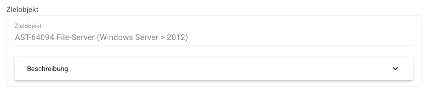

2. Maßnahmenbeschreibung, z.B. aus dem IT-Grundschutz-Kompendium (informativ/schreibgeschützt)

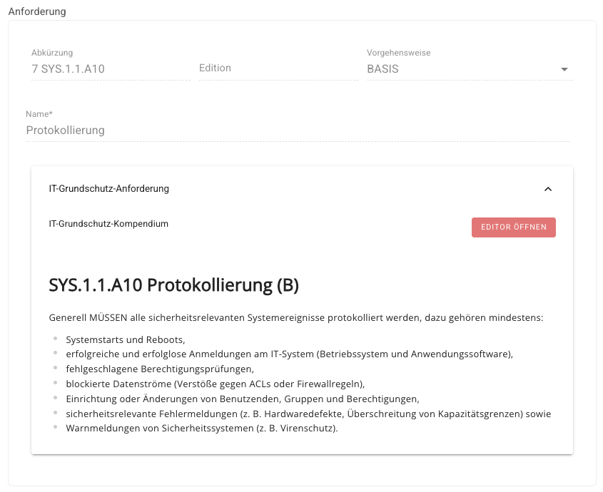

3. Informationen zur Umsetzung dokumentieren Sie in drei Abschnitten:

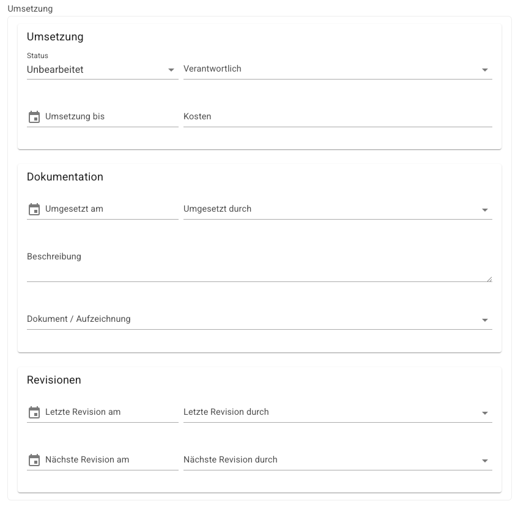

**Umsetzung**

- Umsetzungsstatus (Unbearbeitet, Ja, Teilweise, Nein, Entbehrlich)
- Verantwortliche Person
- Umsetzung bis (Datum)
- Kosten für die Umsetzung

**Dokumentation**

- Umgesetzt am
- Umgesetzt durch
- Umsetzungsbeschreibung
- Link zu einem Dokument oder einer Aufzeichnung

**Revision**

- Letzte Revision am
- Letzte Revision durch
- Nächste Revision am
- Nächste Revision durch

Nachdem Sie die Daten eingetragen haben, schließen Sie den Dialog mit **Speichern**.
