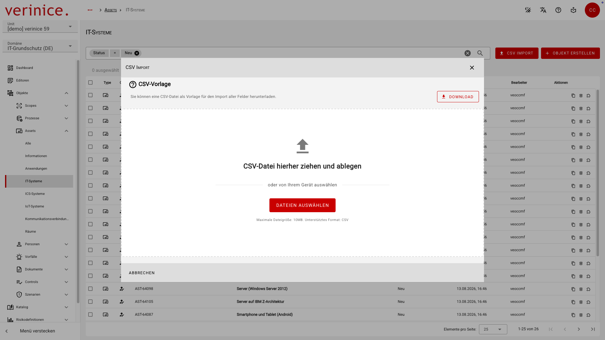
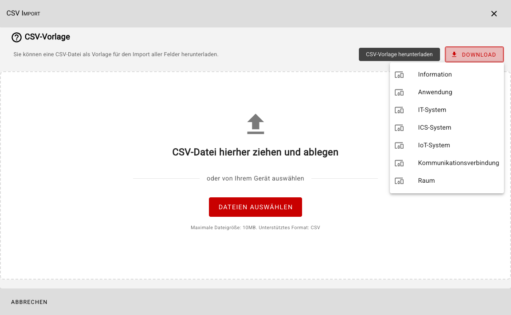
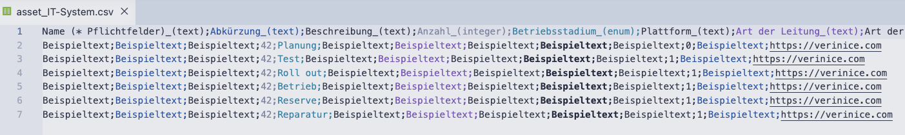
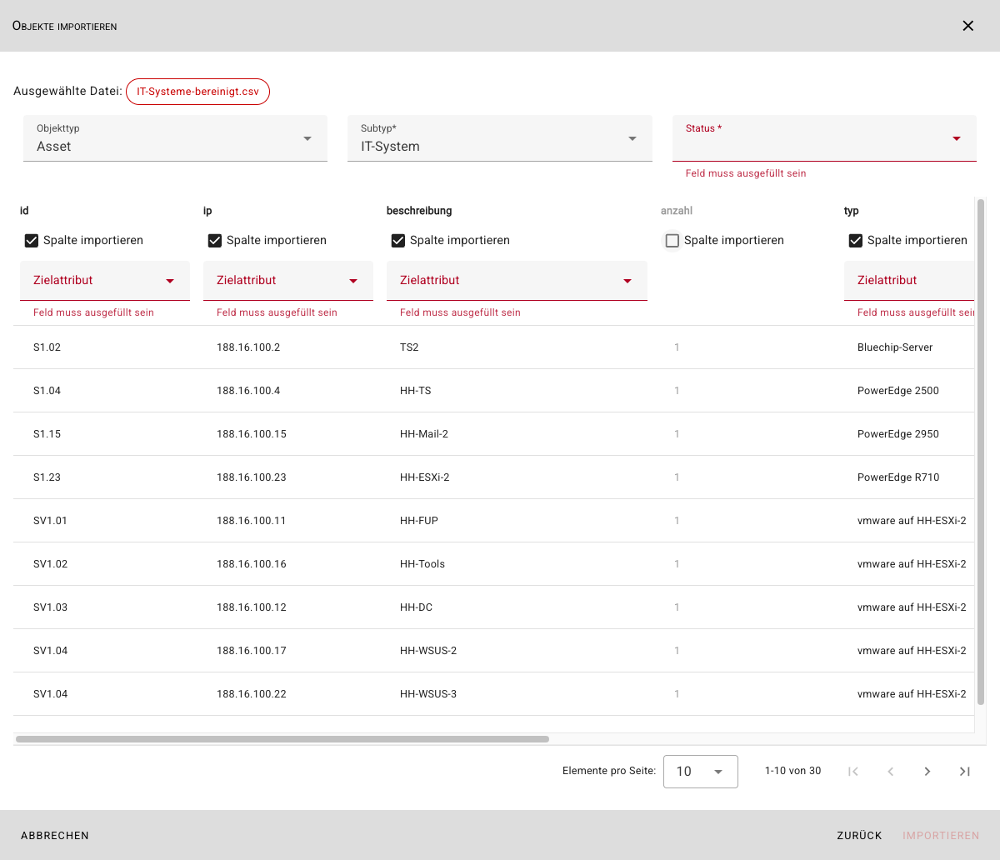
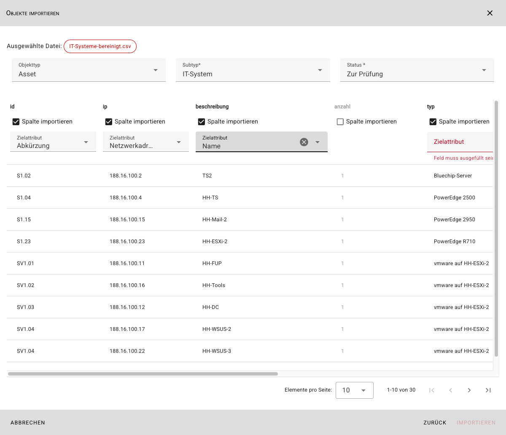
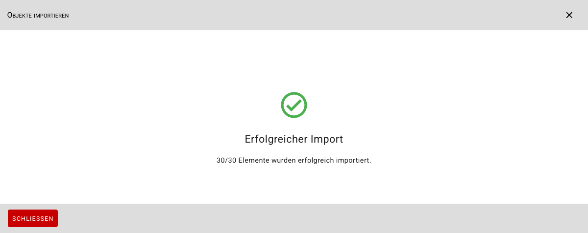

<!-- © 2025 The Project Contributors - see AUTHORS.txt -->
# CSV-Import

Der CSV-Import ermöglicht den Import von Daten in alle Felder aller Subtypen. Wechseln Sie dazu über das Dashboard oder das Menü in die Objektübersicht des gewünschten Subtyps und öffnen Sie den CSV-Import über die Schaltfläche **CSV Import**:

Nicht importiert werden **Verknüpfungen zu anderen Objekten**. Beim CSV-Import werden zudem alle Objekte neu importiert, es erfolgt **keine Aktualisierung** zuvor bereits importierter Objekte.

::: info Für einen wiederkehrenden oder bidirektionalen Import nutzen Sie bitte immer die REST API.
:::

## CSV-Vorlage herunterladen

Sie können vor dem Import über die Schaltfläche **Download** zu jedem Subtyp eine **CSV-Datei** als Vorlage herunterladen, die Daten zu allen Feldern enthält:

Die heruntergeladene CSV-Vorlage enthält Daten wie folgt:

| Feldtyp | Inhalt| Anmerkung |
|---|---|---|
| Text | Beispieltext ||
| Ganzzahl | 42 ||
| Datum | 2026-07-13 | Datum des Exports nach ISO 8601 |
| Datum & Uhrzeit | 2026-07-13T16:24:25 | Datum und Uhrzeit des Exports nach ISO 8601 |
| Checkbox| **0** oder **1**| Boolean |
| Externer Link | https://verinice.com ||
| Auswahlfeld | Alle möglichen Werte | Ein Wert je Zeile |
| Mehrfachauswahl | Alle möglichen Werte | Alle Werte durch **&** separiert in jeder Zeile |

## Daten importieren

Wählen Sie die zu importierende CSV-Datei per Drag-and-Drop oder über die Schaltfläche **Dateien auswählen** aus. Nach Auswahl der Codierung werden Ihnen im sich öffnenden Dialog **Objekte importieren** alle Einträge der CSV-Datei mit allen vorhandenen Spalten angezeigt:

Prüfen Sie, ob der vorgeschlagene **Objekttyp** und **Subtyp** korrekt ausgewählt sind und legen Sie den **Status** für die zu importierenden Objekte fest.

Legen Sie für jede Spalte der CSV-Datei nun fest, ob die Spalte importiert werden soll, und falls ja, in welches Zielattribut die Werte importiert werden sollen:

::: info Die Felder **Abkürzung** und **Name** sind Pflichtfelder für den Import und müssen zugewiesen werden.
:::

Sie können die angezeigten Daten vor dem Import bearbeiten, um letzte Korrekturen vorzunehmen.

Starten Sie den Import über die Schaltfläche **Importieren**. Eine Meldung informiert Sie anschließend darüber, ob der Import erfolgreich war oder ob Fehler aufgetreten sind.

Die importierten Objekte können jetzt in verinice verwendet werden.
