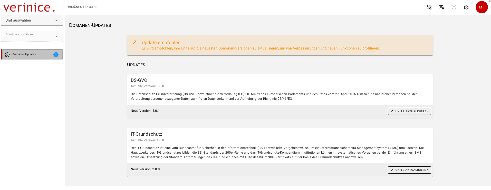
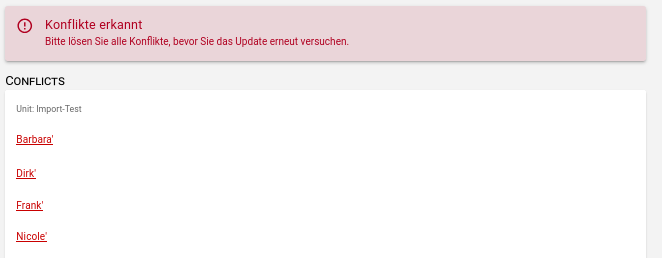
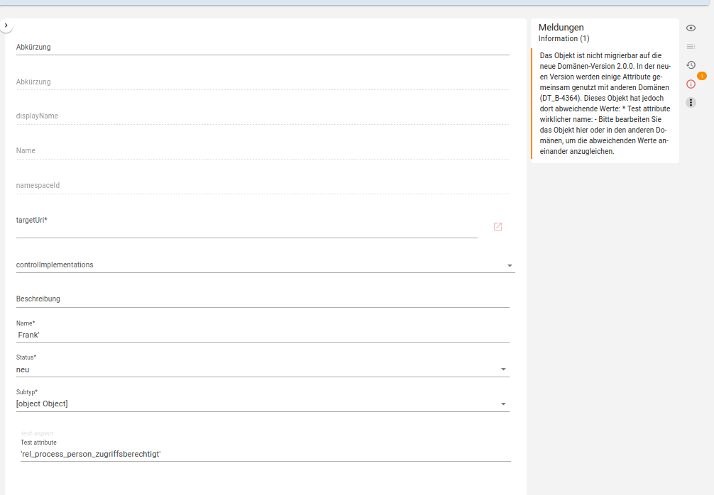
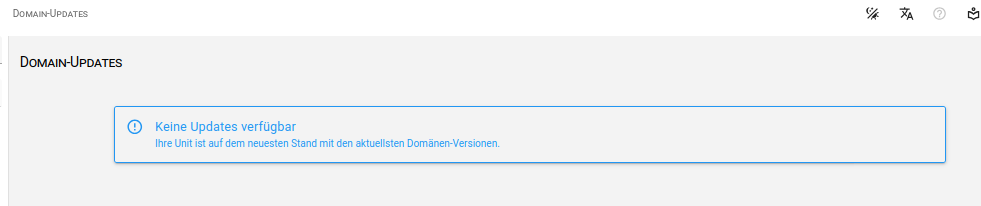

<!-- © 2026 The Project Contributors - see AUTHORS.txt -->
# Domänen-Updates
<!-- verinice 55 -->

Um Inkompatibilitäten (breaking changes) bei der Erweiterung von Domänen zu vermeiden, prüft verinice bei der Anmeldung ob neue Versionen der Domänen vorliegen und zeigt diese ggf. im neuen Menüpunkt **Domänen-Updates** an.

Nach Aufruf des Menüpunkts listet eine Übersicht alle neuen Versionen der Domänen auf:

Es ist empfohlen alle Units auf die neuesten Domänen-Versionen zu aktualisieren, um alle neuen Funktionen nutzen zu können!

Liegen keine Konflikte vor, so werden die Daten in den jeweiligen Units automatisch migriert und die neue Domänen-Version ist aktiv.

Falls Konflikte erkannt werden, so werden diese zur Behebung aufgelistet:

Da bei der Behebung von Konflikten bereits von Ihnen erfasste Daten angepasst werden müssen, navigieren Sie zum jeweiligen Objekt. Im Abschnitt **Meldungen** werden dort die konkret erforderlichen Anpassungen beschrieben und können einfach vorgenommen werden:

Nach Lösen aller Konflikte können Sie das Domänen-Update über **Units aktualisieren** erneut ausführen.

