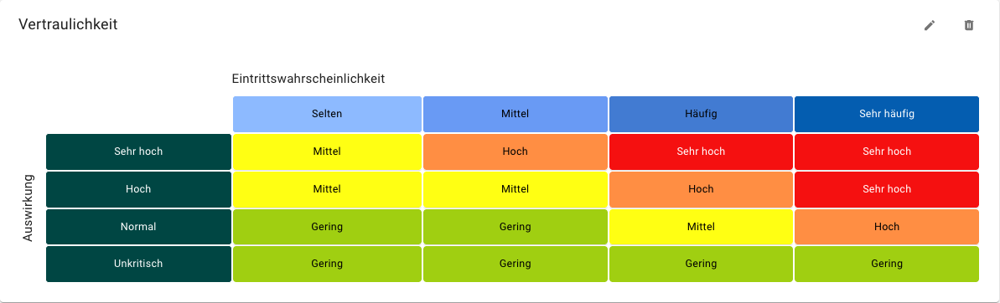
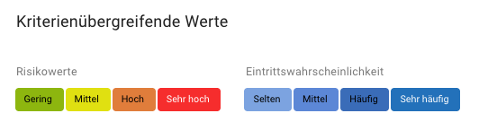
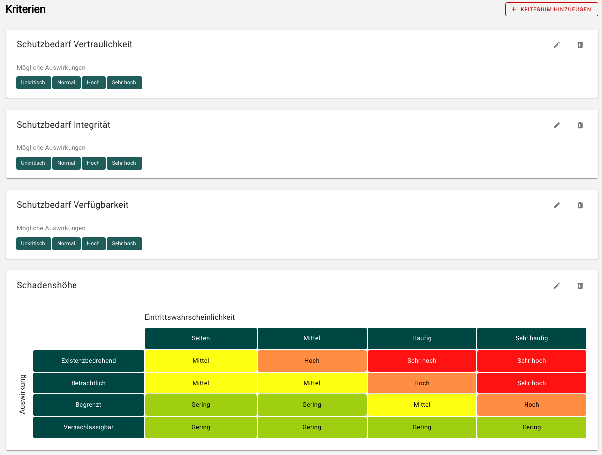

<!-- © 2024 The Project Contributors - see AUTHORS.txt -->
# Risikodefinitionen

::: danger Jede Anpassung einer Risikodefinition bedingt Änderungen an bereits bestehenden Risiken. Es ist deshalb empfohlen, die Risikodefinition **vor**  der Risikobewertung auf die jeweilige Organisation anzupassen!
:::

::: warning Die Änderung der Risikodefinition wirkt sich auf alle Units in der jeweiligen Domäne aus!
:::

Im Abschnitt Risikodefinitionen können die Definitionen für die Risikoanalyse eingesehen und bearbeitet werden.

Die Risikodefinition bildet eine Eintrittswahrscheinlichkeits-Auswirkungs-Matrix für verschiedene Schutzziele ab:

- Je Schutzziel (hier Vertraulichkeit) wird eine Eintrittswahrscheinlichkeits-Auswirkungs-Matrix dargestellt.
- Die Auswirkung kann je Schutzziel angepasst werden.
- Die Y-Achse zeigt die Stufen für die Auswirkung.
- Die X-Achse zeigt die Stufen für die Eintrittswahrscheinlichkeit.
- In der Matrix wird die Zuordnung der Risikokategorien farbig codiert dargestellt. Fahren Sie mit der Maus über einzelne Felder, um die detaillierten Definitionen für die einzelnen Parameter anzuzeigen.

- Die Risikokategorien sind über alle Schutzziele definiert.
- Die Eintrittswahrscheinlichkeit ist über alle Schutzziele definiert.
- Wenn für ein Schutzziel keine Risikomatrix verwendet werden soll, kann diese entfallen.
- Optional kann dann eine Risikomatrix für die Betrachtung der Schadenshöhe verwendet werden.

Sie können die Bezeichnungen und die Beschreibungen für alle Parameter an Ihre Organisation anpassen, die Stufen beliebig erweitern und weitere Schutzziele wie z.B. Authentizität, Patientensicherheit oder Behandlungseffektivität hinzufügen.
