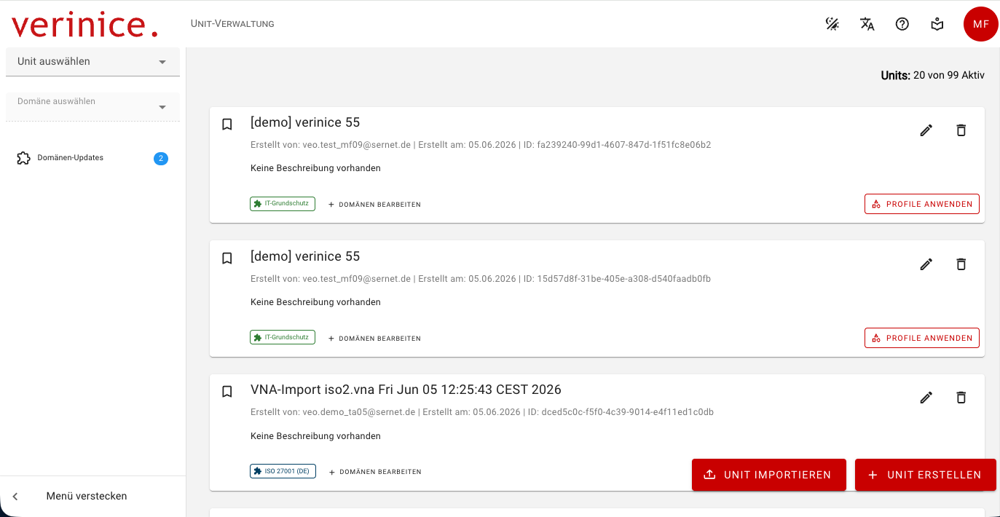
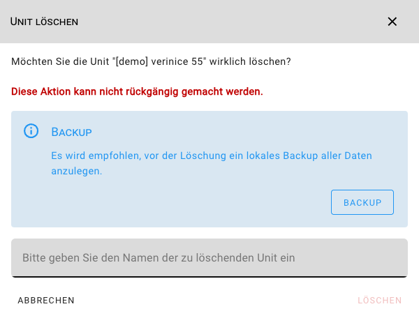

<!-- © 2026 The Project Contributors - see AUTHORS.txt -->
# Unit-Verwaltung
<!-- Stand verinice 55 -->

In der **Unit-Verwaltung** können Sie neue Units anlegen oder importieren sowie bestehende Units bearbeiten oder löschen:

Sie erreichen die Unit-Verwaltung jederzeit über das **verinice-Logo** oder die Auswahl **Units verwalten** im Unit-Selektor.

Beachten Sie die Anzahl **verfügbarer Units**! Grundsätzlich stehen immer zwei Units zur Verfügung, um z.B. eine Unit zur produktiven Arbeit und eine als Test-Unit nutzen zu können. Sollten alle verfügbaren Units in Verwendung sein, können Sie erst dann weitere anlegen, wenn Sie Units gelöscht oder weitere Units hinzugekauft haben.

## Units erstellen

Neue **Units erstellen** Sie über die gleichnamige Schaltfläche in einem Assistenten. Sie können dabei:

- Name und Beschreibung der Unit festlegen.
- [Profile](../object-model/profiles) auf Ihre Unit anwenden. Bitte beachten Sie, dass mit einem Profil immer eine Vielzahl weiterer Objekte erzeugt und ggf. auch eine neue Domäne zugewiesen wird.
- Ihrer Unit weitere [Domänen](../object-model/domains) hinzufügen, um z.B. ein ISMS nach ISO 27001 und ein DSMS nach DS-GVO mit denselben Objekten abzubilden.

## Units importieren

Über die Schaltfläche **Unit importieren** können Sie zuvor über [Datenübertragung](data-transfer) exportierte Units als neue Units importieren.

::: warning Es können aktuell nur Units importiert werden, die auf der selben **Domain-Template-Version** basieren.
:::

## Units bearbeiten

Name und Beschreibung einer Unit bearbeiten Sie über das **Stift-Symbol**. Wie bei der Erstellung von Units können Sie auch bei bestehenden Units **Profile anwenden** und **Domänen bearbeiten**.

::: danger Das Hinzufügen neuer Domänen kann aktuell nicht rückgängig gemacht werden und sollte deshalb initial in einer nicht produktiv genutzten Unit getestet werden.
:::

## Units löschen

Nicht mehr benötigte Units löschen Sie über das **Papierkorb-Symbol** nach einer Sicherheitsabfrage - Sie müssen den Namen der zu löschenden Unit bestätigen. Es wird empfohlen, vorab ein lokales Backup über [Datenübertragung](data-transfer) zu erstellen.

