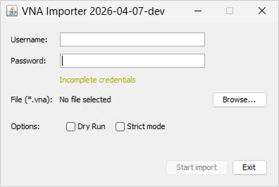
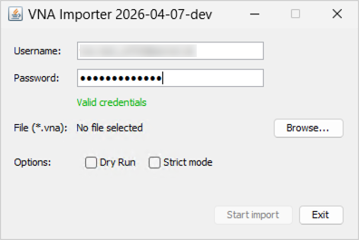

<!-- © 2026 The Project Contributors - see AUTHORS.txt -->
# Der VNA-Importer

Für die Datenübernahme aus **verinice.PRO** oder **verinice.EPV** (Einzelplatzversion) in die neue verinice-Generation (**verinice.cloud** bzw. **verinice.onprem**) steht der **VNA-Importer** als separater Java-Client zur Verfügung.

## Funktionsumfang

Der VNA-Importer ist aktuell verfügbar für die Übernahme von Daten aus den Perspektiven **IT-Grundschutz** inklusive **Datenschutz**. Die Übernahme von Daten aus weiteren Perspektiven (ISO 27001 inklusive Datenschutz, IT-Grundschutz inklusive BCM, ISO 27001 inklusive BCM) befindet sich in Entwicklung und wird sukzessive bereitgestellt.

Der VNA-Importer erstellt eine neue Unit und importiert die Daten aus der VNA-Datei in diese Unit.

::: warning Sollten Sie die maximale Anzahl von Units in Ihrer verinice.cloud-Instanz überschritten haben, müssen Sie zunächst eine Unit löschen oder die Unit-Begrenzung erhöhen, bevor Sie neue Daten importieren können.
:::

Es können mehrere Informationsverbünde in eine Unit übernommen werden. Die Daten werden dabei aus einer zuvor exportierten **VNA-Datei** neu als Kopie in der Zielumgebung angelegt - die originalen Daten bleiben unverändert erhalten!

Im Detail werden folgende Daten übernommen:

- Alle (Ziel)objekte:
  - Verknüpfungen zwischen (Ziel)objekten.
  - Bausteine, Anforderungen, Elementare Gefährdungen.
  - Schutzbedarfswerte für Vertraulichkeit, Integrität, Verfügbarkeit.
  - Risikobewertung.

## Vorarbeiten in verinice

Um alle Verbesserungen in der neuen verinice-Generation bestmöglich nutzen zu können, sind die Daten in verinice vor dem VNA-Export zu prüfen und sofern erforderlich zu bereinigen:

### Modellierung prüfen

In der neuen verinice-Generation wird die Umsetzung von Anforderungen nicht mehr in der Anforderung, sondern in der Verknüpfung zum jeweiligen Zielobjekt dokumentiert. Es wird eine einzige Instanz jedes Bausteins und jeder Anforderung beibehalten und mit mehreren Zielobjekten verknüpft. Diese Deduplizierung von Bausteinen reduziert den Aufwand bei der Arbeit in verinice erheblich, bedarf dazu aber auch einer sorgfältigen Vorbereitung der Ausgangsdaten.

Nur Bausteine der aktuellen **Edition 2023-1** des IT-Grundschutz-Kompendiums werden dabei mit den Bausteinen im Katalog in verinice verknüpft. Ältere Editionen werden **ohne Katalog-Verweis** importiert und verhalten sich im Wesentlichen wie benutzerdefinierte Bausteine. Es ist dringend empfohlen die Modellierung entsprechend zu aktualisieren, um bei Veröffentlichung zukünftiger Editionen automatische Aktualisierungen nutzen zu können!

Die Bausteine müssen **korrekt modelliert bzw. referenziert** sein, dies betrifft insbesondere auch die Verknüpfungen zwischen Zielobjekten und Anforderungen.

Bausteine mit offizieller Benennung aus dem Kompendium müssen **vollständig** und **exakt** sein (alle Anforderungen umfassen, originale Beschreibung enthalten, originale Vorgehensweise eingestellt, ...). Andernfalls werden diese Bausteine ohne Verweis zum Katalog als benutzerdefinierte Bausteine interpretiert.

Pro Baustein darf zudem nur eine Person als **Bausteinverantwortlicher** referenziert sein.

### Risikodefinition prüfen

Die Risikodefinition muss **identisch zur Risikomatrix** in verinice sein. Da in beiden Generationen als Standard die Risikodefinition aus dem BSI-Standard 200-3 verwendet wird, ist keine Aktion erforderlich, sofern die Risikodefinition in verinice nicht angepasst wurde.

Falls eine Anpassung der Risikodefinition erforderlich ist, kann dies einfach über das Menü im Abschnitt **Risikodefinition** erfolgen.

Beachten Sie, dass Risiken in verinice.cloud nur angelegt werden, wenn für ein Zielobjekt in verinice die Option **Risikoanalyse erforderlich** gesetzt ist.

### Neue Zielobjekte definieren

Die Prozessobjekte wurden erweitert um **Fachverfahren**. Sie können vor dem VNA-Export durch Vergabe eines **Tags** in verinice definieren, ob ein Geschäftsprozess als Fachverfahren übernommen werden soll:

- Tag für die Übernahme als Fachverfahren:
  - **veoimport:IT-Grundschutz:PRO_SpecialisedTask**
- (Allgemeine Syntax: veoimport:*domain-name*:*subtyp-id*)

## Einschränkungen

Beim VNA-Import sind die folgenden Einschränkungen zu beachten:

- Einige wenige ältere Felder aus verinice sind in der neuen Generation nicht mehr vorhanden und werden bewusst nicht übertragen (z.B. Tags).
- Der Import von anwenderspezifischen Feldern/Daten (nach Customizing) kann in Abstimmung mit dem verinice.Team ergänzt werden.

## Installation

Für den **VNA-Importer** ist Java (Version 17 bis 25) erforderlich. Da der VNA-Importer kontinuierlich weiter entwickelt wird, verwenden Sie die jeweils aktuellste Version. Das Tool ist in englischer Sprache verfügbar.

## Import in die Cloud-Umgebung (GUI)

Für den Import von Daten in den jeweiligen Client in der **verinice.cloud** steht der VNA-Importer vereinfacht als Tool mit graphischer Benutzeroberfläche (Graphical User Interface - GUI) zur Verfügung. Sie können diese wie folgt aufrufen:

- unter **Windows** durch Ausführen der Datei **veo-vna-importer.exe**.
- unter **macOS** und **Linux** durch Aufruf von **java -jar veo-vna-importer.jar** im Terminal, nach vorherigem Wechsel in das entsprechende Verzeichnis.



### VNA-Import ausführen

Nach Eingabe von Benutzername und Passwort für die Zielumgebung (Grundeinstellung: https://veo-web.verinice.com/) prüft das Programm diese unmittelbar auf Richtigkeit (Valid credentials). Bei Meldung **Invalid credentials** prüfen Sie bitte Benutzername und Passwort für die Zielumgebung.



Nach Auswahl einer zuvor aus verinice exportierten VNA-Datei, können Sie den Import mit zwei Optionen starten:

- **Dry Run (Testlauf):** In diesem Fall wird der Import **ohne** Übernahme von Daten durchgeführt, um eventuelle Fehler vor dem eigentlichen Import identifizieren zu können.
- **Strict Run:** Der Import wird mit strengeren Prüfungen durchgeführt, um Fehler besser identifizieren zu können.

Ein erfolgreicher Import wird durch entsprechende Meldung quittiert. Sofern der Import nicht als **Dry Run** durchgeführt wurde, finden Sie in Ihrer Zielumgebung eine Unit mit allen zuvor exportierten Inhalten vor. Nach einem **Dry Run** stehen die Inhalte dann nach wiederholtem realen Import zur Verfügung.

War der Import aufgrund von Fehlern mit entsprechender Fehlermeldung nicht erfolgreich, finden Sie weitere Hinweise über **Show logs**. Im Regelfall wurden dann noch nicht alle [Vorarbeiten in verinice](#vorarbeiten-in-verinice) vollständig umgesetzt.

Sollte der Export trotz Umsetzung der Vorarbeiten fehlschlagen, unterstützt das verinice.Team gerne bei Erkennung und Behebung der Fehler.

## Import in andere Umgebungen (CLI)

Der VNA-Importer kann unter allen Betriebssystemen per Command Line Interface (CLI) aufgerufen werden, um die Daten in anderen Umgebungen zu importieren. Insbesondere der Import in selbst gehostete Umgebungen (OnPrem) muss über das CLI konfiguriert werden.

Sie starten die VNA-Importer CLI im Terminal durch:

`java -jar build/libs/vna-importer.jar`

### Anwendung

Um alle verfügbaren Optionen des CLI anzuzeigen, rufen Sie den VNA-Importer mit dem Parameter `-h` für die Hilfe auf:

`java -jar build/libs/vna-importer.jar -h`

```
$ java -jar build/libs/veo-vna-importer.jar -h
Usage examples:

Simple import into the veo.cloud:
java -jar veo-vna-importer.jar -f mydata.vna -u veo-user@domain.example

Import using an authentication token:
java -jar veo-vna-importer.jar -f mydata.vna -x TOKEN

Dry-run with debug logging and JSON output to console:
java -jar veo-vna-importer.jar -f mydata.vna -u veo-user@domain.example -n -d\
  -o-

Import into on-prem installation:
java -jar veo-vna-importer.jar -f mydata.vna  -u veo-user@mydomain.example\
  -v https://api.veo.mydomain.example/veo\
  --keycloak-url=https://keycloak.mydomain.example/auth

Authentication:

Keycloak parameters need to be specified on the command line if they deviate
from the default values. Alternatively, the application tries to read a veo
environment configuration file from the current working directory or the user's home directory.

Options:

  -f, --file=<file>          The VNA to import
  -v, --veo-api-url=<veoApiUrl>
                             baseUrl of the veo instance backend API
                               Default: https://api.verinice.com/veo
  -u, --veo-user=<veoUser>   veo username
      --veo-password=<veoPassword>
                             veo password, will be prompted for if not specified
      --keycloak-url=<keycloakUrl>
                             Keycloak authentication URL
                               Default: https://auth.verinice.com/auth
      --keycloak-realm=<keycloakRealm>
                             Keycloak authentication realm
                               Default: verinice-veo
      --keycloak-client=<keycloakClient>
                             Keycloak authentication client
                               Default: veo-prod
  -p, --proxy=<proxy>        proxy to use, can be a hostname (will default to
                               port 3128), host:port, or http://host:post
  -s, --strict               fail on invalid property values instead of
                               skipping them
  -n, --dry-run              attempt conversion but to not send data to the
                               verinice API
  -o, --output-file=<outputFile>
                             If specified, the unit dump JSON is written to
                               that file
  -d, --domain=<domainId>    the ID of the target domain to use, will be
                               auto-selected if omitted
  -r, --risk-definition=<riskDefinition>
                             risk definition ID, can be omitted if there is
                               only a single one in the target domain
  -h, --help                 Print this help message and exit
      --debug                enable debug logging
```

### Format der Konfigurationsdatei

Die Anwendung kann die Konfiguration aus einer JSON-Datei lesen, die sich unter `~/.config/veo/config.json` in Ihrem Home-Verzeichnis befindet. So müssen Sie die Authentifizierungsparameter nicht immer wieder über die Befehlszeile angeben.

Das Format der Konfigurationsdatei wird von verschiedenen verinice-Anwendungen gemeinsam genutzt, sodass Sie dieselbe Datei auch für andere verinice-Tools verwenden können. Aus demselben Grund sind jedoch einige der möglichen Parameter für den VNA-Importer nicht relevant und werden ignoriert. Der Vollständigkeit halber sind diese hier aufgeführt.

#### Konfigurationsstruktur

| Feld | Typ | Beschreibung |
|-------|------|-------------|
| `instances` | Objekt | Container für mehrere Umgebungskonfigurationen |
| `instances.<name>` | Objekt | Benannte Umgebungskonfiguration (z. B. „sandbox“, „production“) |
| `instances.<name>.config` | Objekt | Konfigurationseinstellungen für die jeweilige Umgebung |
| `currentInstance` | Zeichenfolge | Name der aktiven Umgebung, die aus den Instanzen verwendet werden soll (wird nicht verwendet – siehe Hinweis unten) |

HINWEIS: Das Feld `currentInstance` wird vom VNA-Importer nicht verwendet. Stattdessen basiert die zu verwendende Umgebung auf der URL, die über den Befehlszeilenparameter `-v` oder `--veo-api-url` angegeben wird. Wenn dieser Parameter nicht angegeben ist, wird die Standard-URL `https://api.verinice.com/veo` verwendet, die der Produktionsumgebung entspricht.

#### Optionen zur Umgebungskonfiguration

| Feld | Typ | Beschreibung | Standardwert |
|-------|------|-------------|---------|
| `KEYCLOAK_URL` | Zeichenfolge | URL des Keycloak-Authentifizierungsservers | `https://auth.verinice.com` |
| `KEYCLOAK_REALM` | Zeichenfolge | Keycloak-Authentifizierungsbereich | `verinice-veo` |
| `KEYCLOAK_CLIENT` | Zeichenfolge | Keycloak-Client-Kennung | `veo-prod` |
| `KEYCLOAK_ADMIN_USERNAME` | Zeichenfolge | Admin-Benutzername für Keycloak | nicht verwendet |
| `KEYCLOAK_ADMIN_PASSWORD` | Zeichenfolge | Admin-Passwort für Keycloak | nicht verwendet |
| `VEO_URL` | Zeichenfolge | Basis-URL der Backend-API der verinice-Instanz | `https://api.verinice.com/veo` |
| `ACCOUNTS_URL` | Zeichenkette | URL des Account-Dienstes | nicht verwendet |
| `FORMS_URL` | Zeichenkette | URL des Formular-Dienstes | nicht verwendet |
| `HISTORY_URL` | Zeichenkette | URL des Verlaufs-Dienstes | nicht verwendet |
| `REPORTING_URL` | Zeichenkette | URL des Berichts-Dienstes | nicht verwendet |
| `RABBIT_URL` | Zeichenkette | URL des RabbitMQ-Servers (für interne Dienste) | nicht verwendet |
| `RABBIT_ROUTING_KEY_PREFIX` | Zeichenfolge | Präfix für RabbitMQ-Routing-Schlüssel | nicht verwendet |
| `RABBIT_USER` | Zeichenfolge | RabbitMQ-Benutzername | nicht verwendet |
| `RABBIT_PASS` | Zeichenfolge | RabbitMQ-Passwort | nicht verwendet |
| `CLIENT_INIT_API_KEY` | Zeichenfolge | API-Schlüssel für die Client-Initialisierung | nicht verwendet |

#### Beispielkonfiguration

Hier ist eine funktionierende Beispielkonfiguration für die Sandbox-Umgebung:

```json
{
    "instances": {
        "sandbox": {
            "config": {
                "KEYCLOAK_URL": "https://auth.verinice.com/auth",
                "KEYCLOAK_REALM": "verinice-sandbox",
                "KEYCLOAK_CLIENT": "veo-sandbox",
                "VEO_URL": "https://api.sandbox.verinice.com/veo",
            }
        }
    },
    "currentInstance": "sandbox"
}
```
