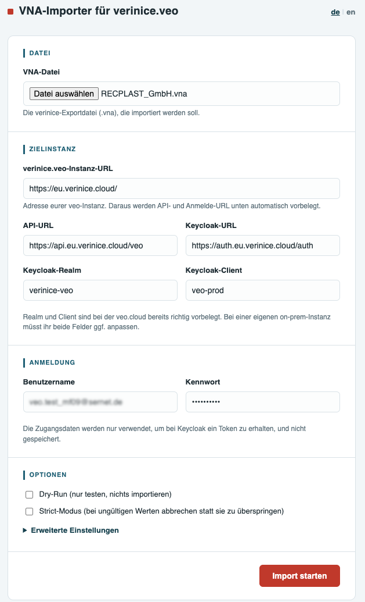
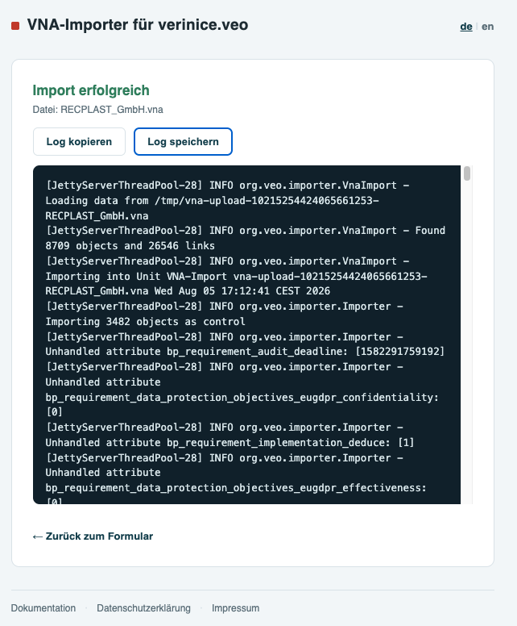
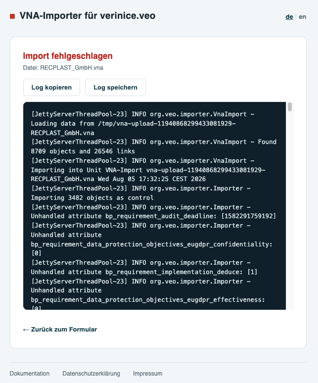

<!-- © 2026 The Project Contributors - see AUTHORS.txt -->
# Der VNA-Importer

Für die Datenübernahme aus **verinice.PRO** oder **verinice.EPV** (Einzelplatzversion) in die neue verinice-Generation **verinice.cloud** steht der Webservice [VNA-Importer](https://vna-import.verinice.com/) zur Verfügung.

Wenn Sie [verinice.onprem](https://verinice.com/produkte/verinice/veriniceonprem) ohne Verbindung zum Internet betreiben, wenden Sie sich bitte an unseren Support:
support@verinice.com.

## Funktionsumfang

Der VNA-Importer migriert Daten aus einer zuvor aus **verinice.PRO** oder **verinice.EPV** exportierten **.vna**-Datei in die jeweilige Zielinstanz **verinice.cloud**. Die Migration berücksichtigt alle Neuerungen gegenüber der Vorgängergeneration und wird in unterschiedlichen Ausbaustufen bereitgestellt:

- Migration von Daten aus der Perspektive **Modernisierter IT-Grundschutz** in die Domänen **IT-Grundschutz** und **Datenschutz** (verfügbar).
- Migration von Daten aus der Perspektive **ISO/ISM** in die Domänen **ISO 27001** und **Datenschutz** (Verfügbarkeit siehe [Roadmap](../roadmap/)).
- Migration von Daten des **BCM** (Business Continuity Management) aus den Perspektiven **Modernisierter IT-Grundschutz** bzw. **ISO/ISM* in die Domänen **BCM BSI 200-4** bzw. **ISO 22301** (Verfügbarkeit siehe [Roadmap](../roadmap/)).

Bei der Migration wird eine neue Unit erstellt und die Daten aus der VNA-Datei in diese Unit kopiert - die originalen Daten bleiben unverändert erhalten! Es können mehrere Informationsverbünde in eine Unit übernommen werden.

::: warning Sollten Sie die maximale Anzahl von Units überschritten haben, müssen Sie zunächst eine Unit löschen oder weitere Units beziehen, bevor Sie neue Daten importieren können.
:::

Im Detail werden folgende Daten übernommen:

- Alle (Ziel)objekte:
  - Verknüpfungen zwischen (Ziel)objekten.
  - Bausteine, Anforderungen, Elementare Gefährdungen.
  - Schutzbedarfswerte für Vertraulichkeit, Integrität, Verfügbarkeit.
  - Risikobewertung.

## Vorarbeiten in verinice

Um alle Verbesserungen der neuen verinice-Generation bestmöglich nutzen zu können, sind die Daten in verinice vor dem VNA-Export zu prüfen und sofern erforderlich zu bereinigen:

### Modellierung prüfen

In der neuen verinice-Generation wird die Umsetzung von Anforderungen nicht mehr in der Anforderung, sondern in der Verknüpfung zum jeweiligen Zielobjekt dokumentiert. Es wird eine einzige Instanz jedes Bausteins und jeder Anforderung beibehalten und mit mehreren Zielobjekten verknüpft. Diese Deduplizierung von Bausteinen reduziert den Aufwand bei der Arbeit in verinice erheblich, bedarf dazu aber auch einer sorgfältigen Vorbereitung der Ausgangsdaten.

Nur Bausteine der aktuellen **Edition 2023-1** des IT-Grundschutz-Kompendiums werden dabei mit den Bausteinen im Katalog in verinice verknüpft. Ältere Editionen werden **ohne Katalog-Verweis** importiert und verhalten sich im Wesentlichen wie benutzerdefinierte Bausteine. Es ist dringend empfohlen die Modellierung entsprechend zu aktualisieren, um bei Veröffentlichung zukünftiger Editionen automatische Aktualisierungen nutzen zu können!

Die Bausteine müssen **korrekt modelliert bzw. referenziert** sein, dies betrifft insbesondere auch die Verknüpfungen zwischen Zielobjekten und Anforderungen.

Bausteine mit offizieller Benennung aus dem Kompendium müssen **vollständig** und **exakt** sein (alle Anforderungen umfassen, originale Beschreibung enthalten, originale Vorgehensweise eingestellt, ...). Andernfalls werden diese Bausteine ohne Verweis zum Katalog als benutzerdefinierte Bausteine interpretiert.

Pro Baustein darf zudem nur eine Person als **Bausteinverantwortlicher** referenziert sein.

### Risikodefinitionen prüfen

Die Risikodefinitionen für die Domänen **IT-Grundschutz** und sofern verwendet für die Domäne **DS-GVO** müssen **identisch zu den Risikomatrizen** in verinice sein.

Da in beiden Generationen für den IT-Grundschutz als Standard die Risikodefinition aus dem BSI-Standard 200-3 verwendet wird, ist keine Aktion erforderlich, sofern die Risikodefinition in verinice nicht angepasst wurde.

Falls eine Anpassung einer Risikodefinition erforderlich ist, kann dies einfach über das Menü im Abschnitt **Risikodefinition** erfolgen.

Beachten Sie, dass Risiken an Zielobjekten in der neuen verinice-Generation nur angelegt werden, wenn für ein Zielobjekt in verinice die Option **Risikoanalyse erforderlich** gesetzt ist. Risiken an Informationsverbünden hingegen werden immer übernommen.

### Neue Zielobjekte definieren

Die Prozessobjekte wurden erweitert um **Fachverfahren**. Sie können vor dem VNA-Export durch Vergabe eines **Tags** in verinice definieren, ob ein Geschäftsprozess als Fachverfahren übernommen werden soll:

- Tag für die Übernahme als Fachverfahren:
  - **veoimport:IT-Grundschutz:PRO_SpecialisedTask**
- (Allgemeine Syntax: veoimport:*domain-name*:*subtyp-id*)

## Einschränkungen

Beim VNA-Import sind die folgenden Einschränkungen zu beachten:

- Einige wenige ältere Felder aus verinice sind in der neuen Generation nicht mehr vorhanden und werden bewusst nicht übertragen (z.B. Tags).
- Der Import von anwenderspezifischen Feldern/Daten (nach Customizing) kann in Abstimmung mit dem verinice.Team ergänzt werden.

## Anwendung

Der [VNA-Importer](https://vna-import.verinice.com) steht als Webservice unter `vna-import.verinice.com` zur Verfügung:

1. Wählen Sie die **VNA-Datei** aus, deren Inhalt Sie nach verinice.cloud migrieren möchten.
1. Geben Sie die URL für die Zielinstanz ein, zum Beispiel für die verinice.cloud:
`https://eu.verinice.cloud`. Alle weiteren Parameter werden automatisch vorbelegt und sollten nicht geändert werden. Für andere verinice-Instanzen können diese Parameter abweichen. Kontaktieren Sie dazu bitte unseren Support.
1. Geben Sie Ihren **Benutzernamen** und Ihr **Kennwort** für die Zielinstanz ein.
1. Führen Sie optional einen **Dry Run (Testlauf)** durch. In diesem Fall wird der Import **ohne** Übernahme von Daten durchgeführt, um eventuelle Fehler vor dem eigentlichen Import identifizieren zu können.
1. Führen Sie optional einen **Strict Run** durch. Der Import wird mit strengeren Prüfungen durchgeführt, um Fehler besser identifizieren zu können.
1. Über **Erweiterte Einstellungen** können für Sonderfälle weitergehende Parameter konfiguriert werden.
1. Starten Sie den **Import**.

### Import erfolgreich

Ein erfolgreicher Import wird durch entsprechende Meldung quittiert.

Sofern der Import nicht als **Dry Run** durchgeführt wurde, finden Sie in Ihrer Zielumgebung eine Unit mit allen zuvor exportierten Inhalten vor. Nach einem **Dry Run** stehen die Inhalte dann nach wiederholtem realen Import zur Verfügung.

Es ist angeraten die Daten zumindest stichprobenhaft auf Vollständigkeit und Korrektheit zu prüfen. Um eventuelle Änderungen bzw. Neuerungen in Ihren Daten aufgrund des Generationswechsels nachvollziehen zu können, empfiehlt sich der Blick in die [Dokumentation](https://docs.eu.verinice.cloud/de/).

Aus Gründen der Nachvollziehbarkeit bietet sich an, die vom VNA-Importer erzeugt **Logdatei** zusammen mit der VNA-Datei zu speichern.

Die Migration von Daten kann jederzeit wiederholt werden, wobei jeweils eine neue Unit erzeugt wird.

### Import fehlgeschlagen

Ein nicht erfolgreicher Import wird analog mit entsprechender Fehlermeldung quittiert.

Die vom VNA-Importer erzeugte **Logdatei** informiert im Detail über die eventuellen Probleme. Sie können die Logdatei kopieren oder speichern und zur Fehlerbehebung im Editor Ihrer Wahl öffnen.

::: danger Bitte beachten Sie dabei insbesondere die folgenden möglichen Fehlerquellen:
:::

- Die Import-Parameter (Zielinstanz, Benutzername, Kennwort, etc.) wurden korrekt eingegeben?
- In Ihrem Client ist die maximale Anzahl von Units noch nicht erreicht - der VNA-Importer kann eine neue Unit erzeugen?
- Alle [Vorarbeiten in verinice](#vorarbeiten-in-verinice) wurden korrekt umgesetzt?

::: info Sollte der Export weiterhin fehlschlagen, unterstützt das verinice.Team bei der Fehlerbehebung. Bitte stellen Sie dazu die Logdatei und die VNA-Datei zur Verfügung.
:::

## Für verinice.onprem

Für den Import in andere Zielumgebungen wie z.B. **verinice.onprem** steht der VNA-Importer als Java-Client zur Verfügung. Bitte kontaktieren Sie den verinice-Support unter support@verinice.com für weitere Informationen.
