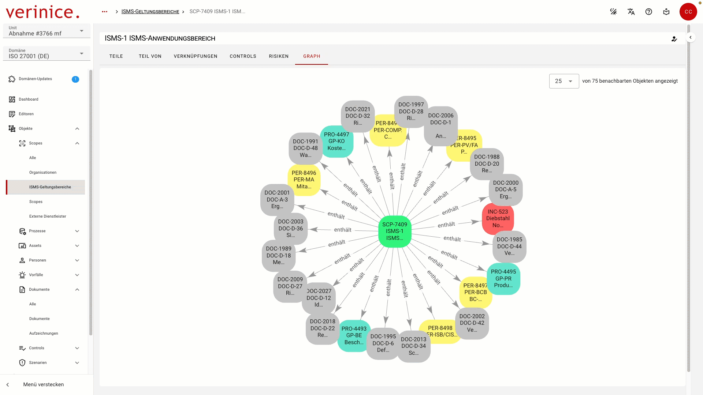

<!-- © 2026 The Project Contributors - see AUTHORS.txt -->
# verinice 55

Die folgenden Neuerungen stehen Anwenderinnen und Anwendern mit dem Release von **verinice 55** zur Verfügung.

## Graph View - Anzahl der angezeigten Objekte wählbar
<!-- epics/359 -->

Im Graph View ist mit dieser Iteration die Anzahl der angezeigten Objekte frei wählbar.

## VNA-Importer IT-Grundschutz und Datenschutz
<!-- epics/305 -->

Bereitstellung des VNA-Importers zur Migration von Daten in die Domänen IT-Grundschutz und Datenschutz.

## Units importieren
<!-- epics/304 -->

In der Unit-Verwaltung können zuvor über Datenübertragung exportierte Units importiert werden.

## Konfliktfreie Domain-Updates
<!-- epics/59 -->

Änderungen und Neuerungen an Domänen können die Migration von bereits existierenden Daten erfordern. Dabei eventuell auftretende Konflikte werden erkannt und angezeigt, damit diese von Anwenderinnen und Anwendern aufgelöst werden können.

Mit dieser Funktion werden die folgenden Neuerungen an Domänen veröffentlicht:

<!-- epics/302 -->
- Domäne **IT-Grundschutz (DE)**
- Domäne **DS-GVO (DE)**
- In der Domäne **ISO 27001 (DE)** wird die deutschsprachige Version der ISO 27005 berücksichtigt.<!-- epics/300 -->
- Der allgemeingültige Subtyp **Dokument** wurde in allen Domänen vereinheitlicht, um das domänenübergreifende Arbeiten zu vereinfachen.<!-- epics/233 -->

## Detailverbesserungen und Bugfixes

* Strukturverbesserungen der Templates im Helm Chart.
* Verbesserte Unterstützung von Registry Mirroring für den On-Prem-Betrieb in Air-Gapped Umgebungen.
* Verbesserung der OpenShift-Unterstützung im Helm Chart.
* Behebung eines Fehlers in Nuxt v4.4.4.
* Verbesserung der Testautomatisierung im Produktionsprozess.
* Autocomplete Funktion im CSV-Import korrigiert.
* Zentrale Ablage und Verwaltung aller Frontend-Scripte.
* Fehlende Validierung von Übersetzungen beim Domain-Template-Import behoben.
* Buttons in der Anwendungsleiste sind nicht mehr aktiv, wenn ein Tutorial geöffnet ist.
* Der veraltete Admin-Endpunkt `POST /admin/domain-templates/{id}/allclientsupdate` wurde entfernt.
