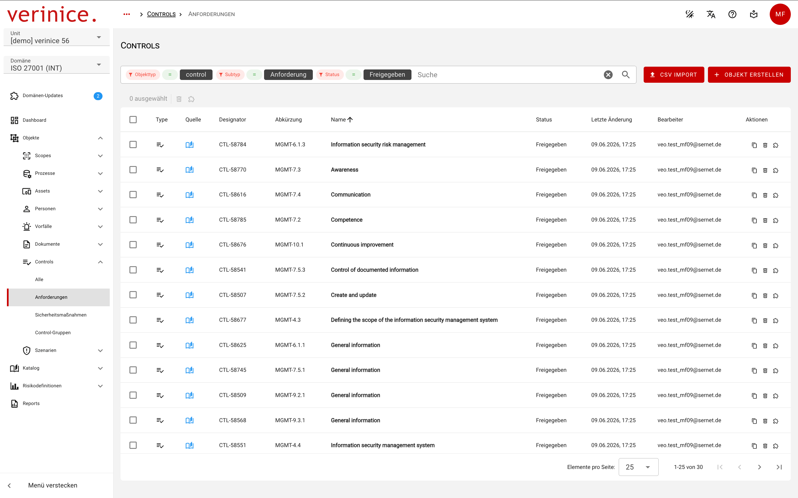
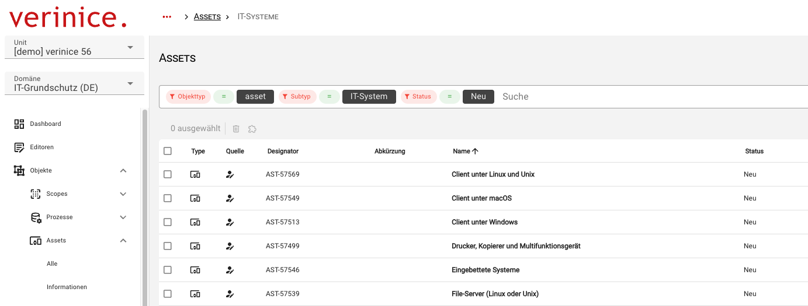
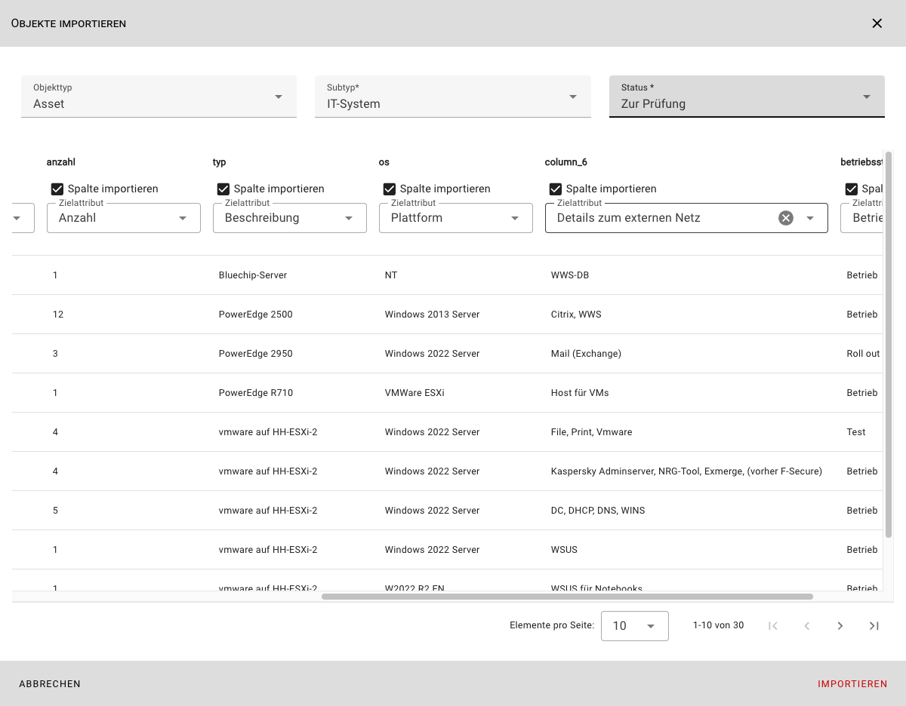

<!-- © 2026 The Project Contributors - see AUTHORS.txt -->
# verinice 56

Die folgenden Neuerungen stehen Anwenderinnen und Anwendern mit dem Release von **verinice 56** zur Verfügung.

## Objektübersicht informativer strukturieren
<!-- epics/344 -->

Die Objektübersicht wurde überarbeitet um Informationen übersichtlicher darzustellen:

- Die Schaltfläche **Objekt erstellen** wurde nach oben rechts verschoben, um die Objektübersicht nicht mehr zu überlagern.
- Der **CSV-Import** ist jetzt als Agent über eine neue Schaltfläche zu erreichen um den Platz für die Objektübersicht zu maximieren.
- Die **Paginierung** (Elemente pro Seite) ist am unteren Bildschirmrand fixiert, so dass auf den ersten Blick ohne zu Scrollen die Anzahl der verfügbaren Objekte erkennbar ist.
- Bei der **Mehrfachauswahl** von  Objekten wird über der Objektübersicht angezeigt, wie viele Objekte ausgewählt sind.
- Die Suche wurde zur besseren Erkennbarkeit über der Objektübersicht positioniert.

## Verbesserung der Suche
<!-- epics/290 -->

Die Suche löst den bisherigen Filterdialog ab und ermöglicht mit dieser Iteration die Suche nach allen verfügbaren Kriterien:

## CSV-Import aller Datentypen
<!-- epics/217 -->

Mit der dritten Iteration des CSV-Imports können Daten in alle Felder eines Objektes importiert werden:

:::tip Mit verinice 57 ist der Download von CSV-Beispieldateien für den Import aller Objekte geplant.
:::

## Konfliktfreie Domain-Updates
<!-- epics/59 -->

Neuerungen an Domänen können die Migration von bereits existierenden Daten erfordern. Dabei eventuell auftretende Konflikte in den Daten werden erkannt und angezeigt, damit diese von Anwenderinnen und Anwendern aufgelöst werden können. Siehe auch die Beschreibung zu [Domänen-Updates](../manual/domain-updates.md) im Handbuch.

## Detailverbesserungen und Bugfixes
<!-- epics/272 -->

- Bei der Anlage von Hauptnutzern können Vor- und Nachname jetzt optional vergeben werden.<!-- work_items/3952 -->
- Die Reports für die internationalen Domänen **ISO 27001 (INT)** und **GDPR (INT)** stehen jetzt komplett zur Verfügung.<!-- epics/353 -->
- Der Report **A.5 Risikoanalyse** für die Domäne IT-Grundschutz wurde erweitert.<!-- work_items/4793 -->
- Im Report **A.6 Realisierungsplan** werden keine Controls aus anderen Domänen ausgegeben.<!-- work_items/4827 -->
- Fehlende Übersetzungen im Report **Datenschutz-Risikoanalyse** wurden ergänzt.<!-- work_items/4825 -->
- Fehlende Übersetzung im Report **Inventarverzeichnis** in der Domäne ISO 27001 wurden ergänzt.<!-- work_items/4824 -->
- Im Reporting wird die veraltete Element-Struktur nicht mehr benutzt.<!-- work_items/2544 -->
- Verwaiste **Externe Links** in der Dokumentation wurden korrigiert.<!-- work_items/4855 -->
- Die Falsche Darstellung der Risikonamen im Reiter **Risiken** wurde korrigiert.<!-- work_items/4090 -->
- Korrektur von Rechtschreibfehlern in den Domänen DS-GVO und GDPR (INT) <!-- work_items/4816 -->
- Aktualisierung verschiedener Bibliotheken und Behebung eventueller Schwachstellen.
<!-- work_items/4832 -->
<!-- work_items/4809 -->
<!-- work_items/4810 -->
<!-- work_items/4570 -->
