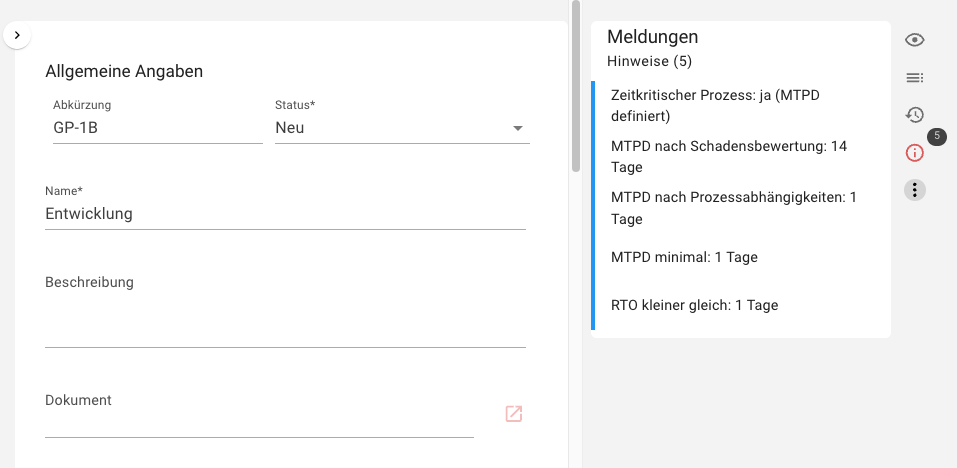
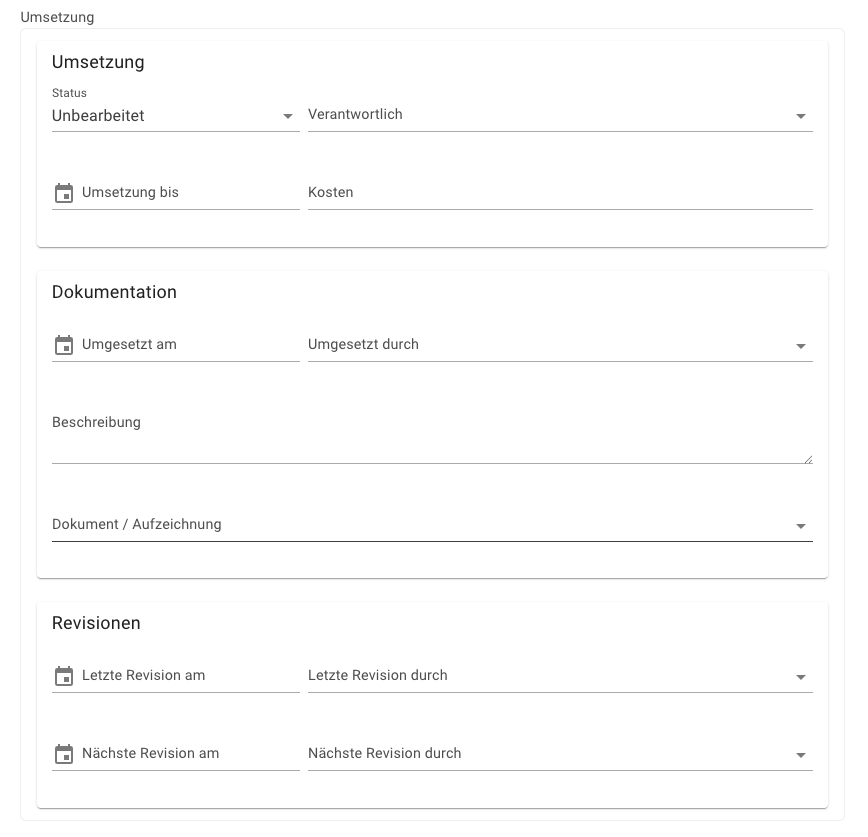
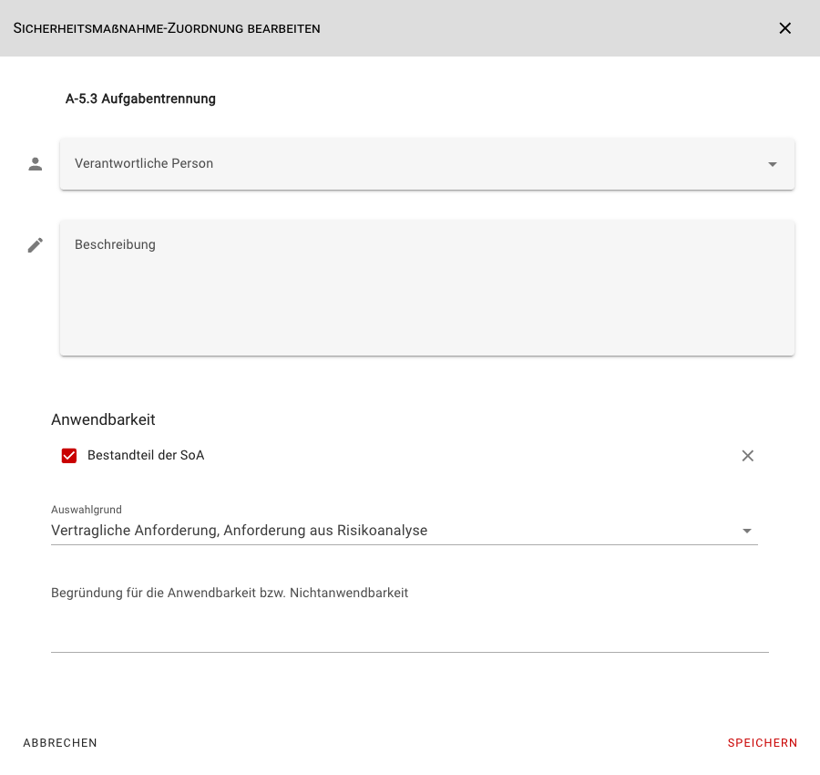

<!-- © 2026 The Project Contributors - see AUTHORS.txt -->
# verinice 57

Veröffentlichung: 24. Juli 2026

Die folgenden Neuerungen stehen Anwenderinnen und Anwendern mit dem Release von **verinice 57** zur Verfügung.

## Business Continuity Management (BCM)
<!-- epics/362 epics/285 epics/258 epics/306 epics/255 -->

Das BCM kann in drei neuen Domänen **BSI 200-4 (DE)**, **ISO 22301 (DE)** und **ISO 22301 (INT)** abgebildet werden. Die Domänen stehen in Kürze in den jeweiligen Bundles zur Verfügung.

Die **MTPD** nach Schadensbewertung kann für Geschäftsprozesse festgelegt werden und die minimale MTPD nach automatischem Abgleich der Abhängigkeiten von anderen Prozessen ermittelt werden. Die **RTO** und die **RPO** für Ressourcen werden analog automatisch nach den Prozessabhängigkeiten abgeleitet.

Die Ergebnisse der Notfallplanung können mittels der Report-Vorlagen **Wiederanlauf- und Wiederherstellungsplan**, **Geschäftsfortführungsplan** und **Notfallhandbuch** dokumentiert und ausgegeben werden.

## Umsetzungsdokumentation erweitern
<!-- epics/261 -->

Die Dokumentation der Umsetzung von Anforderungen wurde domänenübergreifend erweitert:

::: warning Migrationshinweise
In den vorherigen Versionen der Domänen war es bereits möglich, einige der oben gezeigten Attribute (z. B. *Letzte Revision*) direkt am jeweiligen Control zu erfassen. Diese Controlattribute werden jedoch in den neuen Domänenversionen nicht mehr unterstützt.

Wenn Sie diese Controlattribute bereits verwendet haben, übertragen Sie bitte vor dem Domänen-Update Ihre bestehenden Werte in die jeweiligen Umsetzungen(en) des Controls und entfernen Sie die Werte aus dem Control selbst.
:::

## Anwendbarkeit (SoA) besser dokumentieren
<!-- epics/208 -->

Die Anwendbarkeit (SoA) kann im Scopeobjekt in der Zuordnung für die einzelnen ISO-Controls besser dokumentiert werden:

## CSV-Import
<!-- epics/369 -->

Im CSV-Import-Wizard kann eine [CSV-Datei als Vorlage für den Import](../manual/CSV-Import.md) jedes Subtypen heruntergeladen werden. Die Vorlage enthält Daten für alle Felder und vereinfacht so den Import nach verinice. 

## Detailverbesserungen und Bugfixes
<!-- epics/273 -->

- Die Suchkriterien werden konsistent zur Navigation angewendet. <!-- work_items/4880 -->
- Eingegebene Suchkriterien bleiben nach Seitenwechsel erhalten. <!-- work_items/4918 -->
- Beheben eines Fehlers beim Erstellen des Security-Incident-Reports. <!-- work_items/4860 -->
- Im Report A.5 Risikoanalyse werden keine Risiken aus falschen Domains mehr angezeigt. <!-- work_items/4828 -->
- Höhe des Scrollbalkens in der Objektübersicht angepasst. <!-- work_items/4867 -->
- Logo auf der Loginseite aktualisiert und Cursor-Effekt korrigiert. <!-- work_items/4903 -->
