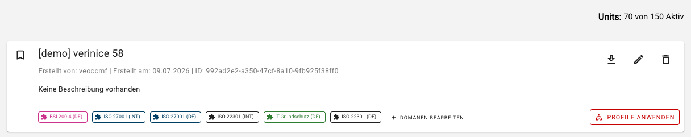
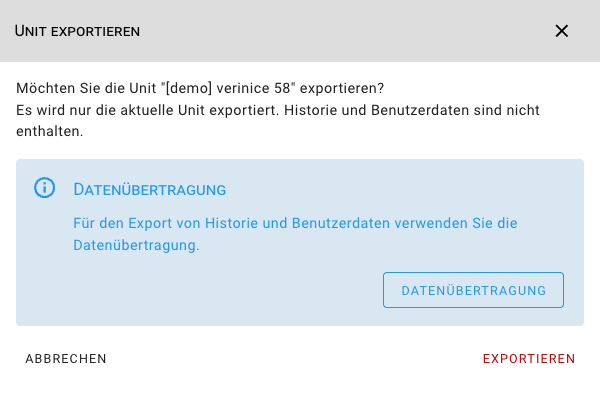

<!-- © 2026 The Project Contributors - see AUTHORS.txt -->
# verinice 58

Veröffentlichung: 14. August 2026 (voraussichtlich)

Die folgenden Neuerungen stehen Anwenderinnen und Anwendern mit dem Release von **verinice 58** zur Verfügung.

## Unit-Export in der Unit-Verwaltung
<!-- epics/376 -->

Units können jetzt direkt aus der Unit-Verwaltung heraus über das Download Icon exportiert werden:

Für ein komplettes Backup inklusive der Datenhistorie steht weiterhin die [Datenübertragung](../manual/data-transfer.md) zur Verfügung.

## Detailverbesserungen und Bugfixes
<!-- epics/274 -->

- Fehler im Text der Warnung für interaktiv zu entfernende Attribute beim Domain-Update behoben. <!-- work_items/5000 -->
- Verbesserung der Barrierefreiheit bei Objekten mit leerem Verlauf im Objektdetail. <!-- work_items/4995 -->
- Der Unit-Import ist permanent aktiviert, das zugehörige Feature Flag wurde entfernt. <!-- work_items/4891 -->
- Unnötige Meldung beim Öffnen des Reiters Meldungen beim Anlegen eines Objekts entfernt. <!-- work_items/2353 -->
- Der Unit-Import ist jetzt auch bei Units ohne Risiken/Risikodefinition möglich. <!-- work_items/4958 -->
- Die Dokumentation für die Risikodefinition wurde aktualisiert. <!-- work_items/4859 -->
