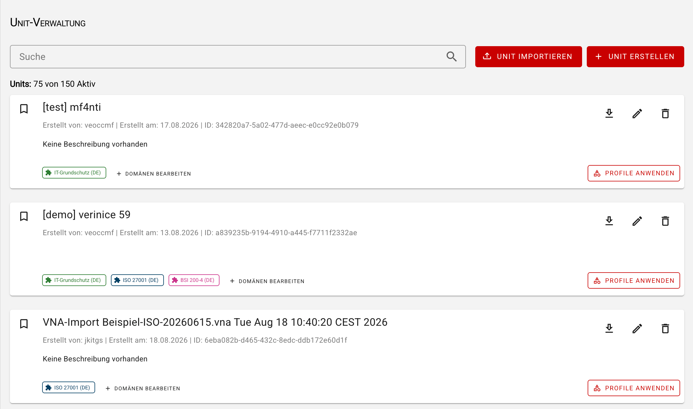

<!-- © 2026 The Project Contributors - see AUTHORS.txt -->
# verinice 59

Veröffentlichung: 4. September 2026 (voraussichtlich)

Die folgenden Neuerungen stehen Anwenderinnen und Anwendern mit dem Release von **verinice 59** zur Verfügung.

## VNA-Import

Mit dem Import von Daten in die Domänen:
- **IT-Grundschutz** und **Datenschutz** 
- **ISO** und **Datenschutz**.
<!-- epics/364 -->
- **Business Continuity (BCM)**
<!-- epics/365 -->
ermöglicht der [VNA-Importer](../new-in-verinice/vna-importer.md) jetzt die Übernahme aller Daten aus verinice.PRO oder verinice.EPV zu verinice.onprem oder verinice.cloud.

## Business-Continuity-Management Beispieldaten
<!-- epics/253 -->

### BCM-Beispieldaten

Für die Domänen **BSI 200-4 (DE)** sowie **ISO 22301 (DE)** und **ISO 22301 (INT)** steht ein Profil zur Verfügung, das eine Organisation mit Beispielobjekten zur Abbildung eines BCMS enthält. Das Profil umfasst einen Beispiel-BCMS-Geltungsbereich inklusive identifizierter Interessengruppen und deren Erwartungen sowie verknüpften Organisationseinheiten, Personen, Dokumenten, Ausfallszenarien und BIA-Ergebnissen.

Anhand zeitkritischer Musterprozesse wird dargestellt, wie MTPD, RTO und RPO ermittelt werden und als Basis für Geschäftsfortführungspläne (GFP) sowie Wiederanlaufpläne (WAP) dienen. Dazu wurden beispielhafte BC-Strategien, BC-Lösungen aus Notfallmaßnahmen sowie Verbesserungsmaßnahmen erfasst.

Ergänzend illustriert ein Grundanforderungskatalog die Compliance-Überprüfung externer Dienstleister am Beispiel eines IT-Hardware-Recovery-Anbieters. Zudem kann der offizielle BSI-Anforderungskatalog direkt auf den Geltungsbereich angewendet werden, um den Reifegrad des BCMS strukturiert zu überprüfen. Vordefinierte Objektverknüpfungen sowie beispielhafte Pläne (GFP für den Prozess „Transaktionen“, WAP/WHP für den „Hardwareserver“) ermöglichen es Ihnen, die verinice-Funktionen und Reports für Notfallhandbuch, GFP und WAP/WHP direkt in der Praxis zu testen.

### BCM-Profil für Hochschulen

Dieses Profil dient als anpassbare Schablone für den zügigen Aufbau eines Reaktiv-BCMS an Hochschulen auf Basis des BSI-Standards 200-4. Es bildet typische Kernaufgaben in Forschung, Lehre und Verwaltung ab und liefert vorgefertigte Strukturen in verinice: von der BAO über BIA-Ergebnisse (117 Prozesse, 35 Ressourcen) bis hin zu konkreten Notfall-Quickwins und Dokumentenvorlagen. Es erleichtert den schrittweisen Ausbau hin zu einem vollständigen Aufbau- bzw. Standard-BCMS.

## Unitverwaltung verbessern
<!-- work_items/5023 -->

Das Layout der Unitverwaltung wurde an die Objektübersicht angepasst:

- Die Schaltflächen **Unit importieren** und **Unit erstellen** befindet sich oberhalb der Unit-Karten.
- Im neuen Suchfeld können Units anhand ihres **Namens** oder ihrer **Beschreibung** gesucht werden.

## Verbesserung des CSV-Imports
<!-- epics/382 -->

Der Assistent für den Import von CSV-Dateien wurde weiter optimiert:

- Die Auswahl der Codierung öffnet keinen zusätzlichen Dialog mehr.
- Zwischen den einzelnen Schritten des Imports kann navigiert werden.
- Die ausgewählte Import-Datei wird angezeigt.

## Detailverbesserungen und Bugfixes
<!-- epics/275 -->

- Beim Löschen von Objekten die in mehreren Domänen verwendet werden, erfolgt ein Hinweis. <!-- work_items/4592 -->
- Fehlende Übersetzung der Objekttypen in den Shortcuts ergänzt. <!-- work_items/5045 -->
- Update auf Nuxt 4.5.1 zur Vermeidung kritischer Sicherheitslücken. <!-- work_items/5043 -->
- Falschpositive Konflikt-Warnung in der Migration korrigiert. <!-- work_items/5027 -->
- Layout des Domänen-Update-Badge behoben. <!-- work_items/5021 -->
- Neue API-Endpunkte für Client-Änderungen. <!-- work_items/4904 -->
- Der API-Schlüssel in Accounts wird nicht mehr aus dem `Authorization`-Header, sondern nur noch aus dem `X-API-KEY`-Header gelesen. <!-- work_items/4645 -->
- Fehlende Markierung am Scope-Icon bei vorhandenen Members ergänzt. <!-- work_items/4617 -->
- In Bausteinen kann die Verknüpfung zu Zielobjekten (Modellierung) gelöscht werden. <!-- work_items/4484 -->
- In der Objektübersicht wurde der Subtyp-Chip in der Suche entfernt und die Überschrift angepasst. <!-- work_items/5042 -->
