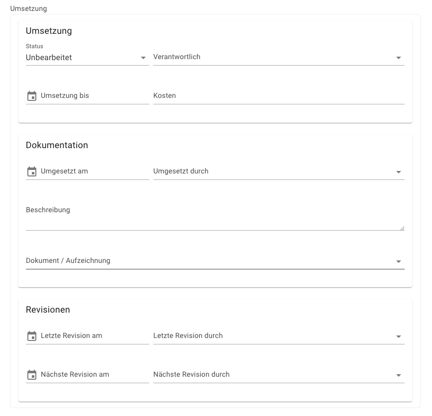
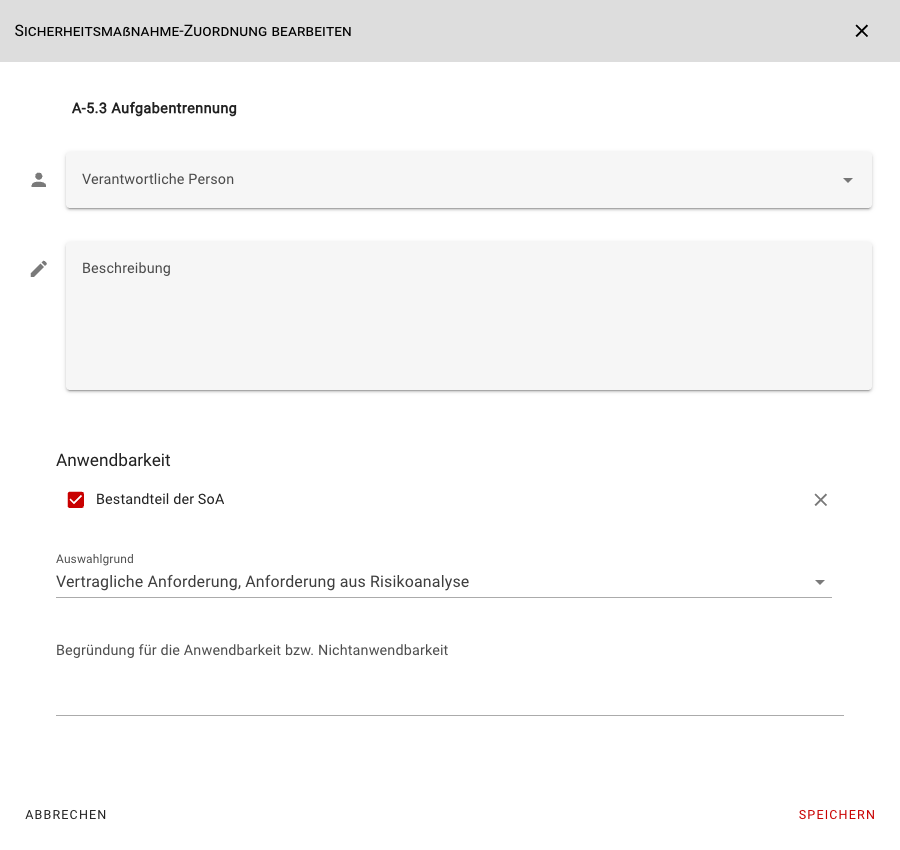
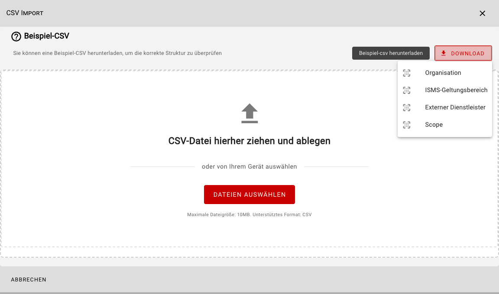
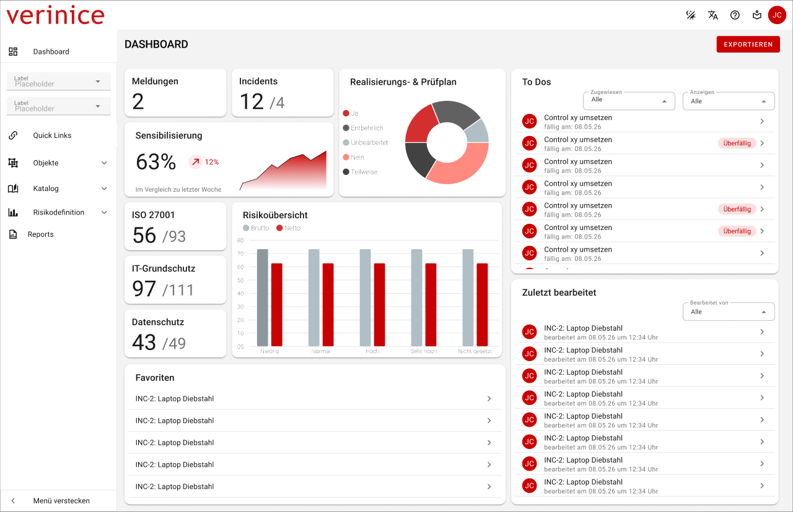
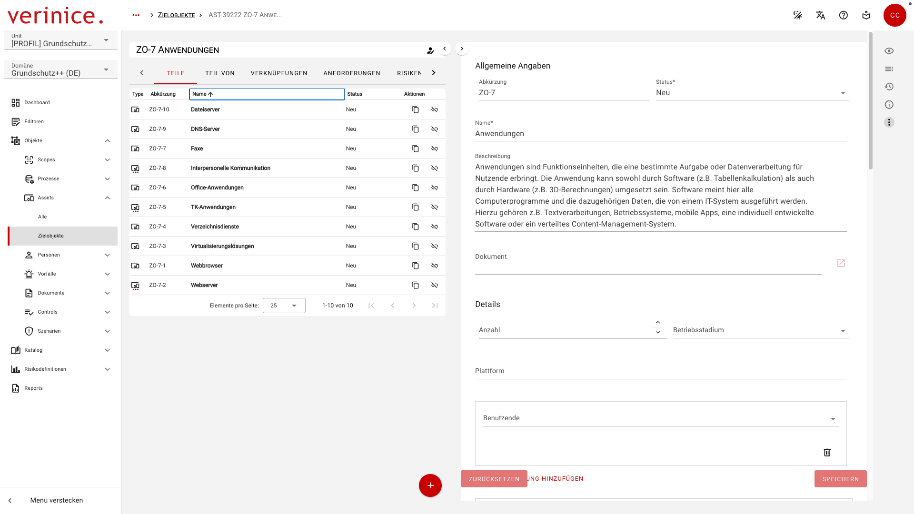

<!-- © 2026 The Project Contributors - see AUTHORS.txt -->
# Roadmap

Stand 2026-07-03 - Änderungen vorbehalten!

## Q3 2026

### Umsetzungsdokumentation <Badge type="danger">Entwicklung</Badge>
<!-- epics/261 -->

Die Dokumentation der Umsetzung von Anforderungen wird domänenübergreifend erweitert:

### SoA-Dokumentation <Badge type="danger">Entwicklung</Badge>
<!-- epics/208 -->

Die Anwendbarkeit (SoA) kann im Scopeobjekt in der Control-Implemenation (CI) für die einzelnen Controls besser dokumentiert werden:

### Beispiel-CSV <Badge type="danger">Entwicklung</Badge>
<!-- epics/369 -->

Download von Beispieldateien für den CSV-Import für alle Subtypen im CSV-Import-Wizard:

### Business-Continuity-Management <Badge type="danger">Entwicklung</Badge>

Bereitstellung des Business-Continuity-Managements mit den Domänen BSI 200-4 (DE) sowie ISO 22301 (DE) und ISO 22301 (INT) inklusive Berechnung der MTPD, RTO und RPO und den Reports zur Erstellung von Notfallhandbuch, Geschäftsfortführungs-, Wiederherstellungs- und Wiederanlaufsplan.

### VNA-Import

VNA-Import von verinice.PRO zu verinice.onprem oder verinice.cloud für IT-Grundschutz, Datenschutz, ISO und BCM inklusive der IT-Grundschutz-Profile, B3S Khs., Mindeststandards des BSI, Kriterienkatalog C5.
- Bereitstellung des VNA-Importers zur Migration von Daten in die Domänen ISO und Datenschutz. <Badge type="info">Test</Badge>
- Bereitstellung des VNA-Importers zur Migration von Daten in die Domänen ISO und Datenschutz. <Badge type="danger">Entwicklung</Badge>
<!-- epics/364 -->
- Bereitstellung des VNA-Importers zur Migration von Daten in die BCM-Domänen. <Badge type="warning">Planung</Badge>
<!-- epics/365 -->

### Ausbau des Berechtigungsmanagements <Badge type="warning">Planung</Badge>
<!-- epics/178 -->

Das Berechtigungsmanagement unterstützt Kreuzreferenzen über Units, um den Zugriff auf Units analog zu den Informationsverbünden in verinice.PRO abzubilden. In weiteren Ausbaustufen werden die Berechtigungen (Rechte und Rollen) auf z.B. Scopeobjekte erweitert.

### Workflow <Badge type="warning">Planung</Badge>
<!-- epics/374 -->
Erstellung von Aufgaben für beliebige Objekte, z.B. als zwischen Usern delegierbare und rück-delegierbare Fragebogen-Objekte.

### Reportformate <Badge type="warning">Planung</Badge>

Bereitstellung zusätzlicher Ausgabeformate für Reports (CSV, XLSX/ODS und DOCX/ODT, HTML):
- Ausgabe von Reports in den Formaten **DOCX** und **ODT** für die redaktionelle Bearbeitung, bevor diese finalisiert werden.<!-- epics/373 -->
- Erstellung weiterer Reportvorlagen in tabellarischer Form in den Formaten **CSV/XLSX/ODS** für die quantitative Weiterverarbeitung, Filterung und Sortierung von Daten.<!-- epics/372 -->
- Ausgabe aller Report-Templates im **HTML**-Format für die interne Bereitstellung (z.B. im Intranet) oder zur schnellen browserbasierten Ansicht ohne Zusatzsoftware.<!-- epics/371 -->

### Auditmanagement <Badge type="warning">Planung</Badge>

Abbildung von internen und externen Audits in verinice mit Delegation von Aufgaben und Überwachung im Rahmen des Workflows. Die Planung und Durchführung von internen und externen Audits wird über ein neues Scopeobjekt abgebildet.

## Q4 2026

### Unit-Import/Export <Badge type="warning">Planung</Badge>

Der Export von Units steht wie der Import in der Unit-Verwaltung zur Verfügung.

### Business-Continuity-Management Beispieldaten <Badge type="warning">Planung</Badge>
<!-- epics/253 -->

Beispiel-Units und -Profile für die BCM-Domänen, z.B. das BCM-Profil für Hochschulen.

### Dashboard <Badge type="warning">Planung</Badge>
<!-- epics/315 -->

Ausgebaute Dashboardfunktionen um Daten visuell darzustellen:

Der Ausbau des Dashboard ist in mehreren Iterationen geplant (die Abbildung zeigt ein erstes Design der Funktionalität):
- Graphische Darstellung der Umsetzungsstatus von Controls und der Risiken.
- Kalendarische Darstellung von Aufgaben und Fälligkeiten.
- Darstellung von Kennzahlen in Kacheln.
- Option zum Export der dargestellten Daten.

### Domäne Grundschutz++ <Badge type="warning">Planung</Badge>
<!-- epics/262 -->

Bereitstellung einer ersten funktionalen Domäne Grundschutz++ (DE) mit den Neuerungen in Methodik und Risikomanagement.

