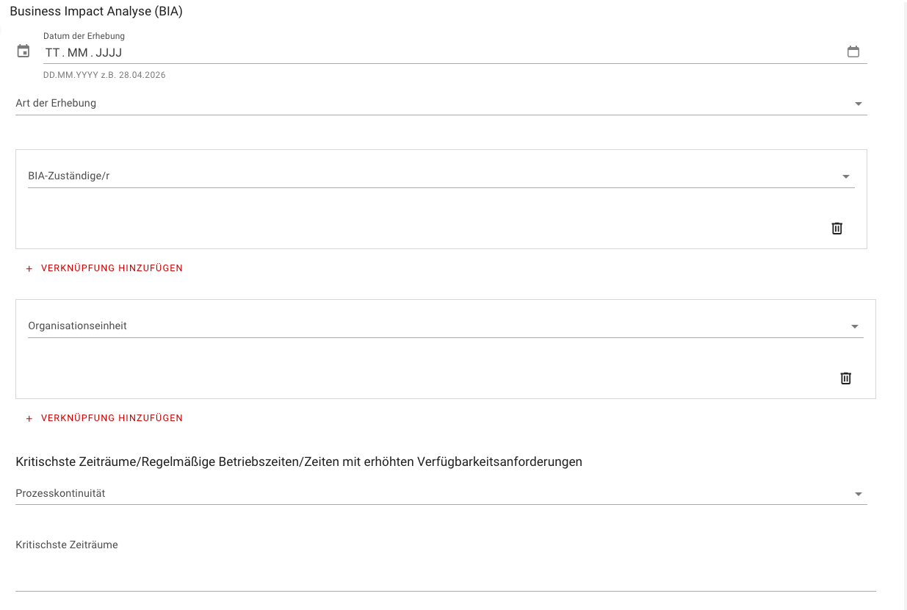
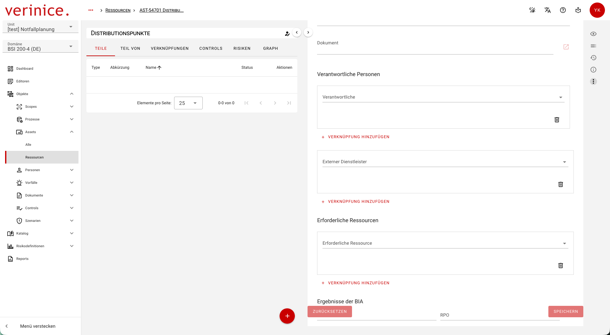
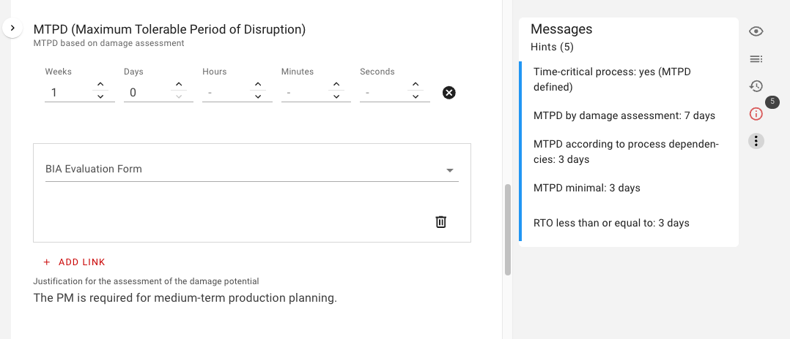
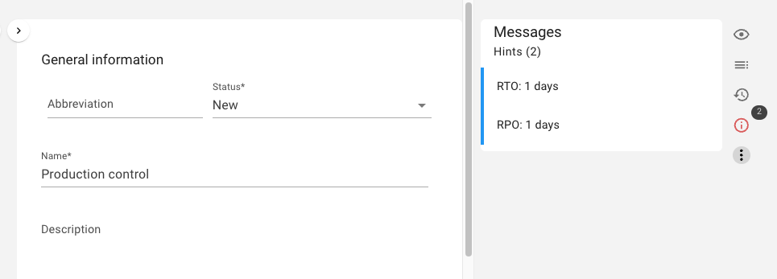

<!-- © 2026 The Project Contributors - see AUTHORS.txt -->
# Business Impact Analysis (BIA)

A primary objective of the Business Continuity Management System (BCMS) is to adequately safeguard business-critical processes. The Business Impact Analysis (BIA) serves to systematically answer the following key questions:

* Time sensitivity: Is the business process time-sensitive?
* Fault tolerance: What is the maximum allowable downtime for the process before intolerable damage occurs to the institution?
* Resource requirements: What resources are absolutely necessary to maintain the process in emergency mode?

Thus, the BIA forms the foundation for prioritizing processes, defining recovery time objectives (RTO) and recovery point objectives (RPO), and subsequently planning emergency and recovery measures.

## Preparing for the BIA

### Defining Business Processes

To begin the BIA, the relevant processes within the BCMS scope must be recorded as objects. Take advantage of existing synergies: If your institution already has an Information Security Management System (ISMS) or a Record of Processing Activities (RPA) in accordance with the GDPR, this data can serve as an ideal starting point.

* Create new processes: If no processes have been recorded yet, create them using the “Business Process” object type.

* Use existing processes: You can easily assign existing processes from the data protection or ISMS domain to the BCMS domain.

### Documentation of Process Details

In the form for the respective business process, you can enter specific additional information regarding the BIA. This includes:

* Type of process continuity: e.g., continuous, outcome-oriented, cyclical, or quasi-cyclical
* Most critical periods: Phases during which a failure would have particularly serious consequences
* Responsibilities: The BIA manager and the responsible organizational unit
* Data collection: The selected methodology (e.g., self-report, individual interview, workshop)

### Defining Resource Categories and Clusters

To provide a structured overview, required resources are recorded under the “Resource” object type and organized into resource categories and clusters (e.g., personnel, IT systems, buildings, service providers, information) via so-called composites (parent groups).

* Structuring: Assign individual resources to the appropriate composite via the “Parts” tab.
* Responsibilities: Link the responsible internal personnel or external service providers directly within the resource.

## Conducting the BIA

### Determining the Damage Potential and the MTPD

To identify time-critical processes, the damage potential of each business process must be assessed for the previously defined time horizons. Define the **MTPD based on damage assessment** according to the worst-case principle in the section **MTPD (Maximum Tolerable Downtime)**:

Next, explain how the MTPD was determined, which damage scenarios were decisive for the assessment, and whether the business process is ultimately time-critical.

### Defining the Emergency Operation Level

Use the Emergency Operation Level field to define the minimum scope of service at which the business process must be operated in the event of a crisis in order to avert intolerable damage (e.g., maintaining 60% of regular capacity, using simplified manual procedures).

### Mapping of Emergency-Related Process Dependencies

After the initial assessment, the emergency-related dependencies between processes are analyzed. This is necessary to determine whether a process’s MTPD is reduced due to its dependency on another process. If the fault tolerance changes as a result of these dependencies, the automated inspection generates the following messages:

- **Time-Critical Process:** The process is classified as time-critical if an MTPD has been defined following a damage assessment.
- **MTPD Following Damage Assessment:** The entered value is displayed
- **MTPD based on process dependencies:** This value is determined using the minimum principle from all MTPDs required by **other processes**. 
- **Minimum MTPD:** The smaller of the two preceding values is used as the minimum MTPD for the process.
- **RTO less than or equal to:** The RTO for resources must always be less than or equal to the MTPD.

### Defining the Required Time to Recovery (RTO) and RPO and Mapping Resource Dependencies

The process owner also identifies and documents the resource dependencies based on the process dependencies:

* The resources required for emergency operation are linked via the custom link.
* The specific RTO and RPO for each resource in this particular business process are defined directly within this custom link.

### Special Considerations for Data- and IT-Based Resources

For information-based resource categories (e.g., data, IT systems, information storage), the Recovery Point Objective (RPO) must also be determined. This describes the maximum tolerable data loss—that is, the furthest back in time that data may be in emergency mode without unduly impairing the process flow.

Conceptually, the RPO is independent of MTPD and RTO; however, it is consolidated in the next step if multiple processes access the same resource.

### Consolidating RTO and RPO

Once all process owners have documented their requirements, the RTO and RPO requirements of the various processes are automatically consolidated at the level of the respective resources. The final results are transferred directly to the resource object. If multiple processes use the same resource, the minimum principle applies: The strictest (smallest) RTO or RPO of all linked processes determines the global requirement for that resource.

### Identification of Single Points of Failure

Resources that are shared by multiple time-critical processes and whose failure could trigger a chain reaction must be identified as critical bottlenecks. In verinice, these vulnerabilities can be documented in the resource object using the Single-Point-of-Failure/of-Knowledge/of-Contact (SPoF/SPoK/SPoC) field. Before doing so, the SPoFs can be linked directly to the parent business process as known vulnerabilities.
verinice distinguishes between three categories:

* SPoF (Single Point of Failure): Technical or service-related bottlenecks (e.g., a central firewall, a single external service provider).
* SPoK (Single Point of Knowledge): Knowledge dependencies in which business-critical expertise resides with a single individual.
* SPoC (Single Point of Contact): Communication dependencies in which the flow of information depends on a single point of contact.

## Developing Emergency and BC Solutions for Business Continuity Planning

Once the gaps and requirements identified in the BIA have been established, appropriate emergency plans and solutions must be developed for the critical resources.

* Linking in verinice: Under the section **Emergency Planning**, you can link the corresponding BC solutions directly to the resources.
* Details: The actual development of the business continuity plans then takes place in the specific subtype **BC Solution** (for details, see the chapter [Business Continuity and Recovery Planning](./create-Plans-for-Emergency)).
