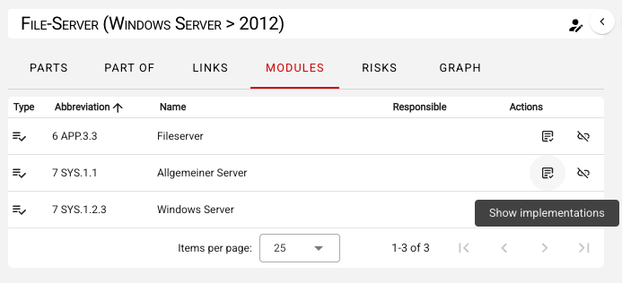
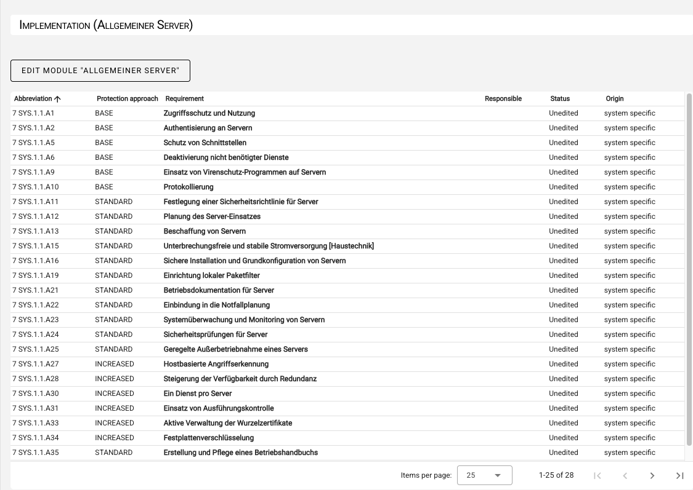
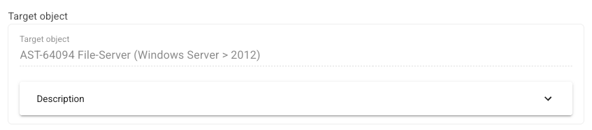
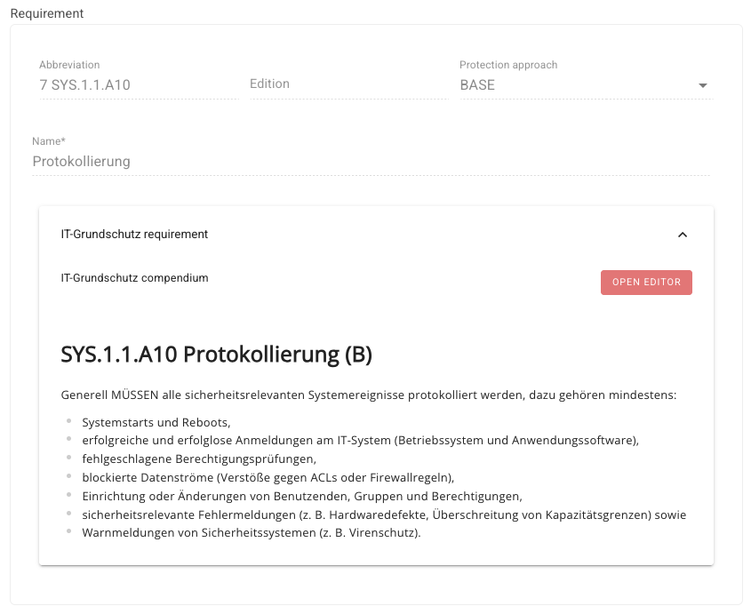
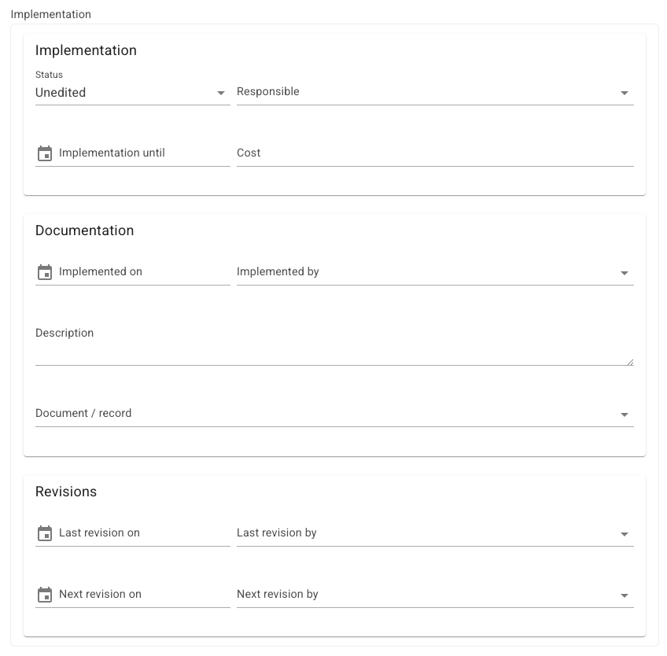

<!-- © 2024 The Project Contributors - see AUTHORS.txt -->
# IT-Grundschutz Check

In this step, the status of the modeled modules—specifically, the individual requirements—must be processed. To edit requirements, click **Show Implementation** for the respective module in the **Modules** tab of the target object's context.

You will be taken to an overview of all requirements of the selected module.

Here, you can edit the individual requirements. By clicking on a requirement, the implementation dialog opens, where you can view or enter the following information in three sections:

- Information about the target object (informational/read-only)

2. Requirement description, i.e. from the IT-Grundschutz Compendium (informational/read-only)

3. Document information about the implementation in three sections:

**Implementation**

- Implementation status (Unprocessed, Yes, Partially, No, Not Required)
- Person Responsible
- Implementation Due by (Date)
- Implementation Costs

**Documentation**

- Implemented on
- Implemented by
- Implementation Description
- Link to a document or record

**Revision**

- Last revised on
- Last revised by
- Next revision on
- Next revision by

Once you have entered the data, close the dialog by clicking **Save**.

After all modeled modules and requirements have been processed, the result of the IT-Grundschutz Check can be generated as a report.
