<!-- © 2024 The Project Contributors - see AUTHORS.txt -->
# Risk Analysis according to 200-3

## Definitions

In BSI IT Baseline Protection according to 200-x, different parameters for risk calculation can be defined per unit. The organization-wide risk matrix valid for all target objects is defined under [Risk Definitions](../manual/risk-definition.md).  
Navigate in the menu to **Risk Definitions** and then **GSRA**. Here you can edit the categories by clicking the **pencil icon**. You can adapt the following parameters to your requirements:

- Probability of occurrence
  - Name and definition of the categories
- Extent of damage
  - Name and definition of the categories
- Risk categories
  - Name, definition, and color of the categories

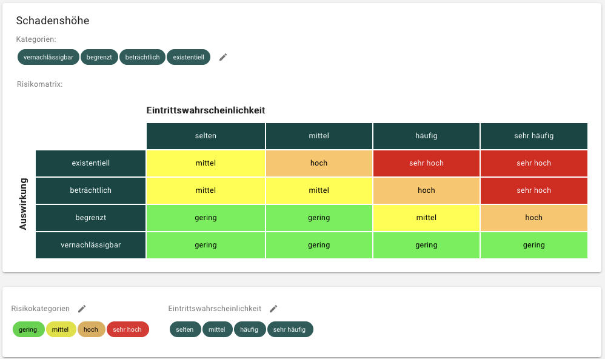

## Create Threat Overview

If a risk analysis is required, you must create a **threat overview** in the target object's details. This may be necessary, for example, if the target object has a high or very high protection requirement in one of the three security objectives.

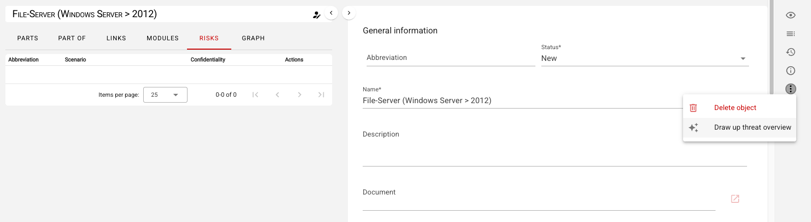

This action copies the elemental threats according to the BSI cross-reference tables into your unit and creates risk objects for each elemental threat in the object environment of the target object:

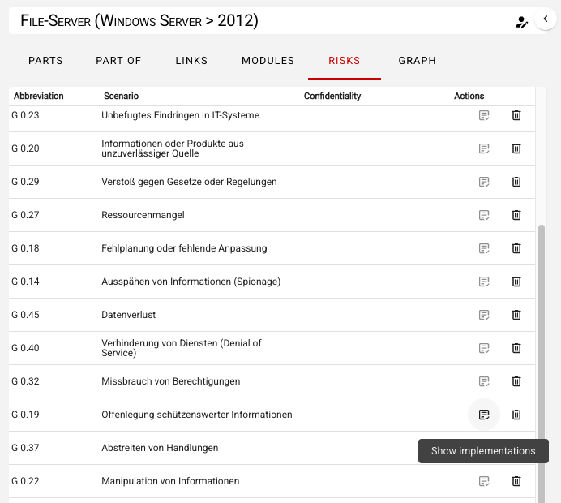

## Risk Assessment

To further process the individual elemental threats, click on the respective threat to open a dialog. The first step is to perform the risk assessment. Evaluate the following parameters:

- **Probability of occurrence** (and optionally an explanation)
- **Impact regarding extent of damage** (and optionally an explanation)

Based on these two values, the **gross risk** is automatically calculated using the risk matrix after you save your entries.

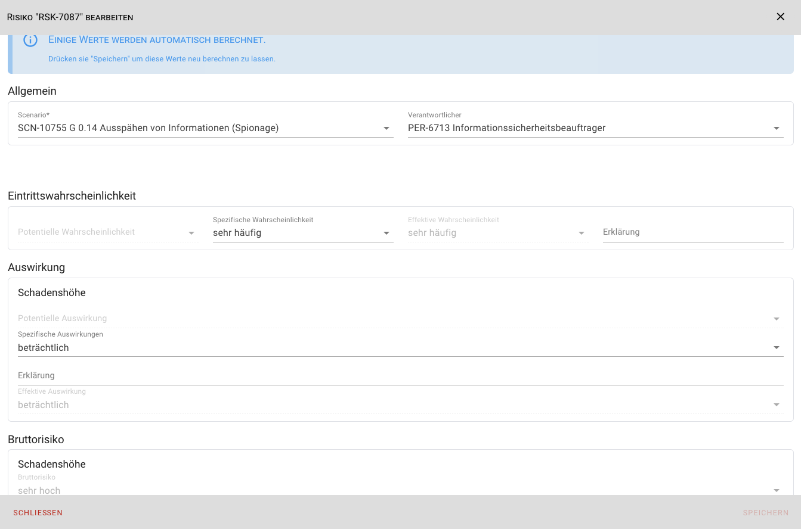

## Risk Treatment

Depending on the level of risk, a risk treatment may or must be performed, and optionally an explanation documented. You can select multiple **treatment options**, with the following options available:

- Risk acceptance
- Risk avoidance
- Risk reduction
- Risk transfer

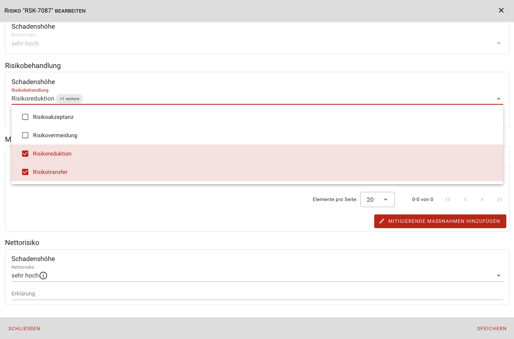

### Risk Reduction

If the risk treatment option **Risk Reduction** is selected, the risk can be reduced by adding additional security measures. You have two ways to add mitigating measures:

1. To create a **new measure**, click **Add Mitigating Measures** and then **Create Mitigating Measure**. A dialog opens to create the new measure. After saving your data for the measure, the new measure will be displayed in the previous risk dialog under **Measures for Risk Reduction**.

2. To link **existing measures**, click **Add Mitigating Measures** and then **Link Mitigating Measure**. A dialog opens where you can select the required mitigating measures from all already existing measures. After closing the dialog by clicking **Save**, the selected measures will be displayed in the **Measures for Risk Reduction** section:

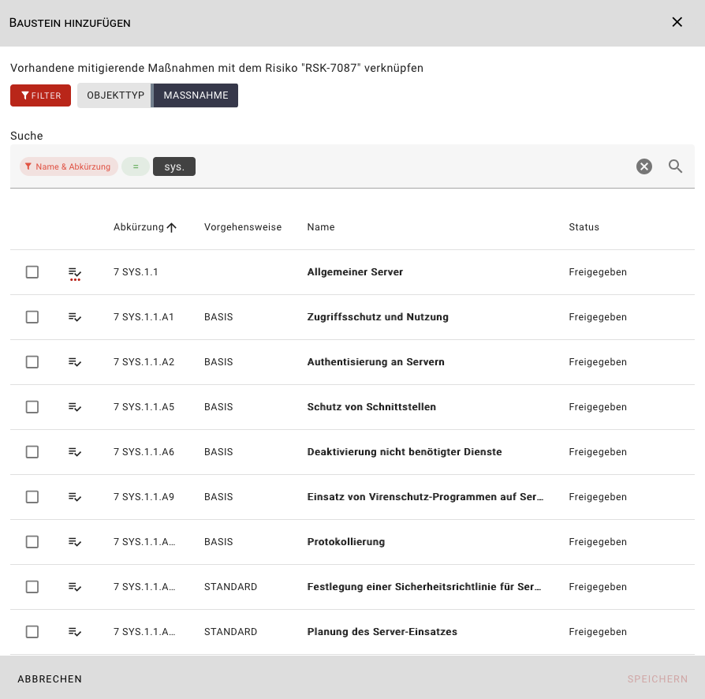

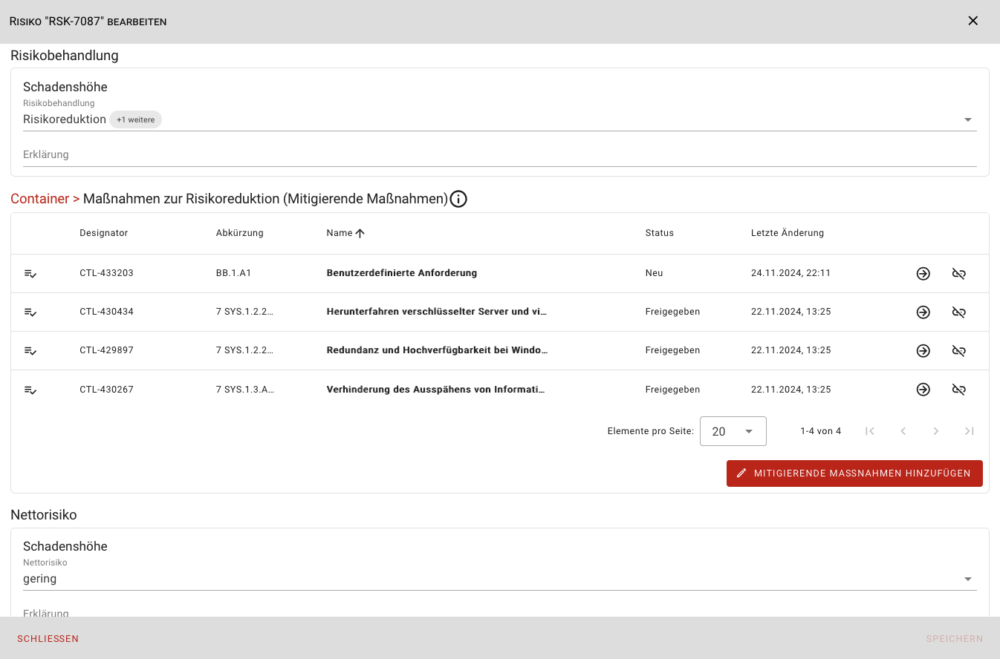

Finally, the **net risk** (and optionally an explanation) must be set manually. **Save** and **Close** the risk dialog.

### Edit Mitigation Safeguards

To edit your mitigation safeguards, click **View Implementation** next to the corresponding threat in the **Risks** tab in the target object’s object environment.

You will be taken to an overview of all mitigating safeguards for the selected threat.

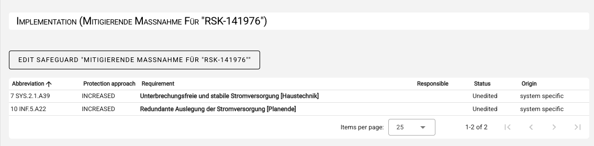

Here you can edit the individual safeguards. Clicking on a safeguard opens the implementation dialog, where you can view or enter the following information in three sections:

1. Information on the target object (informational/read-only)

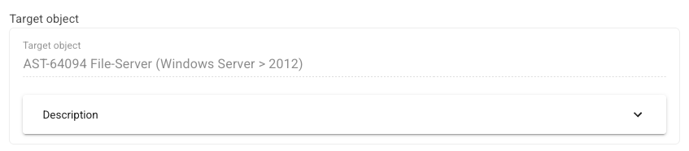

2. Safeguard description, e.g., from the IT-Grundschutz Compendium (informational/read-only)

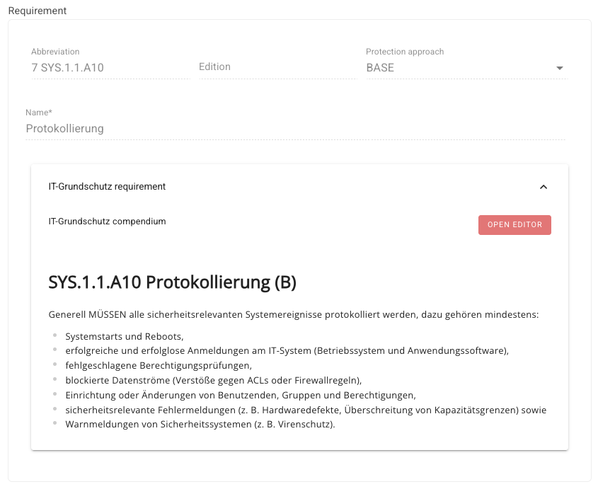

3. Document implementation information in three sections:

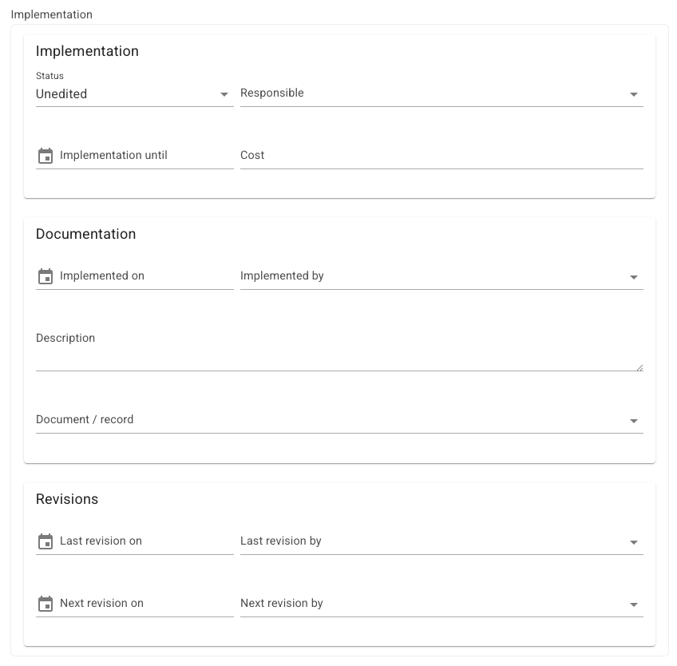

**Implementation**

- Implementation status (Unprocessed, Yes, Partially, No, Not Required)
- Person responsible
- Implementation by (date)
- Implementation costs

**Documentation**

- Implemented on
- Implemented by
- Description of implementation
- Link to a document or recording

**Revision**

- Last revision on
- Last revision by
- Next revision on
- Next revision by

After you have entered the data, close the dialog by clicking **Save**.
