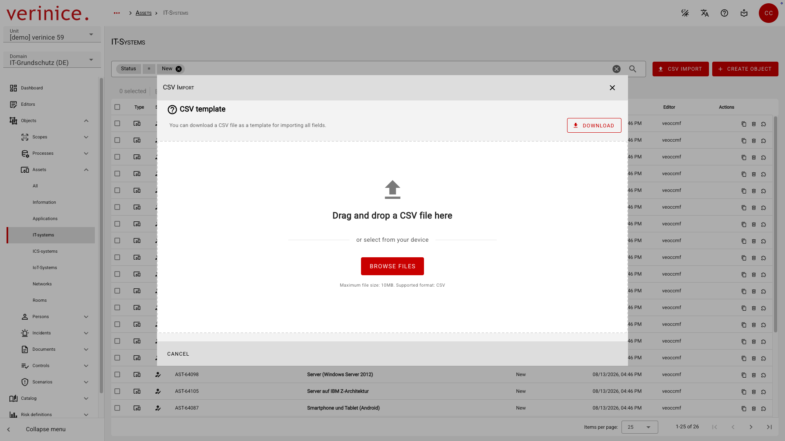
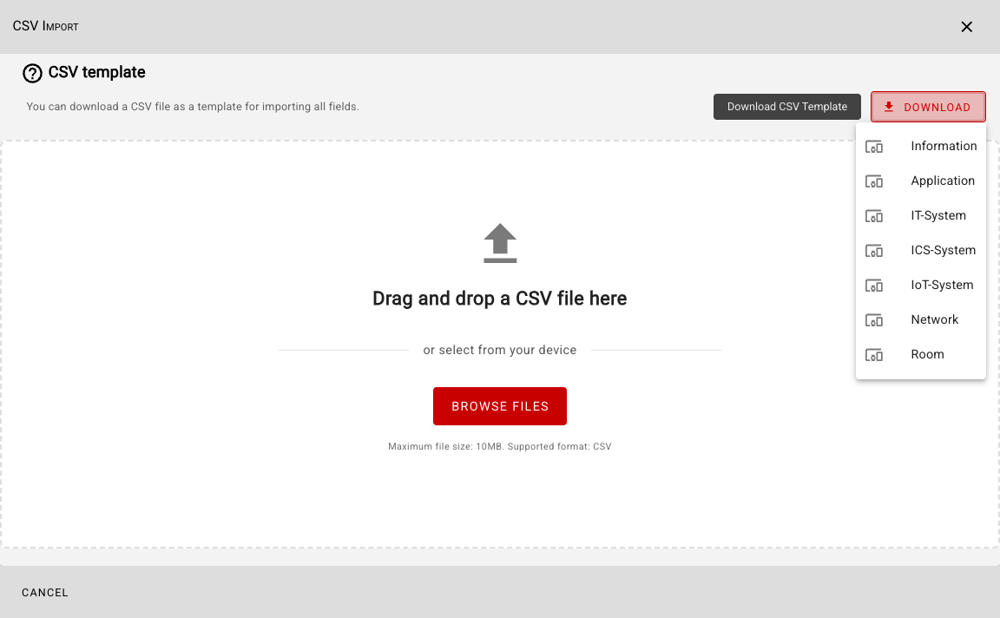
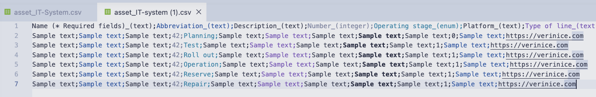
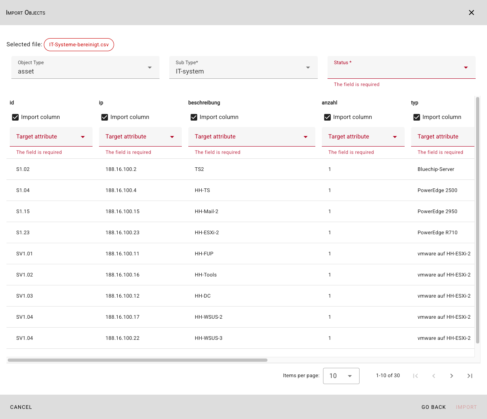
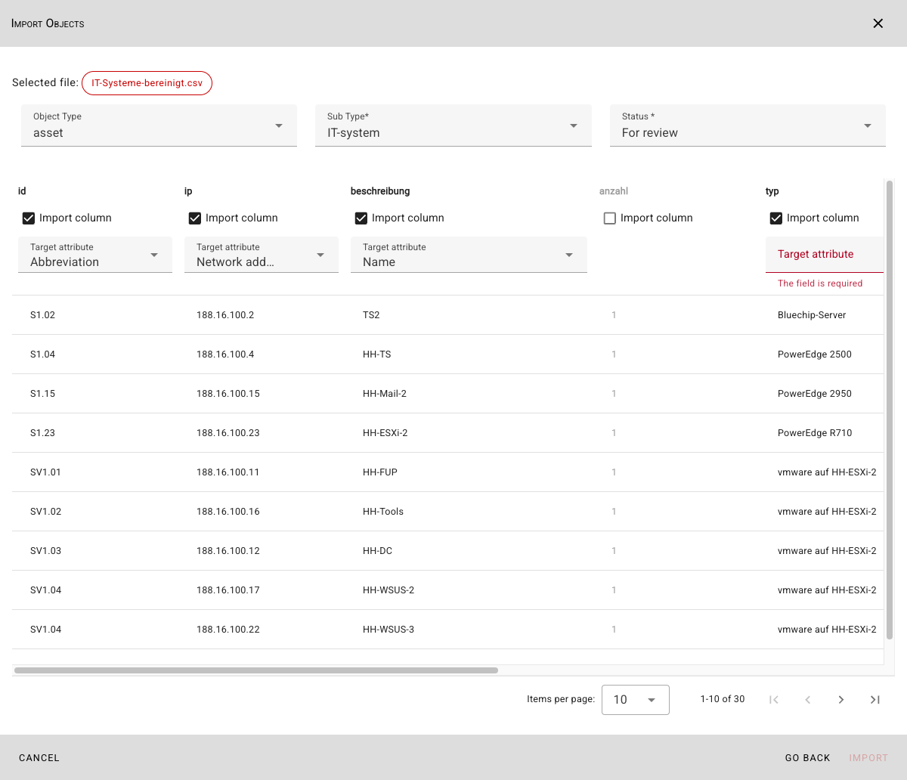
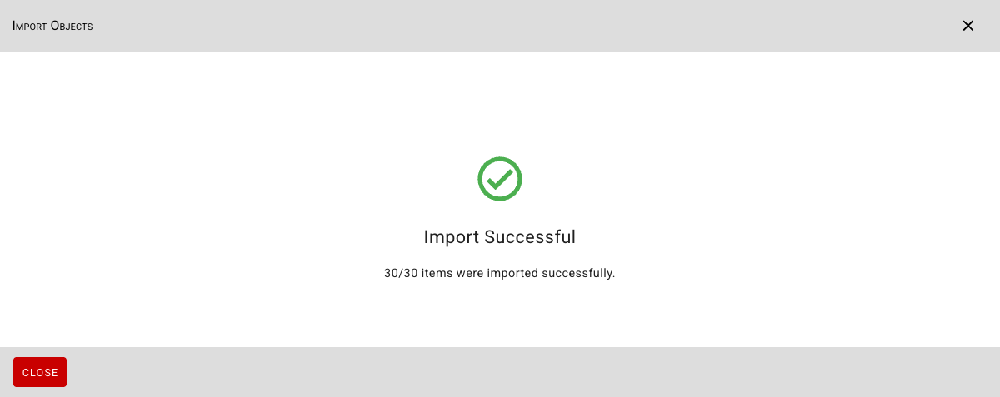

<!-- © 2025 The Project Contributors - see AUTHORS.txt -->
# CSV Import

The CSV import allows you to import data into all fields of all subtypes. To do this, navigate to the object overview for the desired subtype via the dashboard or the menu, and open the CSV import by clicking the **CSV Import** button:

**Links to other objects** are not imported. Additionally, during a CSV import, all objects are imported anew; objects that were previously imported are **not updated**.

::: info For a recurring or bidirectional import, please always use the REST API.
:::

## Download CSV template file

Before importing, you can download a **CSV file** as template for each subtype that contains data for all fields:

The downloaded template file contains the following data:

| Field type | Content | Note |
|---|---|---|
| Text | Sample text ||
| Integer | 42 ||
| Date | 2026-07-13 | Export date according to ISO 8601 |
| Date & Time | 2026-07-13T16:24:25 | Date and time of export according to ISO 8601 |
| Checkbox | **0** or **1** | Boolean |
| External Link | https://verinice.com ||
| Single Select | All possible values | One value per line |
| Multi Select | All possible values | All values separated by **&** on each line |

## Import data

Select the CSV file you want to import by dragging and dropping it or by clicking the **Select Files** button. After selecting the encoding, the **Import Objects** dialog that opens will display all entries in the CSV file along with all existing columns:

Check whether the suggested **Object Type** and **Subtype** are selected correctly, and specify the **Status** for the objects to be imported.

For each column in the CSV file, specify whether the column should be imported and, if so, into which target attribute the values should be imported:

::: info
The **Abbreviation** and **Name** fields are required for import and must be assigned.
:::

You can edit the displayed data before importing to make final corrections.

Start the import using the **Import** button. A message will then inform you whether the import was successful or if any errors occurred.

The imported objects can now be used in verinice.
