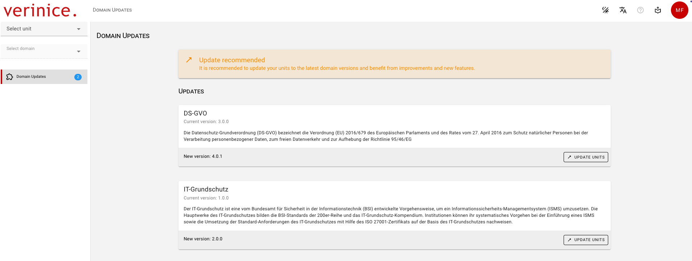
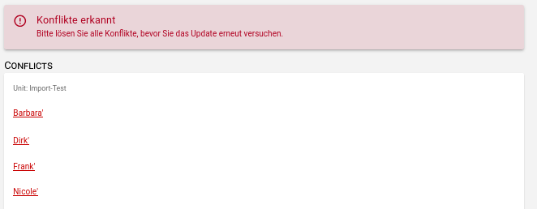
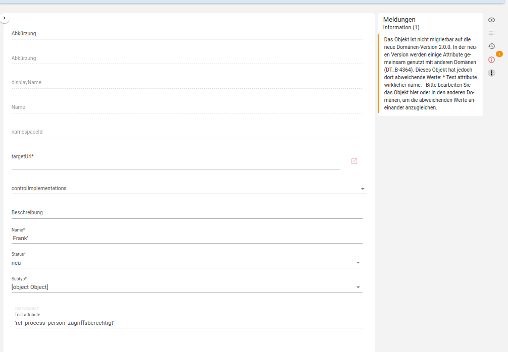
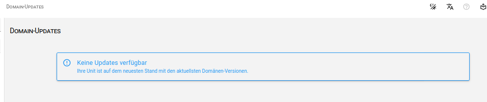

<!-- © 2026 The Project Contributors - see AUTHORS.txt -->
# Domain Updates
<!-- verinice 55 -->

To avoid incompatibilities (breaking changes) when extending domains, verinice checks for new versions of the domains during login and, if available, displays them in the new menu item **Domain Updates**.

After selecting the menu item, an overview lists all new versions of the domains:

It is recommended to update all units to the latest domain versions to take advantage of all new features!

If there are no conflicts, the data in the respective units is automatically migrated and the new domain version is active.

If conflicts are detected, they are listed for resolution:

Since resolving conflicts requires adjusting data you have already entered, navigate to the respective object. In the **Messages** section, the specific adjustments required are described and can be easily made:

After resolving all conflicts, you can run the domain update again via **Update Units**.

