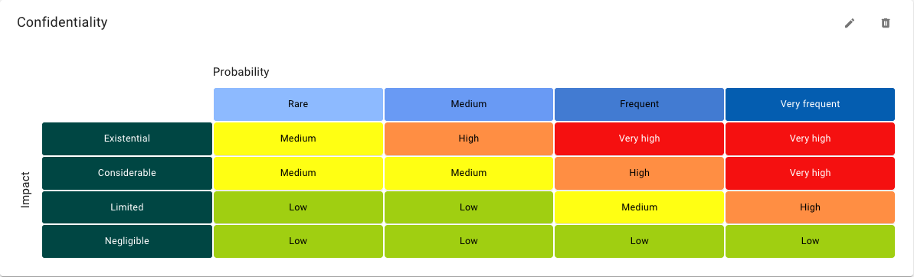
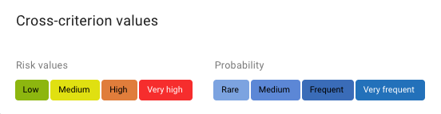
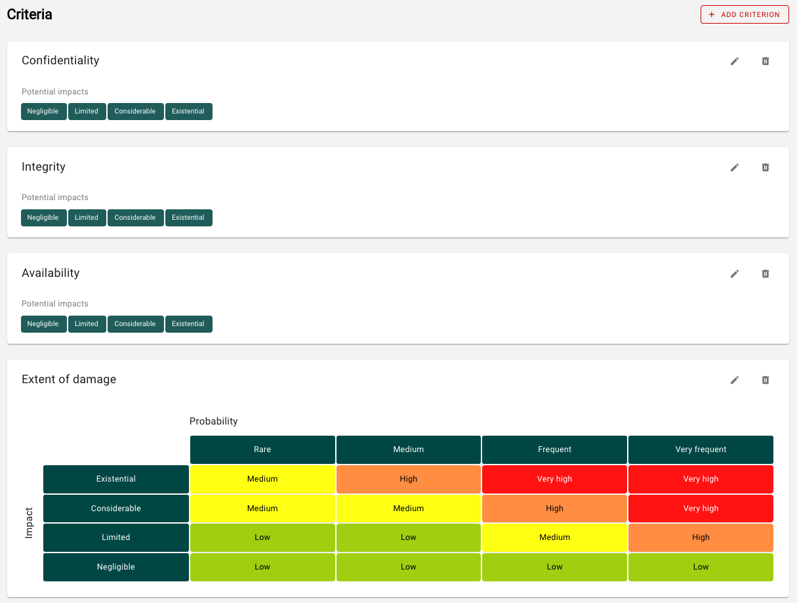

<!-- © 2024 The Project Contributors - see AUTHORS.txt -->
# Risk definitions

::: danger Any adjustment to a risk definition requires changes to existing risks. It is therefore recommended to adapt the risk definition to the specific organization **before** conducting the risk assessment!
:::

::: warning Changing the risk definition affects all units in the respective domain!
:::

The definitions for the risk analysis can be viewed and edited in the Risk definitions section.

The risk definition shows a probability of occurrence/impact matrix for various protection goals:

- A probability of occurrence/impact matrix is shown for each protection objective (here confidentiality).
- The impact can be adjusted for each protection objective.
- The Y-axis shows the impact levels.
- The X-axis shows the levels for the probability of occurrence.
- The assignment of the risk categories is color-coded in the matrix. Move the mouse over individual fields to display the detailed definitions for the individual parameters.

- The risk categories are defined across all protection goals.
- The probability of occurrence is defined across all protection goals.
- If no risk matrix is to be used for a protection goal, this can be omitted.
- Optionally, a risk matrix can then be used to consider the level of damage.

You can customize the labels and the descriptions for all parameters to suit your organization, expand the levels as needed, and add additional security objectives, such as authenticity, patient safety, or treatment effectiveness.
