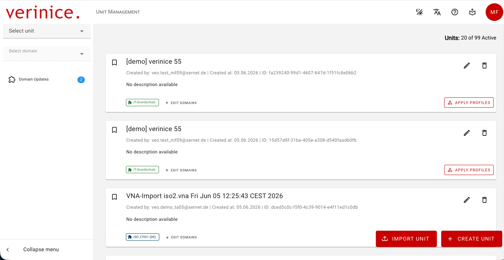
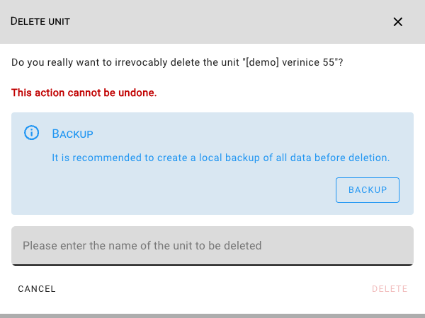

<!-- © 2026 The Project Contributors - see AUTHORS.txt -->
# Unit Management
<!-- verinice 55 -->

In the **Unit Management** section, you can create or import new units, as well as edit or delete existing units:

You can access Unit Management at any time via the **verinice logo** or by selecting **Manage Units** in the Unit Selector.

Note the number of **available units**! Generally, two units are always available, so you can use one for productive work and one as a test unit. If all available units are in use, you can only create additional ones after deleting units or purchasing more.

## Create Units

You can **create new units** using the button of the same name in a wizard. You can:

- Specify the name and description of the unit.
- Apply [profiles](../object-model/profiles) to your unit. Please note that a profile always generates a variety of additional objects and may also assign a new domain.
- Add additional [domains](../object-model/domains) to your unit, for example, to map an ISMS according to ISO 27001 and a DSMS according to the GDPR using the same objects.

## Import Units

Using the **Import Unit** button, you can import units previously exported via [Data Transfer](data-transfer) as new units.

::: warning Currently, only units based on the same **Domain Template Version** can be imported.
:::

## Edit Units

You can edit a unit’s name and description using the **pencil icon**. As with creating units, you can also **apply profiles** and **edit domains** for existing units.

::: danger Adding new domains cannot currently be undone and should therefore be tested initially in a unit not used productive.
:::

## Delete Units

You can delete units that are no longer needed by clicking the **trash can icon** after a confirmation prompt—you must confirm the name of the unit to be deleted. It is recommended that you create a local backup in advance via [Data Transfer](data-transfer).

