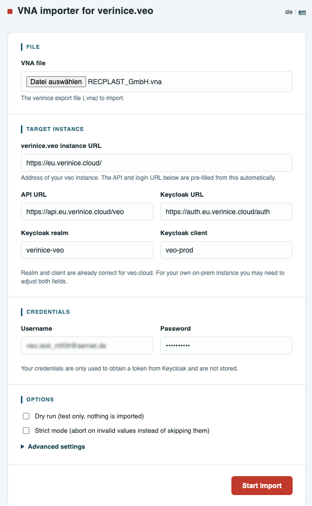
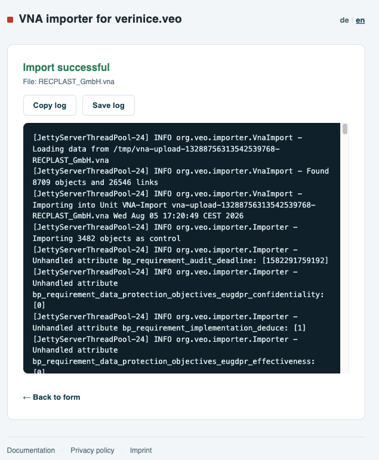
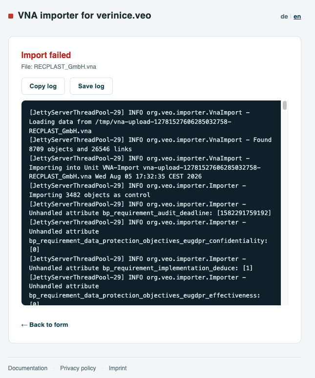

<!-- © 2026 The Project Contributors - see AUTHORS.txt -->
# The VNA Importer

The [VNA Importer](https://vna-import.verinice.com/) web service is available for transferring data from **verinice.PRO** or **verinice.EPV** (single-user version) to the new verinice generation, **verinice.cloud**.

If you are running [verinice.onprem](https://verinice.com/produkte/verinice/veriniceonprem) without an Internet connection, please contact our support team:
support@verinice.com.

## Features

The VNA Importer migrates data from a **.vna file** previously exported from **verinice.PRO** or **verinice.EPV** to the respective target instance of **verinice.cloud**. The migration takes into account all new features compared to the previous generation and is provided in different levels of functionality:

- Migration of data from the **Modernized IT-Grundschutz** perspective to the **IT-Grundschutz** and **Data Protection** domains (available).
- Migration of data from the **ISO/ISM** perspective to the **ISO 27001** and **Data Protection** domains (for availability, see [Roadmap](../roadmap/)).
- Migration of **BCM** (Business Continuity Management) data from the perspectives of **Modernized IT-Grundschutz** and **ISO/ISM* to the domains **BCM BSI 200-4** and **ISO 22301** (for availability, see [Roadmap](../roadmap/)).

During migration, a new unit is created and the data from the VNA file is copied into this unit—the original data remains unchanged! Multiple information networks can be transferred into a single unit.

::: warning If you have exceeded the maximum number of units, you must first delete a unit or acquire additional units before you can import new data.
:::

Specifically, the following data is imported:

- All (target) objects:
- Links between (target) objects.
- Modules, requirements, elementary threats.
- Protection requirement values for confidentiality, integrity, and availability.
- Risk assessment.

## Preparatory Work in verinice

To make the best possible use of all the improvements in the new generation of verinice, the data in verinice must be checked before the VNA export and cleaned up if necessary:

### Check Modeling

In the new generation of verinice, the implementation of requirements is no longer documented within the requirement itself, but rather in the link to the respective target object. A single instance of each modules and each requirement is retained and linked to multiple target objects. This deduplication of modules significantly reduces the effort required when working in verinice, but it also necessitates careful preparation of the source data.

Only modules from the current **Edition 2023-1** of the IT-Grundschutz Compendium are linked to the modules in the verinice catalog. Older editions are imported **without a catalog reference** and essentially behave like user-defined modules. It is strongly recommended that you update your modeling accordingly so that you can take advantage of automatic updates when future editions are published!

The modules must be **correctly modeled or referenced**; this applies in particular to the links between target objects and requirements.
Modules with official names from the compendium must be **complete** and **exact** (include all requirements, contain the original description, have the original procedure set, etc.). Otherwise, these modules will be interpreted as user-defined modules without a reference to the catalog.
Furthermore, only one person may be referenced as the **module owner** per module.

### Check Risk Definitions

The risk definitions for the **IT-Grundschutz** domain and, if used, for the **GDPR** domain must be **identical to the risk matrices** in verinice.

Since the risk definition from the BSI Standard 200-3 is used as the default for IT-Grundschutz in both generations, no action is required unless the risk definition in verinice has been modified.

If a risk definition needs to be modified, this can be done easily via the menu in the **Risk Definition** section.

Please note that risks are only created for target objects in the new verinice generation if the **Risk Analysis Required** option is set for a target object in verinice. Risks associated with information sets, on the other hand, are always transferred.

### Defining New Target Objects

The process objects have been expanded to include **Business Processes**. Before the VNA export, you can define in verinice whether a business process should be imported as a specialized procedure by assigning a **tag**:

- Tag for importing as a specialized procedure:
  - **veoimport:IT-Grundschutz:PRO_SpecialisedTask**
- (General syntax: veoimport:*domain-name*:*subtyp-id*)

## Limitations

The following limitations must be observed during the VNA import:

- A few older fields from verinice are no longer available in the new generation and are intentionally not transferred (e.g., tags).
- The import of user-specific fields/data (as customized) can be supplemented in consultation with the verinice.Team.

## Usage

The [VNA Importer](https://vna-import.verinice.com/work?lang=en) is available as a web service at `vna-import.verinice.com`:

1. Select the **VNA file** whose contents you want to migrate to verinice.cloud.
1. Enter the URL for the target instance, for example, for verinice.cloud:
`https://eu.verinice.cloud`. All other parameters are automatically populated and should not be changed. These parameters may vary for other verinice instances. Please contact our support team for more information.
1. Enter your **username** and **password** for the target instance.
1. Optionally, perform a **dry run (test run)**. In this case, the import is performed **without** actually transferring any data, allowing you to identify any errors before the actual import.
1. Optionally, perform a **strict run**. The import is performed with stricter checks to better identify errors.
1. Under **Advanced Settings**, you can configure additional parameters for special cases.
1. Start the **Import**.

### Import Successful

A successful import is confirmed by a corresponding message.

Unless the import was performed as a **Dry Run**, you will find a unit in your target environment containing all previously exported content. After a **Dry Run**, the content will then be available following a repeated live import.

It is recommended that you check the data for completeness and accuracy, at least on a sample basis. To track any changes or updates to your data resulting from the version update, we recommend consulting the [documentation](https://docs.eu.verinice.cloud/en/).

For traceability purposes, it is a good idea to save the **log file generated by the VNA importer along with the VNA file.
The data migration can be repeated at any time, with a new unit being generated each time.

### Import Failed

An unsuccessful import is indicated by a corresponding error message.

The **log file** generated by the VNA Importer provides detailed information about any problems that may have occurred. You can copy or save the log file and open it in the editor of your choice for troubleshooting.

::: danger Please pay particular attention to the following potential sources of error:
:::

- Were the import parameters (target instance, username, password, etc.) entered correctly?
- Has your client reached the maximum number of units yet—can the VNA Importer create a new unit?
- Have all [preparatory steps in verinice](#preparatory-work-in-verinice) been completed correctly?

::: info If the export continues to fail, the verinice.Team will assist you with troubleshooting. Please provide the log file and the VNA file.
:::

## For verinice.onprem

The VNA Importer is available as a Java client for importing data into other target environments, such as **verinice.onprem**. Please contact verinice Support at support@verinice.com for more information.
