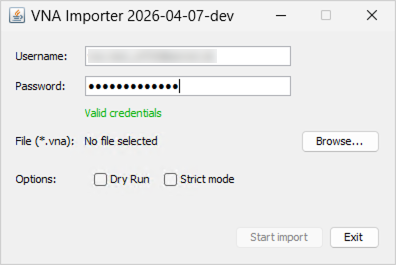

<!-- © 2026 The Project Contributors - see AUTHORS.txt -->
# The VNA Importer

Version: **May 27, 2026**

The **VNA Importer** is available as a separate Java client for transferring data from **verinice.PRO** or **verinice.EPV** (single-user version) to the new verinice generation (**verinice.cloud** or **verinice.onprem**).

## Features

The VNA Importer is currently available for importing data from the **IT-Grundschutz** perspectives, including **data protection**. The import of data from additional perspectives (ISO 27001 including data protection, IT-Grundschutz including BCM, ISO 27001 including BCM) is under development and will be rolled out gradually.

The VNA Importer creates a new unit and imports the data from the VNA file into this unit.

::: warning If you have exceeded the maximum number of units in your verinice.cloud instance, you must first delete a unit or buy further units before you can import new data.
:::

Multiple information networks can be imported into a single unit. The data is created as a new copy in the target environment from a previously exported **VNA file**—the original data remains unchanged!

Specifically, the following data is transferred:

- All (target) objects:
- Links between (target) objects.
- Modules, requirements, elementary threats.
- Protection requirement values for confidentiality, integrity, and availability.
- Risk assessment.

## Preparatory Work in verinice

To make the best possible use of all improvements in the new verinice generation, the data in verinice must be checked before the VNA export and cleaned up if necessary:

### Check Modeling

In the new verinice generation, the implementation of requirements is no longer documented in the requirement itself, but in the link to the respective target object. A single instance of each Module and each requirement is retained and linked to multiple target objects. This deduplication of Modules significantly reduces the effort required when working in verinice, but it also requires careful preparation of the source data.

Only modules from the current **Edition 2023-1** of the IT-Grundschutz Compendium are linked to the modules in the verinice catalog. Older editions are imported **without a catalog reference** and essentially behave like user-defined modules. It is strongly recommended that you update the modeling accordingly so that you can take advantage of automatic updates when future editions are published!

The modules must be **correctly modeled or referenced**; this applies in particular to the links between target objects and requirements.

Modules with official names from the compendium must be **complete** and **exact** (include all requirements, contain the original description, have the original procedure set, etc.). Otherwise, these modules will be interpreted as user-defined modules without a reference to the catalog.

Furthermore, only one person may be referenced as the **Module owner** per Module.

### Check risk definitions

The risk definitions for the **IT-Grundschutz** domain and, if used, for the **GDPR** domain must be **identical to the risk matrices** in verinice.

Since the risk definition from the BSI Standard 200-3 is used as the default for IT-Grundschutz in both generations, no action is required unless the risk definition in verinice has been modified. If a risk definition needs to be modified, this can be done easily via the menu in the **Risk Definition** section.

Please note that risks are only created for target objects in verinice.cloud if the option **Risk Analysis Required** is set for a target object in verinice. Risks associated with information networks, on the other hand, are always transferred.

### Define New Target Objects

The process objects have been expanded to include **Specialized Procedures**. Before the VNA export, you can define in verinice whether a business process should be transferred as a specialized procedure by assigning a **tag**:

- Tag for transfer as a specialized task:
  - **veoimport:IT-Grundschutz:PRO_SpecialisedTask**
- (General syntax: veoimport:*domain-name*:*subtyp-id*)

## Restrictions

The following restrictions must be observed during the VNA import:

- A few older fields from verinice are no longer available in the new generation and are intentionally not transferred (e.g., tags).
- The import of user-specific fields/data (following customization) can be supplemented in consultation with the verinice.Team.

## Installation

<!-- The latest valid version of the VNA Importer is available for download at: -->

Java (versions 17 through 25) is required for the **VNA Importer**. Since the VNA Importer is continuously being developed, please use the latest version available. The tool is available in English.

## Import to the Cloud Environment (GUI)

For importing data into the respective client in **verinice.cloud**, the VNA Importer is available as a simplified tool with a graphical user interface (GUI). You can access it as follows:
- on **Windows** by running the file **vna-importer.exe**.
- on **macOS** and **Linux** by running **java -jar vna-importer.jar** in the terminal, after first navigating to the appropriate directory.


### Run VNA Import

After entering the username and password for the target environment (default: https://veo-web.verinice.com/), the program immediately checks them for validity (Valid credentials). If you see the message **Invalid credentials**, please check the username and password for the target environment.



After selecting a VNA file previously exported from verinice, you can start the import using two options:

- **Dry Run (Test Run):** In this case, the import is performed **without** transferring data, to identify any errors before the actual import.
- **Strict Run:** The import is performed with stricter checks to better identify errors.

A successful import is confirmed by a corresponding message. Unless the import was performed as a **Dry Run**, you will find a unit in your target environment containing all previously exported content. After a **Dry Run**, the content will then be available after a repeated actual import.

If the import was unsuccessful due to errors with a corresponding error message, you can find further information via **Show logs**. In most cases, this means that not all [preparatory steps in verinice](#vorarbeiten-in-verinice) have been fully implemented yet.

If the export fails despite completing the preparatory steps, the verinice.Team will be happy to assist with identifying and resolving the errors.

## Importing into Other Environments (CLI)

The VNA Importer can be invoked via the Command Line Interface (CLI) on all operating systems to import data into other environments. In particular, importing into self-hosted environments (OnPrem) must be configured via the CLI.

You can start the VNA Importer CLI in the terminal using:

`java -jar build/libs/vna-importer.jar`

### Usage

To view all available CLI options, run the VNA Importer with the `-h` parameter for help:

`java -jar build/libs/vna-importer.jar -h`

```
$ java -jar build/libs/vna-importer.jar -h
Usage examples:

Simple import into the verinice.cloud:
java -jar vna-importer.jar -f mydata.vna -u veo-user@domain.example

Import using an authentication token:
java -jar vna-importer.jar -f mydata.vna -x TOKEN

Dry-run with debug logging and JSON output to console:
java -jar vna-importer.jar -f mydata.vna -u veo-user@domain.example -n -d\
  -o-

Import into on-prem installation:
java -jar vna-importer.jar -f mydata.vna  -u veo-user@mydomain.example\
  -v https://api.veo.mydomain.example/veo\
  --keycloak-url=https://keycloak.mydomain.example/auth

Authentication:

Keycloak parameters must be specified on the command line if they differ
from the default values. Alternatively, the application attempts to read a
veo environment configuration file from the current working directory or the user's home directory.

Options:

  -f, --file=<file>          The VNA to import
  -v, --veo-api-url=<veoApiUrl>
                             baseUrl of the Veo instance backend API
                               Default: https://api.eu.verinice.cloud/veo
  -u, --veo-user=<veoUser>   Veo username
      --veo-password=<veoPassword>
                             veo password, will be prompted for if not specified
      --keycloak-url=<keycloakUrl>
                             Keycloak authentication URL
                               Default: https://auth.eu.verinice.cloud/auth
      --keycloak-realm=<keycloakRealm>
                             Keycloak authentication realm
                               Default: verinice-veo
      --keycloak-client=<keycloakClient>
                             Keycloak authentication client
                               Default: veo-prod
  -p, --proxy=<proxy>        proxy to use, can be a hostname (will default to
                               port 3128), host:port, or http://host:post
  -s, --strict               fail on invalid property values instead of
                               skipping them
  -n, --dry-run              attempt conversion but do not send data to the
                               verinice API
  -o, --output-file=<outputFile>
                             If specified, the unit dump JSON is written to
                               that file
  -d, --domain=<domainId>    the ID of the target domain to use, will be
                               auto-selected if omitted
  -r, --risk-definition=<riskDefinition>
                             risk definition ID, can be omitted if there is
                               only a single one in the target domain
-h, --help                 Print this help message and exit
      --debug                enable debug logging
```
### Configuration File Format

The application can read the configuration from a JSON file located at `~/.config/veo/config.json` in your home directory. This way, you don’t have to specify the authentication parameters repeatedly via the command line.

The configuration file format is shared by various verinice applications, so you can use the same file for other verinice tools as well. For the same reason, however, some of the possible parameters are not relevant to the VNA importer and are ignored. For the sake of completeness, they are listed here.

#### Configuration Structure

| Field | Type | Description |
|-------|------|-------------|
| `instances` | Object | Container for multiple environment configurations |
| `instances.<name>` | Object | Named environment configuration (e.g., “sandbox”, “production”) |
| `instances.<name>.config` | Object | Configuration settings for the respective environment |
| `currentInstance` | String | Name of the active environment to be used from the instances (not used – see note below) |

NOTE: The `currentInstance` field is not used by the VNA Importer. Instead, the environment to be used is based on the URL specified via the command-line parameter `-v` or `--veo-api-url`. If this parameter is not specified, the default URL `https://api.eu.verinice.cloud/veo` is used, which corresponds to the production environment.

#### Environment Configuration Options

| Field | Type | Description | Default |
|-------|------|-------------|---------|
| `KEYCLOAK_URL` | String | URL of the Keycloak authentication server | `https://auth.eu.verinice.cloud` |
| `KEYCLOAK_REALM` | String | Keycloak authentication realm | `verinice-veo` |
| `KEYCLOAK_CLIENT` | String | Keycloak client ID | `veo-prod` |
| `KEYCLOAK_ADMIN_USERNAME` | String | Keycloak admin username | not used |
| `KEYCLOAK_ADMIN_PASSWORD` | String | Keycloak admin password | not used |
| `VEO_URL` | String | Base URL of the verinice instance's backend API | `https://api.eu.verinice.cloud/veo` |
| `ACCOUNTS_URL` | String | URL of the accounts service | not used |
| `FORMS_URL` | String | URL of the forms service | not used |
| `HISTORY_URL` | String | URL of the history service | not used |
| `REPORTING_URL` | String | URL of the reporting service | not used |
| `RABBIT_URL` | String | URL of the RabbitMQ server (for internal services) | not used |
| `RABBIT_ROUTING_KEY_PREFIX` | String | Prefix for RabbitMQ routing keys | not used |
| `RABBIT_USER` | String | RabbitMQ username | not used |
| `RABBIT_PASS` | String | RabbitMQ password | not used |
| `CLIENT_INIT_API_KEY` | string | API key for client initialization | not used |

#### Sample Configuration

Here is a working sample configuration for the sandbox environment:
```json
{
    “instances”: {
        “sandbox”: {
            “config”: {
                “KEYCLOAK_URL”: “https://auth.eu.verinice.cloud/auth”,
                ‘KEYCLOAK_REALM’: “verinice-sandbox”,
                
“KEYCLOAK_CLIENT”: “veo-sandbox”,
                “VEO_URL”: “https://api.sandbox.verinice.com/veo”,
            }
        }
    },
    ‘currentInstance’: “sandbox”
}
```
