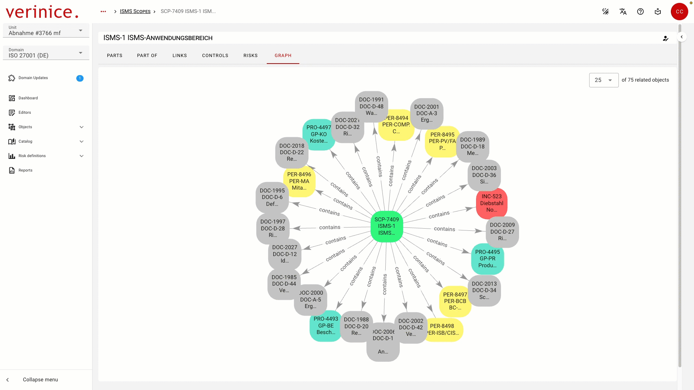

<!-- © 2026 The Project Contributors - see AUTHORS.txt -->
# verinice 55

The following new features are available to users with the release of **verinice 55**.

## Graph View - Selectable number of displayed objects
<!-- epics/359 -->

In the Graph View, the number of displayed objects can be freely selected with this iteration.

## VNA Importer for IT-Grundschutz and Data Protection
<!-- epics/305 -->

Provision of the VNA Importer for migrating data to the IT-Grundschutz and Data Protection domains.
## Import Units
<!-- epics/304 -->

In Unit Management, units previously exported via data transfer can be imported.
## Conflict-Free Domain Updates
<!-- epics/59 -->

Changes and new features in domains may require the migration of existing data. Any conflicts that may arise are detected and displayed so that users can resolve them.

This release includes the following updates to domains:
<!-- epics/302 -->
- Domain **IT-Grundschutz (DE)**
- Domain **GDPR (DE)**
- The domain **ISO 27001 (DE)** now includes the German-language version of ISO 27005. <!-- epics/300 -->
- The universal subtype **Document** has been standardized across all domains to simplify cross-domain work.<!-- epics/233 -->

## Minor improvements and bugfixes

* Structural improvements to the templates in the Helm Chart.
* Improved support for registry mirroring for on-premises operation in air-gapped environments.
* Improved OpenShift support in the Helm Chart.
* Fixed a bug in Nuxt v4.4.4.
* Improved test automation in the production process.
* Fixed autocomplete functionality in CSV import.
* Centralized storage and management of all frontend scripts.
* Fixed missing validation of translations during domain template import.
* Buttons in the application bar are no longer active when a tutorial is open.
* The deprecated admin endpoint `POST /admin/domain-templates/{id}/allclientsupdate` has been removed.
