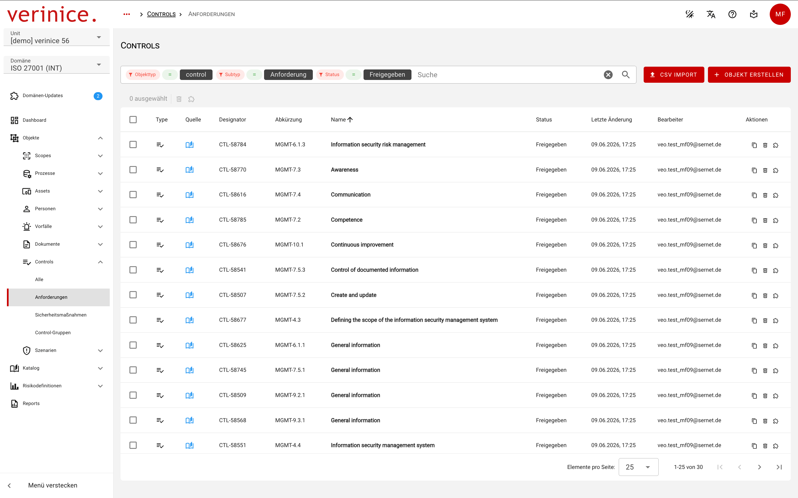
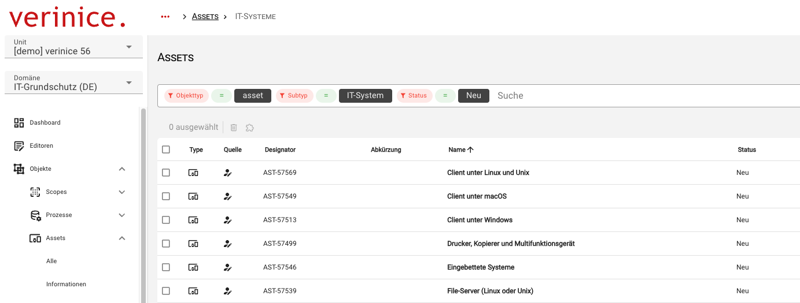
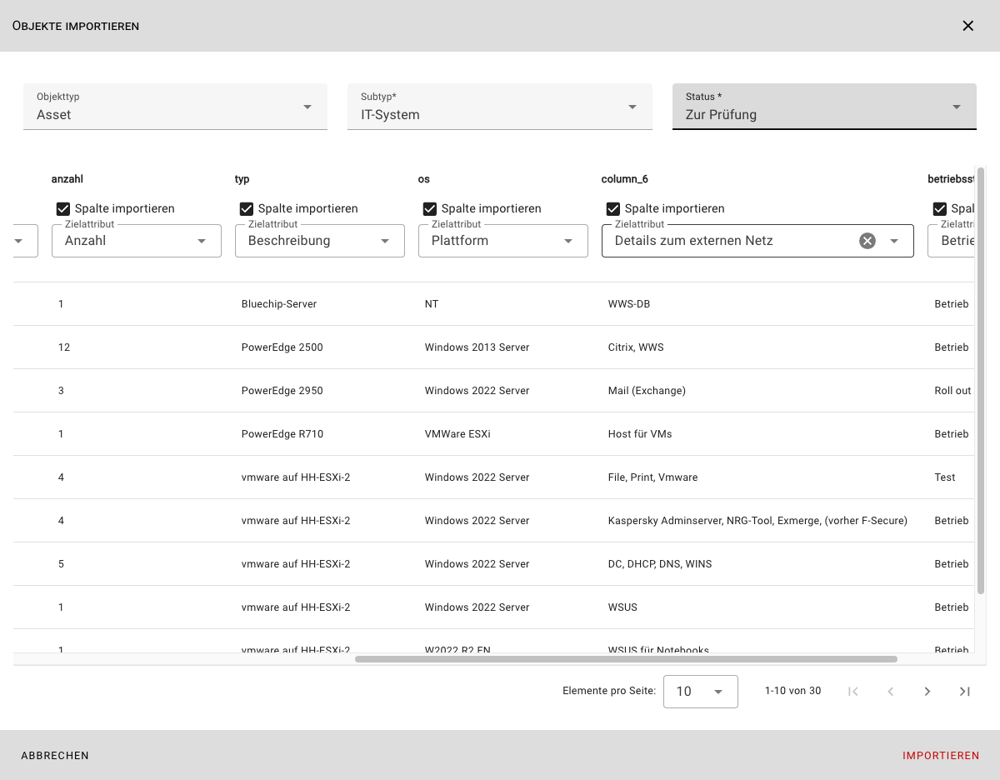

<!-- © 2026 The Project Contributors - see AUTHORS.txt -->
# verinice 56

Release Date: July 3, 2026 (tentative)

The following new features are available to users with the release of **verinice 56**.

## More Informative Object Overview
<!-- epics/344 -->

The object overview has been redesigned to present information more clearly:

- The **Create Object** button has been moved to the top right so that it no longer overlaps the object overview.
- The **CSV Import** is now accessible as an agent via a new button to maximize the space available for the object overview.
- The **Pagination** (items per page) is fixed at the bottom of the screen so that the number of available objects is visible at a glance without scrolling.
- When **selecting multiple** objects, the number of selected objects is displayed above the object overview.
- The search function has been positioned above the object overview for better visibility.

## Search Improvements
<!-- epics/290 -->

The search replaces the previous filter dialog and, with this iteration, allows searching based on all available criteria:

## CSV Import of All Data Types
<!-- epics/217 -->

With the third iteration of the CSV import, data can be imported into all fields of an object:

:::tip With verinice 57, the download of sample CSV files for importing all objects is planned.
:::

## Conflict-Free Domain Updates
<!-- epics/59 -->

Changes to domains may require the migration of existing data. Any conflicts that may arise in the data are detected and displayed so that users can resolve them. See also the description of [Domain Updates](../manual/domain-updates.md) in the manual.

## Minor improvements and bugfixes
<!-- epics/272 -->

- When creating primary users, first and last names can now be optionally specified.<!-- work_items/3952 -->
- The reports for the international domains **ISO 27001 (INT)** and **GDPR (INT)** are now fully available.<!-- epics/353 -->
- The **A.5 Risk Analysis** report for the IT-Grundschutz domain has been expanded.<!-- work_items/4793 -->
- The **A.6 Implementation Plan** report no longer includes controls from other domains.<!-- work_items/4827 -->
- Missing translations in the **Data Protection Risk Analysis** report have been added.<!-- work_items/4825 -->
- Missing translations in the **Inventory List** report in the ISO 27001 domain have been added.<!-- work_items/4824 -->
- The outdated element structure is no longer used in reporting.<!-- work_items/2544 -->
- Broken **External Links** in the documentation have been corrected. <!-- work_items/4855 -->
- The incorrect display of risk names in the **Risks** tab has been corrected.<!-- work_items/4090 -->
- Correction of spelling errors in the DS-GVO and GDPR (INT) domains <!-- work_items/4816 -->
- Various libraries have been updated and any vulnerabilities have been addressed.
<!-- work_items/4832 -->
<!-- work_items/4809 -->
<!-- work_items/4810 -->
<!-- work_items/4570 -->
