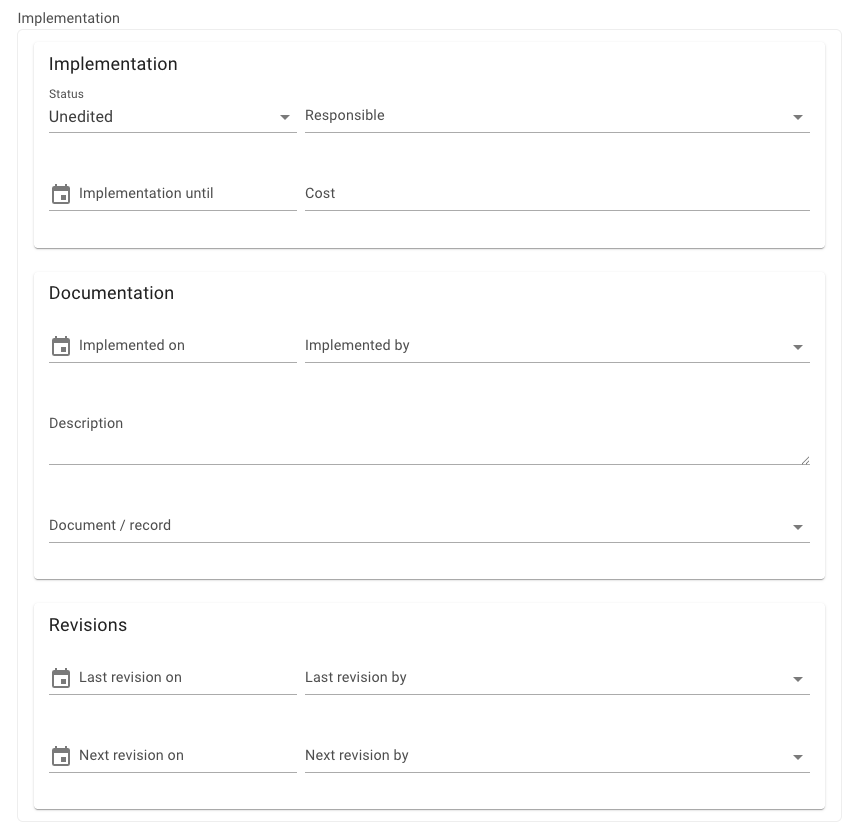
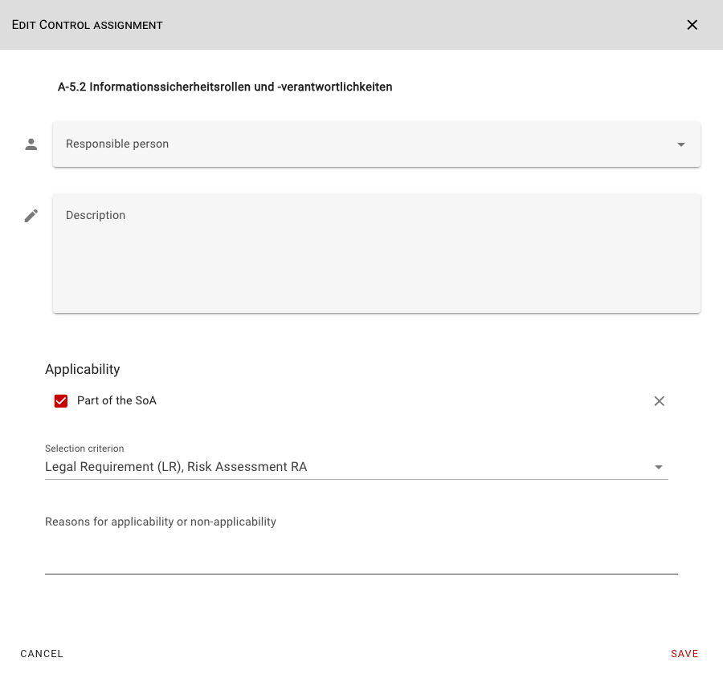
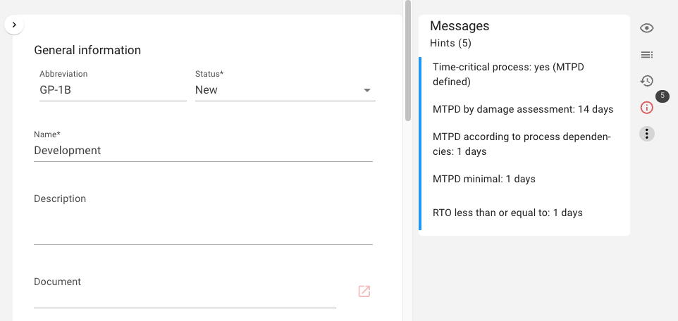

<!-- © 2026 The Project Contributors - see AUTHORS.txt -->
# verinice 57

Release Date: July 24, 2026 (tentative)

The following new features will be available to users with the release of **verinice 57**.

## Expand Implementation Documentation
<!-- epics/261 -->

The documentation of requirement implementation has been expanded across all domains:

## Better Documentation of Applicability (SoA)
<!-- epics/208 -->

Applicability (SoA) can now be better documented in the scope object within the Control Implementation (CI) for individual ISO controls:

## CSV Import
<!-- epics/369 -->

In the CSV Import Wizard, a [CSV file as a template for the import](../manual/CSV-Import.md) can be downloaded for each subtype. The template contains data for all fields, thereby simplifying the import into verinice. 

## Business Continuity Management (BCM)
<!-- epics/362 epics/285 epics/258 epics/306 epics/255 -->

BCM can be mapped to three new domains: **BSI 200-4 (DE)**, **ISO 22301 (DE)**, and **ISO 22301 (INT)**. These domains will soon be available in the respective bundles.

The MTPD based on damage assessment can be defined for business processes, and the minimum MTPD can be determined automatically after reconciling dependencies with other processes. The RTO for resources is similarly derived automatically based on process dependencies.

The results of emergency planning can be documented and output using the report templates **Restart and Recovery Plan**, **Business Continuity Plan**, and **Emergency Manual**.

## Minor improvements and bugfixes
<!-- epics/273 -->

- Search criteria are applied consistently across navigation. <!-- work_items/4880 -->
- Entered search criteria are retained after changing pages. <!-- work_items/4918 -->
- Fixed an error when creating the security incident report. <!-- work_items/4860 -->
- Risks from incorrect domains are no longer displayed in Report A.5 Risk Analysis. <!-- work_items/4828 -->
- Adjusted the height of the scroll bar in the object overview. <!-- work_items/4867 -->
- Updated the logo in Keycloak and corrected the cursor effect. <!-- work_items/4903 -->
- Updated the @nuxt/eslint-config dependency. <!-- work_items/4900 -->
