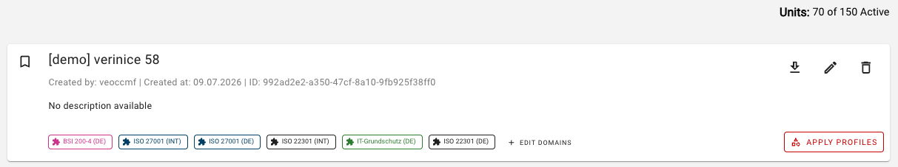
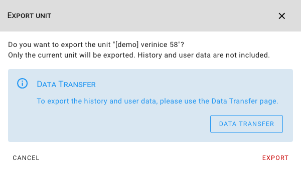

<!-- © 2026 The Project Contributors - see AUTHORS.txt -->
# verinice 58

Release Date: August 14, 2026

The following new features are available to users with the release of **verinice 58**.

## Unit Export in Unit Management
<!-- epics/376 -->

Units can now be exported directly from Unit Management using the download icon:

For a complete backup, including the data history, the [Data Transfer](../manual/data-transfer.md) feature is still available.

## Minor improvements and bugfixes
<!-- epics/274 -->

- Fixed an error in the warning text for attributes that must be removed interactively during a domain update. <!-- work_items/5000 -->
- Improved accessibility for objects with an empty history in the object details. <!-- work_items/4995 -->
- Unit import is now permanently enabled; the associated feature flag has been removed. <!-- work_items/4891 -->
- Removed an unnecessary message that appeared when opening the Messages tab while creating an object. <!-- work_items/2353 -->
- Unit import is now also possible for units without risks or risk definitions. <!-- work_items/4958 -->
- The documentation for risk definitions has been updated. <!-- work_items/4859 -->
