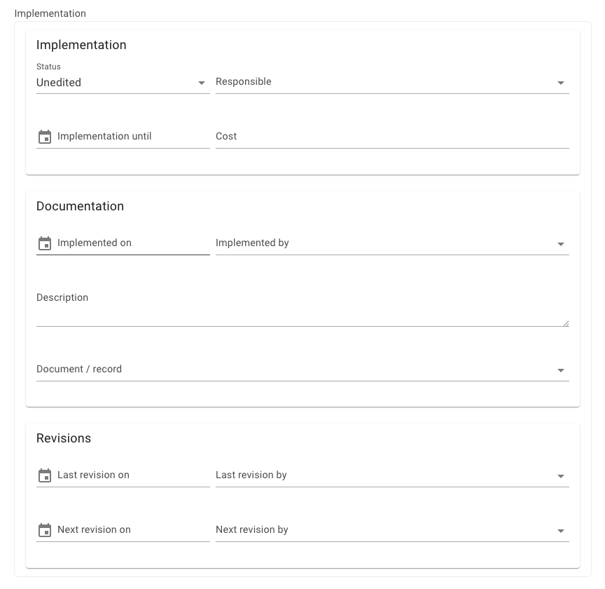
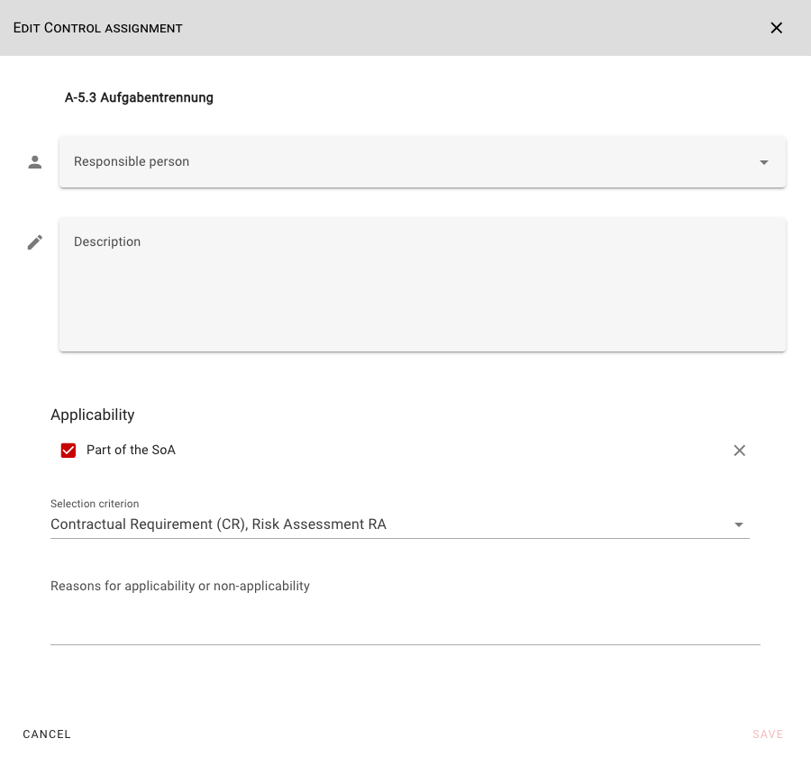
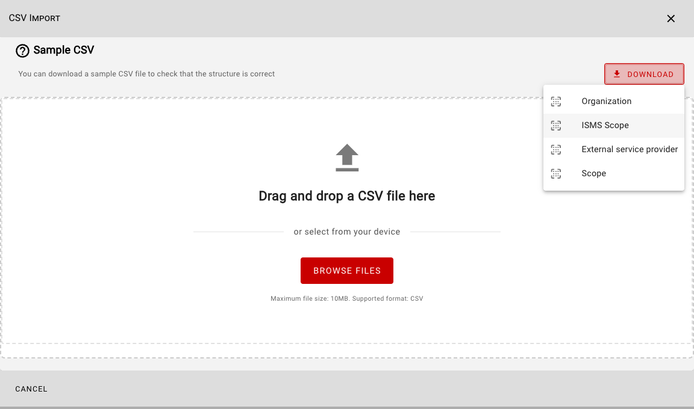
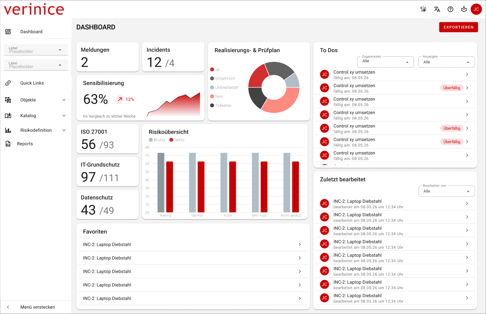
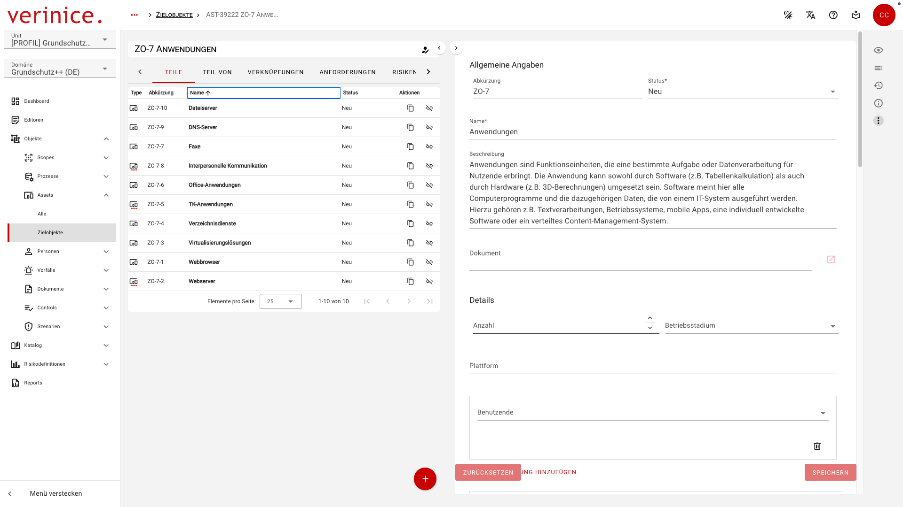

<!-- © 2026 The Project Contributors - see AUTHORS.txt -->
# Roadmap
As of July 3, 2026 - Subject to change!

## Q3 2026

### Implementation Documentation <Badge type="danger">Development</Badge>
<!-- epics/261 -->

The documentation of requirement implementation will be expanded across domains:

### SoA Documentation <Badge type="danger">Development</Badge>
<!-- epics/208 -->

The service orientation (SoA) can be better documented in the scope object within the Control Implementation (CI) for individual controls:

### Sample CSV <Badge type="danger">Development</Badge>
<!-- epics/369 -->

Download sample files for CSV import for all subtypes in the CSV Import Wizard:

### Business Continuity Management <Badge type="danger">Development</Badge>

Implementation of Business Continuity Management covering the BSI 200-4 (DE), ISO 22301 (DE), and ISO 22301 (INT) domains, including calculation of MTPD, RTO, and RPO, as well as reports for creating an emergency manual, business continuity plan, recovery plan, and restart plan.

### VNA Import

VNA import from verinice.PRO to verinice.onprem or verinice.cloud for IT-Grundschutz, data protection, ISO, and BCM, including IT-Grundschutz profiles, B3S Khs., BSI minimum standards, and the C5 criteria catalog.
- Provision of the VNA importer for migrating data to the ISO and Data Protection domains. <Badge type="info">Test</Badge>
- Provision of the VNA importer for migrating data to the ISO and Data Protection domains. <Badge type="danger">Development</Badge>
<!-- epics/364 -->
- Deployment of the VNA importer for migrating data to the BCM domains. <Badge type="warning">Planning</Badge>
<!-- epics/365 -->

### Expansion of authorization management <Badge type="warning">Planning</Badge>
<!-- epics/178 -->

Permissions management supports cross-references across units to map access to units in a manner analogous to the information networks in verinice.PRO. In future phases, permissions (rights and roles) will be extended to include, for example, scope objects.

### Workflow <Badge type="warning">Planning</Badge>
<!-- epics/374 -->

Creation of tasks for any objects, e.g., as questionnaire objects that can be delegated and re-delegated between users.

### Report Formats <Badge type="warning">Planning</Badge>

Provision of additional output formats for reports (CSV, XLSX/ODS, and DOCX/ODT, HTML):
- Exporting reports in the **DOCX** and **ODT** formats for editorial editing before they are finalized.<!-- epics/373 -->
- Creating additional report templates in tabular form in the **CSV/XLSX/ODS** formats for quantitative further processing, filtering, and sorting of data. <!-- epics/372 -->
- Export all report templates in **HTML** format for internal distribution (e.g., on the intranet) or for quick browser-based viewing without additional software.<!-- epics/371 -->

### Audit Management <Badge type="warning">Planning</Badge>

Mapping of internal and external audits in verinice with task delegation and monitoring as part of the workflow. The planning and execution of internal and external audits are mapped via a new scope object.

## Q4 2026

### Unit Import/Export <Badge type="warning">Planning</Badge>

The export of units is available in Unit Management, just like the import.

### Business Continuity Management Sample Data <Badge type="warning">Planning</Badge>
<!-- epics/253 -->

Sample units and profiles for the BCM domains, e.g., the BCM profile for universities.

### Dashboard <Badge type="warning">Planning</Badge>
<!-- epics/315 -->

Expanded dashboard functions to visually present data:

The expansion of the dashboard is planned in several iterations (the figure shows an initial design of the functionality):
- Graphical representation of the implementation status of controls and risks.
- Calendar view of tasks and due dates.
- Display of key metrics in tiles.
- Option to export the displayed data.

### Basic Protection++ Domain <Badge type="warning">Planning</Badge>
<!-- epics/262 -->

Deployment of an initial functional Basic Protection++ (DE) domain with updates to methodology and risk management.

